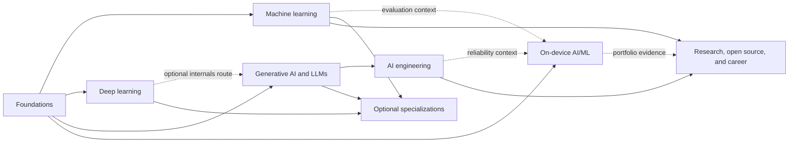

# Curriculum map

The curriculum structure is **Topic → Subtopic → Learning units → Practice project → Mastery checkpoint**. The topic pages are the readable source of truth for what to learn. The machine-readable inventory lives in the repository root as `curriculum.json`; the validation script checks it for structural consistency.

## Suggested dependency flow

This sketch shows common routes, not hard prerequisites. Use the subtopic prerequisite lists in the topic pages and curriculum inventory to choose what to study next. Dashed links show optional context or portfolio evidence. Topics can be learned in parallel when their listed prerequisites are already met. Specializations are elective; choose based on the problems you want to solve.

## Topics and topic projects

| Topic | Goal | Practice project and checkpoint |
|---|---|---|
| [Foundations](topics/foundations.md) | Build basic AI vocabulary and Python, numerical, data, and mathematical habits. | Reproduce a small data-to-prediction workflow and explain its limitations. |
| [Machine learning](topics/machine-learning.md) | Frame prediction problems and evaluate useful baselines and models. | Complete a leakage-safe project with metrics, error analysis, and model card. |
| [Deep learning](topics/deep-learning.md) | Understand tensor computation, training, and learned representations. | Train a small model; explain shapes, curves, and errors. |
| [Generative AI and LLMs](topics/generative-ai.md) | Understand generation and build grounded, evaluated applications. | Build a retrieval assistant with citations, refusal behavior, and a versioned test set. |
| [AI engineering](topics/ai-engineering.md) | Make model-backed systems reliable, secure, observable, and cost-aware. | Operate an evaluated service with fallback, threat model, and runbook. |
| [On-device AI/ML](topics/on-device-ai.md) | Run models under Android device constraints. | Integrate and benchmark a local model with quality and resource measurements. |
| [Specializations](topics/specializations.md) | Explore an elective area in depth. | Complete one branch project with baseline and failure analysis. |
| [Research, open source, and career](topics/research-career.md) | Reproduce, contribute, and communicate technical evidence. | Present a reproduction or contribution and evidence-based case studies. |

## Progression rule

Complete a subtopic when its mastery checkpoint is supported by an artifact and an explanation you can reproduce. If the checkpoint exposes a gap, practice the relevant learning unit and try again. Dates, duration estimates, and pages read do not determine completion. See [How to learn](how-to-learn.md) and [Progress](progress.md).
