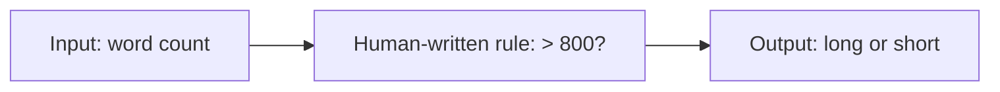
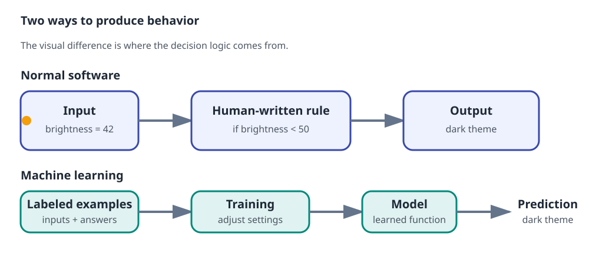
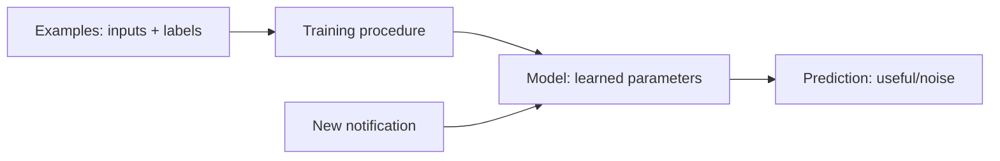
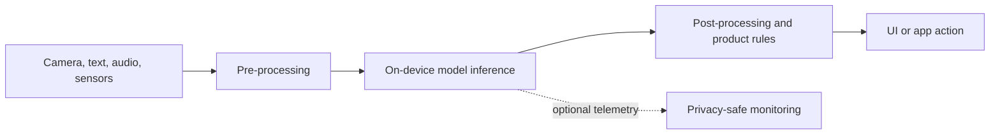
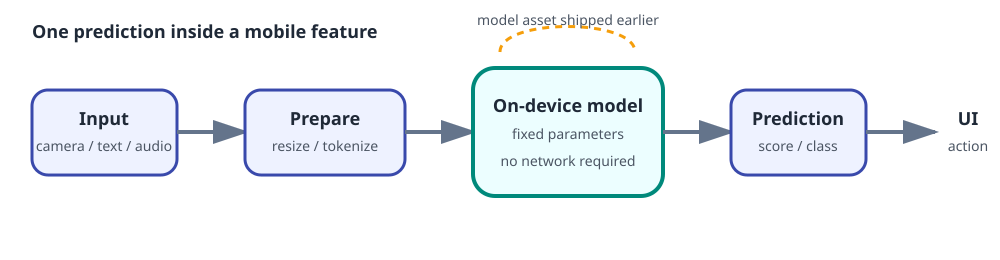

# AI mental models: what is AI?

**Prerequisites:** None  
**Outcome:** You can explain the difference between normal software and machine learning, and you can trace an AI feature from input to output.

!!! tip "Your starting point"
    You already know how to build reliable software. Here you will learn a different way software behavior can be produced: instead of writing every rule yourself, you can learn a rule from examples. Your engineering habits—interfaces, testing, performance measurement, and failure analysis—remain valuable.

## Objectives

By the end, you should be able to:

- define AI, machine learning, model, dataset, training, inference, and evaluation in plain language;
- identify the input and output of a simple AI feature;
- explain why a model can be wrong even when the code is correct;
- distinguish “the model learned a pattern” from “the model understands like a person”;
- describe where on-device inference fits in a mobile architecture.

## 1. Start with a familiar program

Suppose an Android app decides whether to show a “long article” badge:

```kotlin
fun isLongArticle(wordCount: Int): Boolean {
    return wordCount > 800
}
```

The rule is written by a person. For `wordCount = 900`, the program returns `true`; for `wordCount = 500`, it returns `false`. The behavior is determined by source code and a threshold that we chose.

This is normal, rule-based software:



It is predictable inside the cases we designed. If the product owner changes the definition, we change the code or configuration.

## 2. What changes in machine learning?

Now imagine classifying a notification as **useful** or **noise**. There may be no single rule that you can comfortably write:

- a notification from a calendar app may be useful at 8:00 and noise at 3:00;
- a short message may be important while a long message may be promotional;
- the same word can mean different things in different contexts.

Instead of specifying every condition, we collect examples and their answers:

| Notification text | Time | Label |
|---|---:|---|
| “Your appointment starts in 30 minutes” | 08:30 | useful |
| “Flash sale ends tonight” | 14:00 | noise |
| “Bank verification code: 493821” | 09:10 | useful |

A machine-learning system uses examples to adjust a model so that its outputs resemble the labels. The programmer still designs the system, chooses the data, chooses the objective, and tests the result—but the mapping itself is partly learned.





### The shortest useful definition

> Machine learning is a way to build a function by adjusting its internal parameters using examples and an objective.

The word **function** matters. A model is not a ghost in the machine; it is a computation that takes inputs and produces outputs. It may be large and complicated, but the basic contract is still:

```text
input -> computation with parameters -> output
```

## 3. Seven words you must own

Read these slowly. Do not memorize the sentences; connect each word to the notification example.

### AI

**Artificial intelligence** is the broad field of building systems that perform tasks associated with intelligent behavior: perception, language, prediction, planning, or decision-making.

AI is the umbrella. Machine learning is one important way to build AI systems. Not every AI system has to learn from data; a hand-written search algorithm can be called AI too.

### Dataset

A **dataset** is a collection of examples. An example may contain text, an image, a sensor trace, a user action, or a mixture of inputs.

The dataset is not “truth.” It is a measurement of the world produced by a collection process. It can be incomplete, biased, duplicated, stale, or labeled inconsistently.

### Feature and label

A **feature** is an input value the model can use. In the notification example, features could include time, message length, words, sender, or whether the user previously opened similar notifications.

A **label** is the answer we want the model to predict: useful or noise. In a regression problem, the target may be a number such as delivery latency or battery drain.

### Model

A **model** is a parameterized function. “Parameterized” means it contains adjustable values. A tiny model might be:

\[
score = w_1 \times messageLength + w_2 \times hour + b
\]

The values \(w_1\), \(w_2\), and \(b\) are parameters. The formula is simple, but the pattern is the same in a neural network with millions of parameters.

### Training

**Training** is the adjustment process. We show the model examples, compare its predictions with the desired labels, measure the error, and change parameters to reduce that error.

Training is usually expensive and done less often. It may happen on a server, in a research environment, or on a developer’s machine.

### Inference

**Inference** is using the trained model to make a prediction for new input. It is the part that usually happens inside a production request or on a phone.

Training asks, “How should the parameters change?” Inference asks, “Given these fixed parameters, what output should I produce?”

### Evaluation

**Evaluation** measures whether the model is useful on data it did not simply memorize. It includes a metric, a test set, and a definition of acceptable behavior.

An accuracy number without a test design is not enough. A model can score well on a convenient dataset and still fail for new users, new phones, new languages, or rare safety-critical cases.

## 4. Training versus inference: an analogy

Think of learning to recognize a dog in photos.

- **Training** is studying many labeled examples and adjusting your mental pattern.
- **The trained model** is the pattern you carry with you.
- **Inference** is looking at a new photo and saying “dog” with a confidence estimate.
- **Evaluation** is checking your answer on photos you did not study.

The analogy has limits: a human has rich context and a model only computes the patterns represented in its parameters and inputs. Do not turn the analogy into a claim that the model has human understanding.

## 5. A tiny interactive model

This demo is not a trained neural network. It is intentionally small so you can see the input, score, and decision boundary.

<div class="lesson-demo" data-score-demo>
  <div class="demo-heading"><strong>Notification usefulness demo</strong><span class="demo-badge" data-score-label>useful</span></div>
  <label for="urgency">Urgency signal <output data-score-value>70</output></label>
  <input id="urgency" type="range" min="0" max="100" value="70" data-score-input>
  <p class="demo-explanation" data-score-explanation>At this threshold, the tiny model treats the notification as useful.</p>
</div>

Move the slider. The browser is performing inference: a fixed score rule receives an input and produces an output. No learning occurs while you move it. That distinction is the point.

## 6. Normal software versus learned software

| Question | Rule-based program | Machine-learning system |
|---|---|---|
| Where does behavior come from? | Source code and configuration | Code + data + learned parameters |
| What changes after a new example? | Usually nothing until code/config changes | Training may update parameters |
| Main failure mode | Incorrect or missing rule | Bad data, shortcut, drift, or generalization failure |
| How do we test it? | Inputs with expected outputs | Held-out data, metrics, slices, and behavior tests |
| Typical mobile concern | Correctness and latency | Correctness, latency, memory, model version, and data shift |

Neither approach is automatically better. A deterministic rule is preferable when the rule is clear and the cost of ambiguity is high. Learning helps when the rule is difficult to write but examples exist.

## 7. Where on-device AI fits

For an Android feature, the deployed flow can look like this:



On-device AI means the inference computation runs locally. It can reduce network latency, work offline, improve privacy, and lower server cost. It also creates constraints: limited memory, battery, thermal budget, model format compatibility, hardware differences, and update strategy.



The model is only one piece of the feature. A production mobile AI feature is a pipeline with contracts at every boundary.

## 8. Common misconceptions

!!! warning "AI is not a synonym for a neural network"
    Neural networks are one family of models. Rules, trees, linear models, nearest neighbors, probabilistic models, and search algorithms can also be part of AI systems.

!!! warning "A high confidence score is not certainty"
    Confidence is a model output that may be poorly calibrated. A model can be confidently wrong when the input is outside the data it learned from.

!!! warning "More data is not automatically better"
    More duplicated, biased, mislabeled, or irrelevant data can make a system worse. Data quality and coverage matter.

!!! warning "A demo is not a product"
    A demo usually shows one happy path. A product needs evaluation, failure handling, privacy decisions, latency budgets, monitoring, versioning, and a plan for when the model is unavailable.

## 9. Checkpoint exercises

### Exercise 1 — classify the component

For a photo app that automatically groups pictures of the same person, identify:

1. one possible input;
2. one possible output;
3. what training data might look like;
4. what inference means;
5. one reason evaluation could be misleading.

<details>
<summary>Solution</summary>

An input could be an image or an image embedding. An output could be a similarity score or a group ID. Training data could contain pairs or groups of images with identity labels. Inference is comparing a new photo with learned representations and deciding whether images belong together. Evaluation could be misleading if the test photos come from the same people, lighting, phones, and locations as training, while real users provide different conditions.

</details>

### Exercise 2 — teach it back

Explain this sentence to a software engineer who has never studied AI:

> “The model is trained once, then inference runs on-device.”

Your explanation must include what changes during training, what stays fixed during inference, and why the phone still needs ordinary application code around the model.

### Exercise 3 — inspect the boundary

Take one feature you have built before and write:

```text
Input:
Output:
Human-written rules:
Possible learned pattern:
What could go wrong:
How I would evaluate it:
```

## Definition of done

Do not move on until you can answer these without looking:

- What is the difference between a dataset, a model, and a prediction?
- What is the difference between training and inference?
- Why can correct code still produce a bad AI result?
- What makes an on-device AI feature different from a model file?

!!! success "One-sentence summary"
    AI engineering is the discipline of turning data, models, software, and evaluation into a useful and reliable product behavior.

## Further study

- [Google: Introduction to Machine Learning](https://developers.google.com/machine-learning/intro-to-ml)
- [Google: Machine Learning Crash Course](https://developers.google.com/machine-learning/crash-course)
- [Android AI/ML guidance](https://developer.android.com/ai)
- [Google AI Edge](https://ai.google.dev/edge)

**Next topic:** [How learning works](learning-loop.md)

