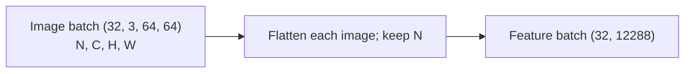
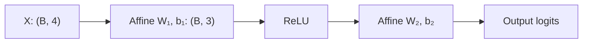
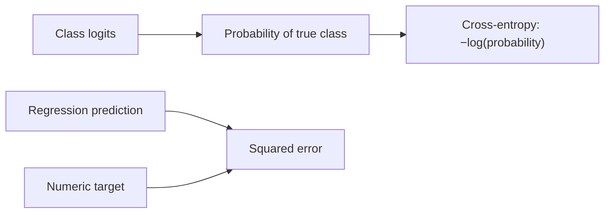
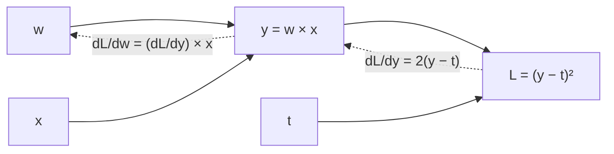
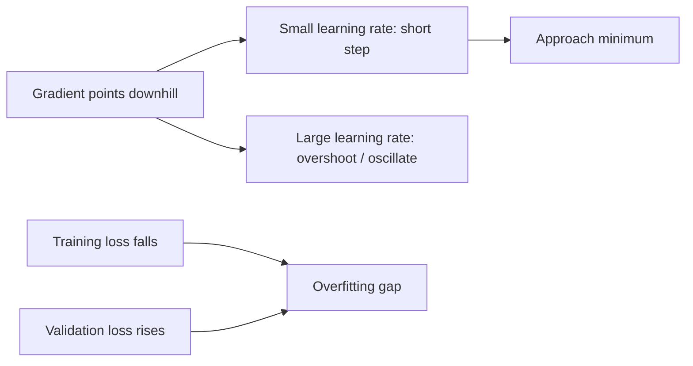
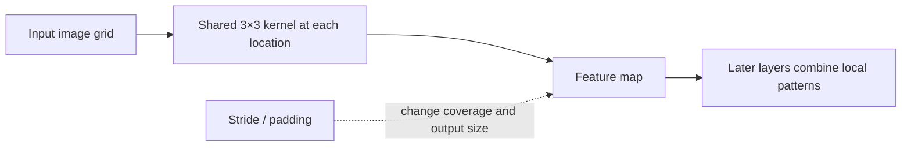
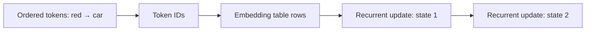
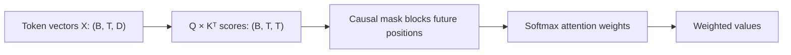
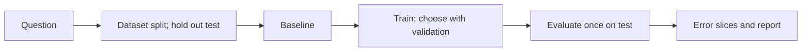

# Deep learning

Deep learning uses layered, parameterized functions to learn representations from data. Learn the computation, optimization, and failure modes before treating architecture names as recipes.

## How to use this topic

The hierarchy is **Topic → Subtopic → Learning units → Practice project → Mastery checkpoint**. Each subtopic has its own project and checkpoint. A separate topic-level capstone combines relevant earlier work. Work through the subtopics as needed, revisit units when a project exposes a gap, and use each checkpoint to decide what to practice next. Pacing is optional and progress is based on demonstrated understanding.

Each subtopic below has a small artifact and a checkpoint. Together, those artifacts feed the final deep-learning project.

## Subtopics

The path is tensors → neural networks → losses → backpropagation → optimizers and generalization. From there, convolutional networks and sequence models are alternative applications of the shared foundations; transformers build on sequence representations. The capstone applies the relevant branches to one chosen task.

### Tensors and shapes

**Beginner explanation.** A tensor is a container of numbers arranged along zero or more axes. A single score is a scalar with shape `()`. A list of scores is a vector with shape `(features,)`; a table of examples and features is a matrix with shape `(examples, features)`. “Tensor” is the general word for all of these, including higher-dimensional arrays such as batches of images or sequences.

The numbers in a shape tell how many entries each axis has, but they do not tell us what each axis means. For instance, `(32,3,64,64)` may mean 32 images, 3 color channels, height 64, and width 64. This is the NCHW convention. Another format, NHWC, would write the same data as `(32,64,64,3)`. Both shapes contain the same number of values, but a convolution layer configured for NCHW can interpret NHWC data incorrectly unless it is told about the layout.

Batching keeps several examples together for efficient processing. If a sequence batch has shape `(8,10,20)`, the axes might be batch, time, and feature: eight sequences, ten time steps, and twenty features per step. Selecting `x[0]` fixes one batch coordinate, so the remaining result has shape `(10,20)`. Averaging over `axis=1` combines the ten time positions separately for every example and feature, leaving `(8,20)`. An axis is removed by selection or by a reduction unless the API is asked to keep the dimension.

Shape reasoning is also a safety check on arithmetic. Broadcasting automatically repeats dimensions of size one so arrays can work together; it does not know your semantic intent. A mean for three NCHW channels must line up with the channel axis as `(1,3,1,1)`. Putting it in `(1,1,1,3)` is a different alignment and can either fail or silently apply values along the wrong axis. Before operating, name the axes, predict the result shape, then verify a sample value as well as the printed shape.

**Prerequisites.** Basic Python variables, lists, and arithmetic. Vector and matrix familiarity from [Mathematics](foundations.md#mathematics) is useful context and can be learned alongside the tensor units.

#### Learning units

- **Tensor dimensions and batches:** Label the batch, time, feature, and channel axes, then infer each dimension from a small example.
- **Tensor operations and devices:** Apply indexing, reshaping, broadcasting, and reductions; check the resulting shape, dtype, and device.

**Worked example.** Let `x` have shape `(8,10,20)`, with axes `(batch,time,feature)`. `x[0]` selects one of the eight sequences and removes only the batch axis; ten time steps and twenty features remain, so the shape is `(10,20)`. `x.mean(axis=1)` combines the ten time values for each of eight sequences and each of twenty features, so the result is `(8,20)`. The code below prints both shapes.

For broadcasting, compare sizes from the rightmost axis toward the left. Two sizes work together if they match or if one is 1. Thus `(16,5,1)` and `(16,5,7)` produce `(16,5,7)`: the final `1` expands seven times, while `5` and `16` already match. Now consider image means. In NCHW, a per-channel mean belongs on the second axis, so `(1,3,1,1)` expands across batches, heights, and widths. After permuting to NHWC, it must become `(1,1,1,3)` to align with the final channel axis.

~~~python
import numpy as np
x = np.arange(8 * 10 * 20).reshape(8, 10, 20)
first = x[0]
summary = x.mean(axis=1)
print(first.shape, summary.shape)  # (10, 20) (8, 20)

images = np.zeros((2, 3, 4, 4), dtype=np.float32)  # N, C, H, W
channel_mean = np.array([0.5, 0.4, 0.3])[None, :, None, None]
normalized = images - channel_mean
nhwc = images.transpose(0, 2, 3, 1)
nhwc_mean = np.array([0.5, 0.4, 0.3])[None, None, None, :]
print(images.shape, normalized.shape, nhwc.shape)  # (2,3,4,4), (2,3,4,4), (2,4,4,3)
print((nhwc - nhwc_mean).shape)  # (2, 4, 4, 3)
~~~

**Concepts and vocabulary.**

- **Rank, shape, and axis:** Rank is the number of axes; shape gives the size of each; an axis is one named direction such as batch, time, or channel.
- **Batch and feature:** Batch indexes independent examples processed together; feature indexes values describing each example or step.
- **Dtype and device:** Dtype controls how values are represented (such as integers or 32-bit floats); device is where the tensor resides (such as CPU or GPU).
- **Indexing, reshape, transpose/permute:** Indexing selects entries, reshape changes dimensions while preserving element order, and transpose/permute changes axis order.
- **Broadcasting and reduction:** Broadcasting expands size-one axes for compatible elementwise operations; a reduction such as sum or mean combines values along selected axes.
- **Contiguous storage:** Whether values occupy the expected sequential memory layout. Some operations need a copy before reshaping a permuted tensor.

**Illustration or animation.** The diagram shows batch-axis-preserving flattening. An optional animation can reveal the `N`, `C`, `H`, and `W` axes before reshaping.

**Code practice.** Work through this sequence with the preceding NumPy starter: (1) print the shape and dtype of the array; (2) select one example and one channel and predict the new shapes before printing; (3) flatten with `(batch_size, -1)` and confirm the batch size is unchanged; (4) permute NCHW to NHWC and move the three means from shape `(1,3,1,1)` to `(1,1,1,3)`. Check a sample pixel in each channel so a numerically valid but axis-misaligned broadcast does not pass unnoticed.

**Common mistakes.** Mixing up batch and feature axes; flattening the batch together with an example; confusing a transpose with a reshape; assuming broadcasting will align the axes you intend; silently moving tensors between CPU and accelerator; and overlooking integer versus floating-point dtypes.

**Exercises and solution guidance.**

1. For a tensor `(8,10,20)` with axes batch, time, features, find shapes after selecting example zero and averaging over time. **Solution:** Selection fixes one batch coordinate and removes that axis, giving `(10,20)`. Averaging combines the ten time values for every feature of every example, so batch and feature remain: `(8,20)`.
2. Can `(16,5,1)` add to `(16,5,7)`? **Solution:** Yes. Compare dimensions from the right: `1` can be repeated to match `7`; `5` matches `5`; `16` matches `16`, so the result is `(16,5,7)`. A middle dimension of `4` would fail to match `5`.
3. Name axes for NHWC and place three channel means for broadcasting. **Solution:** Axes are examples, height, width, channels. The mean shape is `(1,1,1,3)` so each channel mean aligns with the final axis and repeats across examples and pixels. In NCHW the corresponding shape is `(1,3,1,1)`.

**Practice project.** Produce a notebook tracing axes and shapes through indexing, permutation, reduction, flattening, and broadcasting.
**Mastery checkpoint.** Given a short forward-pass snippet, annotate every tensor shape and axis, identify an incompatible operation, and fix it without trial-and-error guessing.

### Neural networks and forward computation

**Beginner explanation.** A neural network is a function made from simple calculations whose parameters can be adjusted from examples. In a dense (fully connected) layer, each output unit receives every input feature. It multiplies each feature by a learned weight, adds those products, and then adds a learned bias. For input vector `x`, weight matrix `W`, and bias vector `b`, a batch of rows is transformed by `xW + b`. The shape of `W` determines how many output units there are: if the input has six features and the layer has four units, `W` has shape `(6,4)` and `b` has shape `(4,)`.

A layer by itself only makes an affine transformation. If we stack two such layers directly, the result is mathematically another affine transformation, so depth alone has not added the ability to model a curved or more complicated boundary. An **activation** such as ReLU applies `max(0,z)` to each value between layers. This nonlinear bend lets later layers combine regions of the input space in more varied ways. The design still depends on data and training; a nonlinear network can also learn a poor function.

The **forward pass** is the calculation from input through each layer to scores at the output. During learning, a loss compares those scores with target labels and later calculations update the parameters. The forward pass itself does not learn or alter weights. For classification, the output layer commonly gives one raw score, or **logit**, per class. The largest logit can be used to choose a class, while a softmax can express normalized probabilities when probabilities are useful. A logits-based loss usually accepts the raw scores directly and performs the stable normalization internally.

**Prerequisites.** Python functions and the tensor shape ideas above. Vector and matrix multiplication from [Mathematics](foundations.md#mathematics) is useful context and can be reviewed alongside the examples.

#### Learning units

- **Neurons, layers, and activations:** Build a small layered function and explain how its learned parameters and nonlinear activations transform an input.
- **Forward pass and logits:** Trace a batch through the network, compute output shapes, and distinguish logits from probabilities and class decisions.

**Worked example.** Use input `[2,-1]`, two output units, weight matrix `[[1,2],[3,-1]]`, and bias `[0,1]`. For output unit 1, multiply the inputs by the first column: `2×1 + (-1)×3 = -1`; add its bias `0` and the first score is `-1`. For output unit 2, use the second column: `2×2 + (-1)×(-1) = 5`; add bias `1` and get `6`. The layer scores are therefore `[-1,6]`. ReLU applies `max(0,z)` independently, giving `[0,6]`.

For a batch with two input rows, matrix multiplication applies the same two units to both examples. That is why `(2,2) @ (2,2)` gives two rows of scores, shape `(2,2)`. Rows remain examples and columns represent output units. The code shows the score before activation and the hidden values after ReLU.

~~~python
import numpy as np
X = np.array([[2., -1.], [1., 3.]])
W = np.array([[1., 2.], [3., -1.]])
b = np.array([0., 1.])
print(X @ W + b)
# [[-1.  6.]
#  [10.  0.]]
scores = X @ W + b
hidden = np.maximum(scores, 0)
print(hidden)
# [[ 0.  6.]
#  [10.  0.]]
~~~

**Concepts and vocabulary.**

- **Parameter, weight, and bias:** Learned numeric values. Weights scale and mix inputs; biases shift each output.
- **Linear/fully connected layer:** Applies a weighted sum to every input feature for each output unit, plus a bias.
- **Activation and hidden layer:** A nonlinear function such as ReLU; a hidden layer is an intermediate learned representation rather than the final prediction.
- **Forward pass and computational graph:** The ordered calculation that builds outputs from inputs; the graph records operations and dependencies for later gradient calculation.
- **Logit, probability, and class decision:** A logit is a raw output score, a probability is normalized and bounded from 0 to 1, and a class decision selects a label from scores or probabilities.
- **Initialization:** The rule used to set parameters before training, which affects early signal and gradient scales.

**Illustration or animation.** The diagram shows the forward computation; an optional animation can reveal the feature and parameter shapes at each layer.

**Code practice.** Start with the given NumPy batch and print `X.shape`, `W.shape`, and `(X @ W + b).shape`. Hand-calculate the first row as `[-1,6]`, then apply ReLU and confirm `[0,6]`. Next, create the equivalent framework `Linear(2,2)` layer, copy in the same W and b, and compare outputs. Finally change the layer to three outputs and check that a batch of two examples now returns `(2,3)`.

**Common mistakes.** Thinking a layer learns during the forward pass; omitting or duplicating a nonlinearity; applying softmax when a loss expects logits; mismatching the output count to the task; and using an input shape incompatible with the layer's expected feature dimension.

**Exercises and solution guidance.**

1. For `X` shaped `(12,6)` and a layer with four outputs, give parameter and output shapes. **Solution:** Each of four output units needs six weights, so W is `(6,4)`; the bias has one value per output, `(4,)`. Matrix multiplication gives `(12,4)`, preserving the twelve rows as examples.
2. Why does ReLU change what a network can represent? **Solution:** ReLU clips negative weighted sums, creating a bend. Without it, composing linear or affine layers is still one affine function, so extra depth alone cannot create a nonlinear boundary.
3. What does a five-class logits head produce? **Solution:** Five raw scores per example, `(B,5)`. The loss uses the integer class target to locate the correct score; softmax is not required before a logits-based loss.

**Practice project.** Produce a forward-pass walkthrough with every layer, parameter shape, activation, and output explained.
**Mastery checkpoint.** Explain a network's output from its input by tracing layer-by-layer shapes, parameter roles, and where nonlinearity enters.

### Loss functions and learning signals

**Beginner explanation.** A loss function turns a prediction and its target into a numeric penalty. Training tries to adjust parameters so this penalty is smaller on the training examples. The right loss depends on what is being predicted. In regression, where the target is a number, squared error is often used: subtract the target from the prediction, then square the difference. Squaring makes errors nonnegative and makes a miss of 4 count four times as much as a miss of 2 (`16` versus `4`). Other metrics, such as absolute error, penalize large misses less sharply.

For classification, the model emits one score per class. Multiclass cross-entropy asks how much probability the model assigned to the correct class. If the correct class gets probability `p`, its per-example loss is `-log(p)`: probability 1 gives loss 0, while a small probability produces a larger penalty. A logits-based implementation computes this stably without requiring the user to run softmax first. The target is often an integer class index, one index for each example, while the scores have one column per class.

First inspect losses for individual examples. A reduction called `none` leaves them separate; `sum` adds them; `mean` averages them. Mean loss is easier to compare across batch sizes, but a single mean can hide a few hard or mislabeled examples. Loss is an optimization signal, not the whole evaluation: a model may have low training loss and still fail on held-out examples, rare classes, or an incorrectly defined target.

**Prerequisites.** Forward passes, logits, labels, and basic averages. Probability intuition is useful for classification.

#### Learning units

- **Loss as an objective:** Calculate per-example and reduced loss values, and explain what the chosen reduction measures.
- **Regression and classification losses:** Match a prediction head, target shape, and dtype to a suitable regression or classification loss.

**Worked example.** Take one example with class logits `[2,0]`. To see the corresponding probabilities, exponentiate the scores: approximately `[7.389,1]`; divide each by their total `8.389`, giving `[0.881,0.119]`. If class zero is the correct label, cross-entropy selects its probability and computes `-ln(0.881) ≈ 0.127`. If class one is the target instead, the loss is `-ln(0.119) ≈ 2.128`. The model favored class zero, so the class-one target is a more costly mistake.

The code uses two examples with logits `[2,0]` and `[0,2]`, both labeled class zero. The first loss is low and the second high; their mean is about `1.127`. Separately, regression predictions `[5,4]` against targets `[3,5]` have errors `[2,-1]`, squared errors `[4,1]`, mean `2.5`, and sum `5`. The choice of reduction changes the reported scale, not the individual example errors.

~~~python
import numpy as np
logits = np.array([[2., 0.], [0., 2.]])
targets = np.array([0, 0])
probs = np.exp(logits) / np.exp(logits).sum(axis=1, keepdims=True)
per_example = -np.log(probs[np.arange(2), targets])
print(per_example.round(3))  # [0.127 2.127]
print(per_example.mean().round(3))  # 1.127
~~~

**Concepts and vocabulary.**

- **Target/label, regression, and classification:** The desired output value; regression predicts a numeric quantity, while classification selects among categories.
- **Mean squared error (MSE):** Average squared prediction-target difference for numeric targets.
- **Binary and multiclass cross-entropy:** Common losses for one binary outcome or one of several classes; check whether the API expects logits or probabilities.
- **One-hot encoding and integer class index:** Two target representations. A one-hot vector has one 1 at the correct class; an integer index stores only that class number.
- **Reduction (`none`, `sum`, `mean`):** Whether per-example losses are retained, added, or averaged.
- **Class weighting and calibration:** Weighting changes the penalty for selected classes; calibration concerns whether predicted probabilities match observed frequencies.

**Illustration or animation.** Compare the classification and regression loss paths below. A companion plot can show how cross-entropy changes with the probability assigned to the correct class.

**Code practice.** Run the preceding batch calculation and inspect both per-example losses. Confirm that the first example has loss about `0.127` and the second about `2.127`; then average them to get `1.127`. Recreate the same logits and integer targets in your framework's logits-based cross-entropy, first with no reduction and then with mean reduction. Compare results and check target dtype/shape. For regression, add predictions `[5,4]` and targets `[3,5]`; square the errors `[2,-1]` to get `[4,1]`, whose mean is `2.5`.

**Common mistakes.** Choosing a classification loss for continuous targets or vice versa; passing probabilities where logits are expected; using the wrong target shape or dtype; averaging over the wrong dimensions; trusting a loss while labels are misaligned; and interpreting a single aggregate loss as proof that every class performs well.

**Exercises and solution guidance.**

1. Target 3 and prediction 5: calculate squared error. **Solution:** Difference is `5-3=2`; squaring gives `2²=4`. Absolute error would be 2, which is a different measure.
2. Give score/target shapes for nine examples and seven classes. **Solution:** Scores are `(9,7)`, one row per example and one column per class. Integer class targets are commonly `(9,)`, one class index for each row.
3. Why not softmax logits before logits-based cross-entropy? **Solution:** The loss expects unnormalized scores and performs a stable log-softmax internally. Passing probabilities makes the function treat normalized probabilities as if they were logits and changes the objective.
4. For losses `[2,6,4]`, give mean and sum. **Solution:** Sum is `12`; mean is `12/3=4`. The mean is on the per-example scale, while sum changes with the number of examples.

**Practice project.** Produce a worked loss comparison notebook with target formats, tensor shapes, logits, and reductions.
**Mastery checkpoint.** Given a prediction head and target format, select a compatible loss, state the expected shapes/dtypes, and explain what its scalar reduction measures.

### Backpropagation and gradients

**Beginner explanation.** A forward pass produces a loss, but the loss alone does not say how to change the model. A derivative measures how much a result changes when one input changes slightly. For a model parameter, its derivative of the loss tells whether increasing that parameter would tend to raise or lower the current loss and by how much nearby.

Neural networks contain many operations, so derivatives are built from small local derivatives using the **chain rule**. If a weight changes an intermediate prediction and that prediction changes the loss, multiply those rates to get the effect of the weight on the loss. For `y = wx` and `L = (y-t)²`, the intermediate value is `y`; `dL/dy=2(y-t)` and `dy/dw=x`, so `dL/dw=2(y-t)x`. Backpropagation applies this reasoning efficiently backward through the computational graph, reusing intermediate results.

The collection of parameter derivatives is the gradient. It is calculated from the current batch and does not itself change parameters. A gradient descent update subtracts a learning-rate-scaled gradient because the gradient points toward increasing loss locally. Frameworks often accumulate gradients across backward calls, so the training loop typically clears them before calculating a new batch's gradient. Automatic differentiation computes the chain-rule bookkeeping; checking it on a tiny hand-computable case can catch disconnected operations or mistakes in the code.

**Prerequisites.** Forward computation, a loss, multiplication and addition, and an informal understanding of slope. Derivatives can be learned alongside this subtopic.

#### Learning units

- **Computational graphs:** Draw a small forward computation as a graph and mark where each parameter affects the loss.
- **Chain rule and gradients:** Propagate derivatives through the graph by applying the chain rule to calculate parameter gradients.
- **Gradient checking:** Compare analytic or automatic gradients with finite differences and investigate meaningful discrepancies.

**Worked example.** Set `x=2`, `w=1`, and target `t=1` in `y=wx`, `L=(y-t)²`. The forward calculation gives prediction `y=2` and loss `(2-1)²=1`. To calculate the gradient, first ask how loss changes with `y`: `dL/dy=2(y-t)=2`. Then ask how `y` changes with `w`: `dy/dw=x=2`. By the chain rule, `dL/dw = 2×2 = 4`.

Gradient descent uses `w_new = w - learning_rate × gradient`. At rate `0.1`, this gives `1 - 0.1×4 = 0.6`. The new prediction is `1.2`, and loss is `(1.2-1)²=0.04`, lower than 1. This particular step improved the loss. A larger rate is not automatically better; on a curved loss surface the same rule can step past a low-loss region.

~~~python
def loss(w):
    return (2.0 * w - 1.0) ** 2
for w in (1.0, 0.6):
    print(w, loss(w))
# 1.0 1.0
# 0.6 0.04
~~~

**Concepts and vocabulary.**

- **Derivative and partial derivative:** The rate of change with respect to one value; a partial derivative varies one input or parameter while holding the others fixed.
- **Gradient:** The vector containing the partial derivative for every parameter.
- **Chain rule and computational graph:** The rule for combining local rates through composed operations, represented as a graph of intermediate values and dependencies.
- **Gradient accumulation and zeroing:** Backward passes add to stored gradients by default in many frameworks; clear them when a fresh batch update is intended.
- **Automatic differentiation:** Program tracing that computes derivatives by applying chain-rule operations, rather than symbolic algebra or finite differences.
- **Finite differences and gradient checking:** Approximate a derivative from nearby loss evaluations and compare with the analytic or automatic result; useful for small checks but sensitive to step size.

**Illustration or animation.** The flow below shows a forward computation and the derivative contributions traced backward through the chain rule.

**Code practice.** With PyTorch installed, create scalar `w = torch.tensor(1.0, requires_grad=True)`, compute `(2*w-1)**2`, and call `backward()`: `w.grad.item()` should be `4.0`. To see accumulation, recompute the loss and call `backward()` again without clearing; the gradient becomes `8.0`. Set `w.grad = None`, recompute once, and it returns to `4.0`. Separately compare with the finite-difference snippet above; small disagreement is expected because that calculation is approximate.

**Common mistakes.** Forgetting to clear accumulated gradients; detaching a tensor before the loss; updating parameters before backward has run; confusing a gradient with a weight value; expecting a gradient to say whether a feature is causally important; and assuming matching loss proves gradients are correct.

**Exercises and solution guidance.**

1. Derive the gradient for `L=(w*x-t)^2`. **Solution:** Let `y=wx`. Then `dL/dy=2(y-t)` and `dy/dw=x`, so the chain rule gives `dL/dw=2(wx-t)x`.
2. Evaluate it at `x=2,w=1,t=1`. **Solution:** Prediction is 2, error is 1, so gradient is `2*1*2=4`. A step of size 0.1 gives `w=0.6`, prediction 1.2, and loss 0.04 instead of 1.
3. Why compare automatic derivatives with finite differences? **Solution:** It can reveal a detached graph or incorrect derivative formula on a tiny known case. Finite differences are approximate and sensitive to epsilon, so passing this check supports the local implementation but does not prove an entire model correct.

**Practice project.** Produce a gradient-check notebook comparing hand-derived, framework, and finite-difference values.
**Mastery checkpoint.** Trace one parameter's contribution to a loss through the chain rule and diagnose missing, accumulated, or disconnected gradients in a training snippet.

### Optimizers, training, and generalization

**Beginner explanation.** A training loop repeatedly takes a batch of examples, runs the model, computes a loss, backpropagates gradients, and asks an optimizer to update parameters. An epoch is one pass over the training set; minibatches divide that pass into smaller updates. Randomly shuffling examples can keep updates from following an accidental ordering in the data. Stochastic gradient descent (SGD) follows the current batch gradient. Momentum tracks a moving direction based on recent gradients, and Adam adapts update scales using running averages. These optimizers change how updates are made, but all still depend on a suitable learning rate and a sound data/evaluation setup.

The learning rate scales an update. If it is tiny, each step may make little progress; if it is too large, the parameter can jump across a low-loss region and oscillate or diverge. Initialization sets starting weights, while normalization changes the scale or distribution of activations and can make optimization easier. Weight decay penalizes large parameter values; dropout randomly omits activations during training; data augmentation creates altered training examples. Each intervention can help in some situations and hurt in others, so change one at a time and record the run.

Keep data roles separate. Training data determines gradient updates. Validation data guides choices such as learning rate, architecture, and checkpoint. The test set is held for a final estimate after those choices are complete. Fit preprocessing statistics such as means and standard deviations on training data only, then apply the same values to validation and test. If training loss falls but validation loss rises, the model may be fitting training-specific details, but first check for duplicate leakage, inconsistent preprocessing, label problems, and a validation set that differs from the intended use. A curve suggests a cause; it does not prove one.

**Prerequisites.** Tensors, a model forward pass, a compatible loss, and backpropagation. Basic plotting helps interpret learning curves.

#### Learning units

- **Gradient descent and learning rate:** Run gradient descent at several learning rates and use loss curves to identify steps that are too small or unstable.
- **Minibatches, momentum, and Adam:** Train with minibatches and compare plain gradient descent, momentum, and Adam under a recorded setup.
- **Initialization, normalization, and regularization:** Change one initialization or regularization choice at a time and compare training with validation behavior.

**Worked example.** Suppose training losses after four epochs are `[1.2,0.8,0.5,0.3]`, while validation losses are `[1.3,0.9,0.7,0.9]`. Training loss improves every epoch, but validation first improves and then worsens. Epoch 3 is the best observed validation checkpoint because `0.7` is the smallest validation loss. Save that checkpoint even though epoch 4 has lower training loss; the model is selected for performance on data not used to update its parameters.

The gap at epoch 4 is consistent with overfitting: the model is continuing to fit training examples without improving validation. But before adding regularization, inspect the split for duplicate examples, make sure normalization was fit only on training data and applied consistently, and review mislabeled or unusually shifted validation examples. If the evaluation setup is sound, compare one intervention—such as stopping at epoch 3 or adding modest weight decay—and record both curves. The next run should test a specific explanation rather than stack several changes together.

**Concepts and vocabulary.**

- **Epoch, minibatch, and shuffle:** One full training-set pass; a smaller batch used for an update; and randomizing example order between passes.
- **SGD, momentum, and Adam:** Optimizers that use current gradients, recent gradient direction, or adaptive running statistics to update parameters.
- **Learning rate and initialization:** The update scale and the starting rule for model parameters.
- **Train/validation/test split:** Training updates parameters; validation supports model selection; test is reserved for final evaluation.
- **Learning curve and overfitting:** Metric values across updates or epochs; fitting training data increasingly well while generalization to held-out data stops improving or worsens.
- **Weight decay, dropout, normalization, and augmentation:** Different methods that can affect parameter size, activations, numerical scales, or training examples. Normalization layers may use different behavior in training and evaluation modes.
- **Data leakage, checkpoint, reproducibility, experiment tracking:** Held-out information entering training/selection improperly; a saved parameter state; repeatability from recorded settings and data; and the organized record of runs.

**Illustration or animation.** Compare learning-rate steps with the training/validation gap shown below. An optional animation can move the parameter along a one-dimensional loss curve.

**Code practice.** Build the training loop in this order: split examples before fitting preprocessing; create a minibatch loader from training data; for each batch clear gradients, predict, calculate loss, backpropagate, and step the optimizer; after each epoch switch to evaluation mode and compute validation loss without gradient tracking. Save the checkpoint whenever validation improves. Log both losses, learning rate, seed, and configuration. The example curve has its best validation loss at epoch 3, so your checkpoint rule should select epoch 3 even though training loss is lower at epoch 4.

To see learning-rate effects before using a framework, run this one-parameter gradient descent example. The loss is `(w-3)^2`, whose derivative is `2*(w-3)`. A rate of `0.1` approaches the minimum gradually; `1.1` overshoots and diverges. Then use the ordered training loop above on a minibatch model.

~~~python
def train_one_rate(rate, steps=5):
    w = -2.0
    path = [w]
    for _ in range(steps):
        gradient = 2 * (w - 3.0)
        w -= rate * gradient
        path.append(round(w, 3))
    return path

print(train_one_rate(0.1))  # approaches 3 in small steps
print(train_one_rate(1.1))  # overshoots and moves farther away
~~~

**Common mistakes.** Learning rates that are far too high or low; forgetting evaluation mode or gradient disabling at validation; tuning repeatedly on the test set; preprocessing before the split in a way that leaks information; ignoring class-wise or slice metrics; failing to save the model/configuration; and assuming Adam removes the need to tune the learning rate.

**Exercises and solution guidance.**

1. Training loss falls while validation rises. Name checks and interventions. **Solution:** First check split duplicates, preprocessing leakage, labels, and validation examples. If the pattern remains, compare early stopping, weight decay, augmentation, or a smaller model one at a time; the curve suggests but does not prove overfitting.
2. Where do feature-scaling statistics come from? **Solution:** Fit mean and standard deviation on training examples only and apply those fixed values to validation and test. Otherwise held-out information influences the pipeline.
3. Why leave test data untouched during selection? **Solution:** Every choice based on a test score adapts the workflow to that set. Repeated tuning makes its final score optimistic, so use validation for choices and test once at the end.

**Practice project.** Produce a reproducible training report with configuration, train/validation curves, checkpoint, and error slices.
**Mastery checkpoint.** Given learning curves and an error summary, distinguish likely optimization trouble from overfitting, data problems, or evaluation leakage, then justify a next experiment.

### Convolutional neural networks

**Beginner explanation.** In an image, nearby pixels often form meaningful local structures such as edges and corners. A convolutional layer learns a small grid of weights, called a **kernel** or filter, and slides it across the image. At each location, it multiplies the filter values by the corresponding image patch and sums the products to produce one output value. A filter with three input channels has separate weights for each channel, and several filters produce several output feature maps. Reusing the same filter at every location both reduces the number of learned weights and allows the same local pattern to be detected in different parts of an image.

Kernel size, stride, and padding determine which patches are examined. **Stride** is how many pixels the kernel moves between positions. **Padding** adds a border, often zeros, so edge pixels can participate and output height/width can be preserved. For one spatial dimension, the output size is `floor((input + 2×padding - kernel)/stride) + 1`. A pooling layer, such as 2-by-2 max pooling with stride 2, takes the largest value in each non-overlapping local window and halves the spatial dimensions. Later convolutions combine simpler feature maps into larger patterns. A receptive field is the portion of the original image that can influence one output location; it grows through successive layers and pooling.

Convolutions are useful for image structure, but they do not guarantee a good classifier. A flattened dense baseline is a useful comparison. Keep the data split, training budget, preprocessing, and evaluation metric comparable so an apparent gain can be attributed to a meaningful difference.

**Prerequisites.** Tensor axes, matrix-like operations, neural-network layers, and loss/training basics. Image and color-channel conventions should be explicit.

#### Learning units

- **Convolution, stride, and padding:** Predict feature-map dimensions for chosen kernels, strides, and padding, then confirm them in code.
- **Pooling and image classifiers:** Add pooling to a small image classifier, trace its shapes, and assess it against a simple baseline.

**Worked example.** Take an NCHW input `(B,3,32,32)` and a convolution with 16 filters, kernel 3, stride 1, and padding 1. For height, the output formula gives `floor((32 + 2×1 - 3)/1)+1 = floor(31)+1 = 32`; width is the same. Each filter reads all 3 input channels and produces one feature map, so 16 filters give output `(B,16,32,32)`. A 2-by-2 max pool with stride 2 takes one maximum from each 2-by-2 window: height and width become `floor((32-2)/2)+1=16`, yielding `(B,16,16,16)`. Batch size and feature-map channels remain unchanged.

~~~python
import math
def out_size(size, kernel, stride, padding):
    return math.floor((size + 2 * padding - kernel) / stride) + 1
print(out_size(32, 3, 1, 1))  # 32
print(out_size(28, 5, 1, 2))  # 28
~~~

**Concepts and vocabulary.**

- **Convolution and kernel/filter:** A sliding weighted sum over local input patches; a kernel is the learned set of patch weights.
- **Channel and feature map:** Color or learned feature dimension in a tensor; each output filter creates one feature map.
- **Stride and padding:** Movement between evaluated patch positions and the border values added around an image.
- **Pooling and receptive field:** A local summary/downsampling operation; the input region that can affect one output value.
- **Spatial dimensions and channel count:** Image height/width versus the number of input or learned output maps.
- **Data augmentation and image normalization:** Training-time image transformations and consistent value scaling; fit any data-dependent statistics only on the training split.

**Illustration or animation.** The diagram shows a shared kernel producing a feature map; an optional grid animation can vary stride and padding to reveal output coverage.

**Code practice.** Use the output-size starter above before building a model. With an input `(32,3,32,32)`, apply a 3×3 convolution with 16 filters, stride 1, padding 1; print and explain `(32,16,32,32)`. Apply 2×2 max-pooling with stride 2 and verify `(32,16,16,16)`. Then flatten only channel/height/width and create one logit per dataset class. Compare the result to a flattened dense baseline on the same train/validation split, metric, and update budget.

**Common mistakes.** Assuming channel-first or channel-last without checking; miscalculating spatial dimensions; flattening before spatial features are extracted; leaking augmented or duplicated images across splits; applying transformations with incorrect scale/range; and attributing improvements to architecture when training budget or preprocessing also changed.

**Exercises and solution guidance.**

1. Input 28, kernel 5, stride 1, padding 2: output size? **Solution:** Formula gives `floor((28+4-5)/1)+1=28`; padding adds four total positions and offsets the kernel's reduction.
2. Explain weight sharing. **Solution:** The same filter weights are reused at every spatial position. This cuts parameters and allows local patterns to be detected across locations, though the whole network is not automatically invariant to shifts.
3. Why inspect a confusion matrix? **Solution:** It shows which true/predicted class pairs account for errors. Read it with per-class counts because a rare class can be almost entirely missed while accuracy remains high.

**Practice project.** Produce a small CNN experiment with shape trace, baseline, learning curves, and example errors.
**Mastery checkpoint.** Predict a CNN's output shapes, explain what its filter and receptive field represent, and use validation/error evidence to identify a useful next change.

### Sequence models and embeddings

**Beginner explanation.** A sequence is an ordered set of items. Order can change meaning: “red car” and “car red” contain the same words but place them in different roles. A model typically starts with integer token IDs, but those integers are arbitrary labels, so the number itself should not be fed as a meaningful measurement. An **embedding table** maps each ID to a learned vector. Looking up ID 12 selects row 12; the vector values are tuned during training so they become useful representations for the task.

A recurrent neural network reads one vector at a time. It combines the current token vector with a hidden state from the previous step to create a new hidden state. The state acts as a running summary of the prefix read so far. Because each update depends on the previous one, reversing token order changes the sequence of calculations and can change the final state. The same recurrence can be used at every position, which lets the model process sequences of different lengths.

Examples in a batch often have unequal lengths. Padding inserts a special placeholder token to make them fit a rectangular tensor, but it is not part of the original content. A mask marks which positions are real. The model or loss must use that mask so padding does not update the recurrent state or count as a target. Otherwise, it can learn artifacts of how sequences were padded. Recurrent networks are an important way to understand sequence computation; attention-based transformers provide another way to mix information across positions and often parallelize training more effectively.

**Prerequisites.** Tensors and shapes; neural networks and forward computation; and either [Classification](machine-learning.md#classification) or [Regression](machine-learning.md#regression) as a basic supervised prediction task. Either branch is sufficient.

#### Learning units

- **Embeddings and representation learning:** Map token IDs through an embedding table and compare the learned representation with one-hot inputs.
- **Sequence models and recurrent state:** Trace a short ordered sequence through recurrent state updates and inspect how padding and order affect the result.

**Worked example.** Use a one-dimensional toy embedding table: `red → 1` and `car → 2`. Let the state update be `new_state = 0.5×old_state + embedding`, starting from zero. For `red car`, the first state is `0.5×0+1=1`; the second is `0.5×1+2=2.5`. For `car red`, the first state is `2`; the second is `0.5×2+1=2`. The different final states show that update order matters.

Now append padding to `red car`. A correct mask says the third position is absent, so the state remains `2.5`. If a zero embedding were processed without a mask, the update would instead be `0.5×2.5+0=1.25`, changing the representation even though the sequence content did not change. The code demonstrates both the word-to-ID lookup and the mask that skips the padded update.

**Concepts and vocabulary.**

- **Sequence, token, and vocabulary:** Ordered items, a single item in that order, and the set of token IDs available to a model.
- **Token ID and embedding table:** An arbitrary integer lookup key and the learned vector stored at the corresponding table row.
- **Hidden state and recurrence:** The current compact state and the repeated rule that updates it from the previous state and current input.
- **Padding, mask, and sequence length:** Placeholder entries used to form batches, flags for valid positions, and the number of actual items before padding.
- **Representation:** A vector encoding useful information about an item or prefix; individual dimensions need not have direct human meanings.

~~~python
embeddings = {"red": 1.0, "car": 2.0}
def run(tokens):
    state = 0.0
    for token in tokens:
        state = 0.5 * state + embeddings[token]
    return state
print(run(["red", "car"]))  # 2.5
print(run(["car", "red"]))  # 2.0

import numpy as np
table = np.array([[0.0], [1.0], [2.0]])  # rows are token IDs 0, 1, 2
def run_ids(ids, mask):
    state = 0.0
    for token_id, keep in zip(ids, mask):
        if keep:  # padding has keep=False and does not update state
            state = 0.5 * state + table[token_id, 0]
    return state
print(run_ids([1, 2, 0], [True, True, False]))  # 2.5
~~~

The ID selects a row, so ID 1 retrieves `[1.0]` and ID 2 retrieves `[2.0]`. The mask skips the final placeholder entirely. This runnable version makes the table lookup and masked state update explicit.

**Illustration or animation.** Follow token order through embedding lookup and recurrent updates below. An optional animation can reveal the hidden state after each token.

**Code practice.** Extend the runnable scalar-state code by replacing word keys with integer token IDs and embedding-table rows. Print the vector retrieved for each ID and state after each token. Add a padding ID and a mask: when the mask is false, skip the state update. Verify that `red car` ends at `2.5`, `car red` at `2.0`, and a masked padding position leaves `2.5` unchanged. Explain why the vector, rather than the numeric ID, enters the recurrence.

**Common mistakes.** Treating embedding coordinates as human-readable meanings; confusing token ID with the vector; dropping sequence order accidentally; including padding as real content; and claiming recurrent models are always preferable or obsolete.

**Exercises and solution guidance.**

1. What does looking up an ID return? **Solution:** The embedding vector in that table row. The integer is a key, not a numeric feature; row 7 is not necessarily “larger” or closer in meaning than row 3.
2. Why can `red car` and `car red` end with different states? **Solution:** The second update receives the state made by the first token. Reversing order changes the intermediate state and therefore the final computation.
3. Why mask padding? **Solution:** Padding was inserted to make batch shapes uniform. If it updates the state or contributes to loss, the model can learn from sequence length artifacts rather than actual content.

**Practice project.** Produce a sequence walkthrough showing token IDs, embeddings, recurrent states, padding, and baseline errors.
**Mastery checkpoint.** Trace a short sequence through embedding lookup and recurrent updates, explain the role of order and padding, and compare the model to a baseline with evidence.

### Transformers and attention

**Beginner explanation.** Self-attention lets each token representation gather information from other positions in the same sequence. Learned projections create a query, key, and value vector for each token. The model compares one query with all keys using dot products. The resulting scores say how strongly that query matches each position; softmax turns permitted scores into weights summing to one. The output at that position is a weighted sum of the values. In full transformers, scores are scaled by the key width's square root so their magnitude does not grow too much with vector size.

For a model that predicts text from left to right, a causal mask blocks a token from seeing future positions. It is applied before softmax so forbidden scores receive zero probability. Attention alone does not express order, so positional information is added to token representations. A transformer block then mixes information through attention and applies a feed-forward transformation at each position. Residual connections add an earlier representation back to the transformed one, while normalization helps stabilize values across layers. Multiple attention heads use separate projections to learn different relationships; their existence does not guarantee that a model's internal reasoning is interpretable.

For a batch of size `B`, sequence length `T`, and one head, query-key scores have shape `(B,T,T)`. There are `T²` scores per example and head. At `T=128` this is 16,384 scores; at `T=256` it is 65,536, four times as many. This quadratic component is one reason long contexts consume substantial compute and memory, though total cost also depends on the model width and layers.

**Prerequisites.** Tensors and neural-network layers; token order and embeddings are covered in [Sequence models and embeddings](#sequence-models-and-embeddings). Vector and matrix notation from [Mathematics](foundations.md#mathematics) is useful context and can be reviewed alongside the examples.

#### Learning units

- **Queries, keys, and values:** Compute query, key, and value shapes and use them to form attention scores for a small sequence.
- **Masks, positions, and transformer blocks:** Apply a causal mask, add position information, and identify the roles of residual, normalization, and feed-forward layers.
- **Transformer computation and cost:** Trace a transformer block’s tensor operations and estimate how attention work changes with sequence length.

**Worked example.** For three scalar token vectors `[1,2,3]`, let Q, K, and V equal those vectors for simplicity. The score for query position 2 against the three keys is its value 2 multiplied by each key: `[2,4,6]`. Because position 2 cannot see the future token at position 3, replace the last score with `-∞` before softmax. Softmax over `[2,4,-∞]` assigns the third key exactly zero probability. The first two probabilities are `exp(2)/(exp(2)+exp(4)) ≈ 0.119` and `exp(4)/(exp(2)+exp(4)) ≈ 0.881`. The context is `0.119×1 + 0.881×2 ≈ 1.881`; the future value 3 contributes nothing.

The code constructs all three query rows and applies the upper-triangular future mask. In a real implementation Q and K often have a feature dimension, and the score is divided by the square root of that dimension. For `B` examples and `T` positions, the pairwise score tensor for a single head is `(B,T,T)`; multiple heads add a head axis or are folded into the batch depending on the framework.

~~~python
import numpy as np
scores = np.array([[1., 2., 3.], [2., 4., 6.], [3., 6., 9.]])
scores[np.triu_indices(3, k=1)] = -np.inf
shifted = scores - np.max(scores, axis=1, keepdims=True)
weights = np.exp(shifted) / np.exp(shifted).sum(axis=1, keepdims=True)
print(weights[1].round(3))  # [0.119 0.881 0.   ]
~~~

**Concepts and vocabulary.**

- **Query, key, value, and attention score:** Projected vectors; their dot product scores one query-key match before normalization.
- **Softmax and mask:** Softmax makes row weights sum to one; a mask excludes positions before those weights are computed.
- **Self-attention and multi-head attention:** Mixing information across positions in the same sequence, with one or several learned projection sets.
- **Positional encoding/embedding:** A representation added to token information so order and location can affect the computation.
- **Residual connection, layer normalization, feed-forward block:** An additive path around a transformation; activation/scale normalization; and a per-position learned transformation.
- **Autoregressive mask and quadratic attention cost:** The past-and-current-only mask for next-token prediction; the `T²` query-key score growth with sequence length `T`.

**Illustration or animation.** Trace the score, causal-mask, and weighted-value stages below. A complementary attention grid can highlight a query against all keys and blank future positions.

**Code practice.** Run the NumPy attention starter and inspect score, weight, and output shapes. Add a three-position lower-triangular allowed mask, apply it before softmax, and assert that the second query's weight for the third key is zero. Check that each allowed row sums to one. Then double sequence length from 3 to 6 and count score entries: they grow from 9 to 36 for one head and one example. Compare your shapes with a framework attention layer, taking care to match mask polarity.

**Common mistakes.** Mixing batch, head, sequence, and feature dimensions; omitting the scale factor; applying masks with the wrong polarity or broadcast shape; forgetting positional information; leaking future tokens in autoregressive training; assuming attention weights are a complete explanation; and ignoring context-length memory cost.

**Exercises and solution guidance.**

1. Shape of `Q @ Kᵀ` for `B=2,T=5`, one head? **Solution:** `(2,5,5)`: each of two examples has five query rows and five key columns.
2. What does the causal mask hide at position t? **Solution:** Positions greater than t. The current and preceding tokens are allowed because they form the available prefix; future tokens would leak the target.
3. What happens to pair counts when T doubles? **Solution:** They change from `T²` to `(2T)²=4T²`. This is four times as many score entries, not necessarily four times total model runtime because other operations contribute too.

**Practice project.** Produce a small attention visualization with tokenization, tensor shapes, mask behavior, and sequence-cost notes.
**Mastery checkpoint.** Trace query/key/value shapes, explain how a mask changes information flow, and identify the main memory cost as sequence length grows.

## Topic practice project and mastery checkpoint

### Deep-learning capstone

**Beginner explanation.** A useful model project begins with a task and an evaluation plan, not an architecture name. State what input is available at prediction time, what target the model must produce, who or what will use the output, and which errors matter. Choose a metric that reflects those priorities. A simple rule—such as predicting the most common class—sets a baseline. If a neural model cannot beat that baseline on held-out data, its added complexity has not yet earned a place.

Split data to approximate the way future examples will arrive. Keep related or duplicate records in one split, and fit learned preprocessing such as normalization only on training data. Train parameters on training examples, use validation to select settings and checkpoints, then evaluate the selected checkpoint on the untouched test split once. This separation matters because repeatedly tuning to a test score gradually turns the test set into another validation set and makes the final reported number too optimistic.

After measuring the selected model, inspect representative errors and report results for important classes or slices. A single average cannot show whether a rare class is ignored, labels are wrong, or certain conditions cause failures. Save the data version, split, configuration, random seed, run command, checkpoint, metrics, and limitations so another person can reproduce and judge the evidence. Choose the architecture branch that fits the structure of the input—CNNs for local image patterns, sequence models or transformers for ordered inputs—and keep alternatives such as CNNs versus dense baselines comparable in training and evaluation.

**Prerequisites.** Tensors, neural networks, losses, backpropagation, and optimizer/training basics. Complete CNN or sequence/transformer units when relevant to the chosen task; these branches are alternatives, not prerequisites for one another.

**Capstone focus:**

- **Reproducibility, checkpoints, and experiment tracking:** Record the configuration and seed, save the selected checkpoint, and make the training run repeatable.
- **Debugging and GPU memory:** Diagnose a training failure from logs and tensor shapes, then locate and reduce the main GPU memory use.

**Concepts and vocabulary.**

- **Problem framing and target/label:** State the prediction-time question, the input available to the model, and the answer the model must produce.
- **Baseline and metric:** A simple reference method and a numerical measure of task performance. Keep the metric tied to the errors that matter for the use case.
- **Split and leakage:** Separate examples for training, validation, and final test; leakage occurs when information from a held-out example or future target influences fitting or selection.
- **Preprocessing and model configuration:** Transform raw data into the inputs expected by the model, and record architecture, hyperparameters, optimizer, and other run settings.
- **Error slice and learning curve:** A meaningful subset of cases used to locate uneven performance, and a plot of a metric over training time or epochs.
- **Checkpoint and seed:** A saved model parameter state and a recorded random-number starting point that helps make runs comparable.
- **Ablation, reproducibility, limitation, and artifact:** A controlled removal/change used to understand a component; the ability to repeat a run from its recorded inputs; a statement of what the evidence does not establish; and the concrete output such as a notebook, model, report, or dataset manifest.

Sequence models and embeddings are useful context when the task has order: a recurrent model carries a state forward through tokens, an embedding maps each token ID to a learned vector, and attention provides another way for positions to combine sequence information.

**Illustration or animation.** Follow the project workflow below, keeping the final test set visibly separate from training and model selection.

**Worked example.** For an image classifier, first inspect label counts and decide whether accuracy alone reflects the cost of missing each class. Split the images before fitting normalization, keeping duplicate or near-duplicate images together. Suppose the largest class makes up 60% of the training labels; always predicting that class gives a 60% accuracy baseline. Train a CNN and monitor its validation loss. If epoch 3 has the best validation result, save that checkpoint. Evaluate it once on the untouched test set after model choices are complete.

Suppose overall test accuracy looks strong but recall for one class is low. Read the confusion matrix to see which labels it is mistaken for, inspect examples of that class, and verify their labels and preprocessing. Then formulate one targeted change, such as more representative training examples or an augmentation that preserves the class. Compare the change on validation and report any gains alongside regressions. The single overall score cannot tell whether errors came from imbalance, annotation mistakes, distribution shift, or the model itself.

**Code practice.** Build the notebook in this order: state prediction target and metric; inspect labels and duplicates; split data before fitting preprocessing; record a simple baseline; train one relevant neural architecture; choose the checkpoint using validation; evaluate that selected checkpoint once on test; inspect representative errors and per-class/slice results. Save a configuration, seed, data version, checkpoint, and run command. For a memory error, record batch and activation shapes, then change batch size first so the effect is interpretable.

**Common mistakes.** Starting with a large architecture before a baseline; selecting models on test data; hiding failed runs; reporting one metric without its task context; overlooking data quality and leakage; failing to inspect wrong predictions; and claiming general performance from a small or unrepresentative dataset.

**Exercises and solution guidance.**

1. Can the test set guide another experiment after several validation improvements? **Solution:** No. Continue using validation for choices. A test score used to choose a model has become selection feedback and will no longer be an independent final estimate.
2. Overall score is good but one class performs poorly. What next? **Solution:** Check class support, per-class recall, confusion partners, labels, and representative errors. Form one targeted change, evaluate on validation, and report improvements and regressions together.
3. What belongs in a reproducible handoff? **Solution:** Data/version and target, split, baseline, configuration/seed, environment/run commands, checkpoint, metrics/curves, error analysis, and limitations. These let a reader reproduce the run and judge what its evidence supports.

**Practice project.** Produce a runnable model project with documented data/splits, baseline, checkpoint, shape walkthrough, curves, error analysis, and limitations.
**Mastery checkpoint.** Present the task, justify the evaluation, explain a model's forward pass and training behavior, compare it fairly to a baseline, interpret errors, and name what the available evidence cannot establish.

