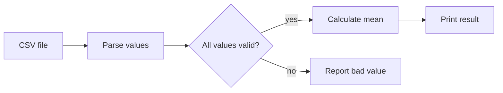
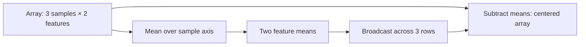
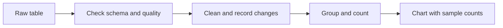
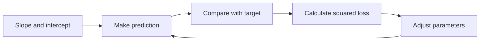

# Foundations

Foundations build the vocabulary and practical habits needed to reason about AI systems instead of treating them as black boxes. Progress is tracked by demonstrated mastery, not by a fixed schedule.

## Topic map

```text
Foundations
├── AI mental models
│   ├── Rules, examples, data, and labels
│   ├── Models, training, inference, and learning
│   └── Evaluation, generalization, and limitations
├── Python for AI
│   ├── Values, types, and collections
│   ├── Conditions, loops, and functions
│   └── Modules, files, exceptions, debugging, and reproducibility
├── Numerical computing
│   ├── NumPy arrays, shapes, and dtypes
│   ├── Indexing, axes, broadcasting, and vectorization
│   └── Vectors, matrices, and products
├── Data analysis
│   ├── DataFrames and data contracts
│   ├── Cleaning, grouping, and joins
│   └── Distributions, visualization, and data quality
├── Mathematics
│   ├── Linear algebra and functions
│   ├── Derivatives, gradients, and optimization
│   └── Probability, statistics, and uncertainty
└── Practice project → Topic mastery checkpoint
```

The order is a suggested path through dependencies. Learning units can be split, revisited, or practiced in a different order when prerequisites are already secure. Move on when the mastery checkpoint can be demonstrated; session count and elapsed time do not determine progress.

## Subtopics

### AI mental models

**Beginner explanation.** A regular program follows instructions that a person wrote. For example, a shop might set a rule that an order over $50 gets free shipping. The programmer can point to the exact condition that caused the result.

A machine-learning system is useful when it is difficult to write all the rules by hand. Instead, people give it examples that pair information with an answer, and a training procedure adjusts the model so its answers fit those examples. A spam filter, for instance, can learn patterns from messages marked “spam” or “not spam.” Training adjusts numerical settings called parameters; it does not simply copy a list of fixed rules from each example.

This does not mean the computer understands spam or knows whether its prediction is good. People decide what counts as spam, select and check the examples, choose a way to measure mistakes, and decide what the system should do with a prediction. Keep three questions separate: what information goes in, what output is requested, and what decision a person or product makes with that output. A useful-looking score can still be wrong, biased by its examples, or unsafe for the intended decision.

**Prerequisites.** None. Curiosity about everyday software examples is enough.

**Concepts and vocabulary.** Rule-based system; example; input; output; feature; label or target; dataset; model; parameter; training; inference; prediction; classification; loss; evaluation; training, validation, and test data; generalization; uncertainty; failure mode.

#### Learning units

1. **Rules versus learning from examples.** Identify whether a behavior comes from explicitly authored rules or patterns fitted from examples. Begin with [AI mental models: what is AI?](../lessons/ai-mental-models.md).
2. **Data, features, and labels.** Trace a raw example to the information provided to a model and the answer it is asked to predict.
3. **Models, training, and inference.** Explain that training adjusts model parameters using examples, while inference applies the resulting model to a new input.
4. **Prediction, error, and improvement.** Follow a prediction through a loss and an update. The [How learning works lesson](../lessons/learning-loop.md) provides a small hand-worked example.
5. **Evaluation and limitations.** Distinguish training evidence from held-out evaluation; explain why memorizing familiar examples does not show that a model will generalize.
6. **Uncertainty and impact.** Identify what a model output does not tell you, and connect errors to the decision or user affected.

**Worked example.** Consider a system that sorts screenshots into “map,” “message,” or “game.”

1. **Define one example.** A screenshot is one example. Its pixels are the raw input; a resized, normalized representation of those pixels may be the features the model receives. The category selected by a human reviewer is the label.
2. **Train from earlier examples.** Training adjusts the model's parameters so that screenshots resemble patterns associated with their labels. If reviewers disagree about a screenshot, the model receives a confusing signal; it cannot infer which reviewer was right.
3. **Use the model on a new screenshot.** During inference, the new screenshot goes through the same resizing and normalization steps. The model returns a score for each category. The largest score can select a category, but that score is not automatically a calibrated chance that the answer is correct.
4. **Check whether it learned a useful pattern.** Evaluate it on screenshots kept out of training. If it is accurate on familiar screenshots but fails on a new phone theme, it may have learned incidental visual details instead of patterns that transfer.
5. **Consider the whole feature.** A wrong category may confuse a user, and sending a screenshot to a remote service may expose private information. Accuracy alone cannot decide whether that design is appropriate.

**Illustration or animation cue.** Use the existing [rules-versus-learning illustration](../assets/img/rules-vs-learning.svg). Extend it with a short flow animation from screenshot → pixels/features → model → category score → app action, and mark where a wrong prediction could enter.

**Code practice.** Run this small, inspectable example. The first predictor is a rule written by a person; the second calculates a center for each label from training examples and chooses the closest center.

```python
training = [(10, "coat"), (14, "coat"), (16, "coat"),
            (20, "no coat"), (22, "no coat"), (26, "no coat")]
groups = {}
for temperature, label in training:
    groups.setdefault(label, []).append(temperature)
centers = {label: sum(values) / len(values)
           for label, values in groups.items()}

def written_rule(temp):
    return "coat" if temp < 18 else "no coat"

def learned_predictor(temp):
    return min(centers, key=lambda label: abs(temp - centers[label]))

for temp, expected in [(17, "coat"), (19, "no coat")]:
    rule = written_rule(temp)
    learned = learned_predictor(temp)
    print(temp, "expected:", expected, "rule:", rule, "learned:", learned)
```

`groups.setdefault(label, []).append(temperature)` creates a list for a label the first time it appears, then appends the current temperature. The dictionary comprehension calculates an average for each list: add the group's numbers and divide by their count. This gives `40 / 3 ≈ 13.3` for “coat” and `68 / 3 ≈ 22.7` for “no coat.” In `learned_predictor`, `abs(temp - centers[label])` is the distance from the new temperature to a label's center, and `min` picks the smaller distance. At 17 the distances are about 3.7 and 5.7, so it chooses “coat”; at 19 they are about 5.7 and 3.7, so it chooses “no coat.” The hand-written rule compares against the fixed cutoff 18. In this tiny dataset they happen to agree, but changing the examples can move the learned centers without changing the written cutoff.

This is only a toy learning procedure: real images have many features, and two labels cannot usually be summarized by one temperature-like number. The temperature example teaches the mechanics of rule-based versus data-fitted behavior; it does not show how an image model processes pixels. Change one training value and observe whether its label's center and the predictions change. Then add a test example that was not used to calculate the centers and count correct predictions. Two test examples are not enough evidence about future performance.

**Common mistakes.** Calling every automated system AI; treating a prediction as a fact; confusing a feature with a label; assuming training examples are independent proof of quality; describing a model as understanding its task; overlooking how the output will be used.

**Exercises and answer guidance.**

- In an email spam filter, give one possible feature and the label. **Answer:** message text could be a feature because it is information available to the filter; “spam” or “not spam” could be the label, according to a written labeling policy. Sender information might also be a feature, but check whether it will be available when the filter runs and whether using it is appropriate.
- A model is correct on every training example but often wrong on new examples. What is a likely explanation? **Answer:** the model may have memorized details of its training examples instead of learning patterns that apply more broadly. Another possibility is that new examples differ from the training set. A held-out test set helps reveal the problem because its answers were not used to adjust the model, though it only represents the kinds of future examples it contains.
- For the screenshot classifier, name two failure modes beyond an incorrect category. **Answer:** a theme or device missing from training might cause systematically worse results for some users; sending a screenshot to a remote service could expose private information. Even when a category is correct, an app might take an unwanted action based on it, so the effect of the prediction matters too.


**Practice project.** Produce a one-page data-to-prediction trace with the decision, input, target, training/inference split, evaluation idea, and failure modes.
**Mastery checkpoint.** Teach the trace to another learner. They should be able to point out what is data, what the model learns, what happens at inference, how quality is checked, and one limitation without relying on unexplained jargon.

### Python for AI

**Beginner explanation.** Python is a programming language: you write instructions in a text file, and the Python interpreter reads and runs them. A variable gives a value a name, such as `temperature = 18`; a list holds several values; and a function gives a sequence of steps a reusable name. Those basics let you inspect examples, calculate summaries, and run small model experiments.

Programs also receive imperfect inputs. A number might arrive as text, a file might be missing, or a row might lack a required field. A helpful script checks these assumptions and reports a specific problem instead of silently producing a misleading answer. Separating reading, checking, and calculating into functions makes each part easier to understand and test.

Reproducibility means that someone can rerun your work and understand how the result was made. That includes recording the input, Python and package versions when they matter, configuration, and random seed for randomized work. A notebook can hide values left over from an earlier cell, so run it from a clean state before relying on its output.

**Prerequisites.** Basic computer use, text editing, and running a command in a terminal. No AI or programming prerequisite is required; the suggested route places this after AI mental models.

**Concepts and vocabulary.** Interpreter; environment; variable; value; type; string; integer; float; boolean; list; dictionary; condition; loop; function; parameter; return value; module; file path; exception; debugging; test; notebook; random seed; dependency/version.

#### Learning units

1. **Values and types.** Create and inspect numbers, text, booleans, lists, and dictionaries; convert types deliberately.
2. **Conditions and loops.** Branch on a condition and process a collection one item at a time.
3. **Functions and modules.** Name a reusable operation, pass inputs, return outputs, and import code from a module.
4. **Files and exceptions.** Read structured input, write results, and handle a missing or malformed file with a useful message.
5. **Debugging and small tests.** Reproduce an error, inspect values and stack traces, and test expected behavior on a normal case and an edge case.
6. **Reproducible experiments.** Record dependencies, inputs, configuration, and random seeds where applicable. Start with [Python and reproducible AI work](../lessons/python-reproducibility.md).

**Worked example.** Suppose a CSV file contains response times in milliseconds, with one value per row.

1. Open the file and parse each row. CSV parsing matters because quotes, commas, and line endings make splitting raw text by hand unreliable.
2. Convert a value such as the text `"250"` to the number `250`. If a row contains `"unknown"`, conversion should fail; silently treating it as zero would make the average too small.
3. Decide how to handle invalid rows. For a small report, collect their row numbers and report how many were excluded. If many rows are invalid, stop and investigate the data instead of hiding the quality problem.
4. Calculate the mean from the valid numbers. For `[200, 250, 300]`, the sum is `750`, and dividing by 3 gives `250` milliseconds.
5. Keep the calculation separate from file reading. A `mean(values)` function can be checked with `[2, 4, 6]`, which should return `4`, regardless of which file supplied the values.

The number alone is not a complete report: include the input file, units, number of valid rows, and number rejected so a reader can judge whether two averages are comparable.

**Illustration or animation cue.** Show a short program as a value-flow diagram: file → parsed list → validation → calculation function → printed result. Animate one invalid value travelling to a clear error message instead of silently disappearing.



**Code practice.** This runnable starter uses Python's built-in CSV reader, so it needs no package installation. It checks the required column and rejects unknown labels rather than counting them silently.

```python
import csv
from io import StringIO

def count_labels(file_object):
    reader = csv.DictReader(file_object)
    if reader.fieldnames is None or "label" not in reader.fieldnames:
        raise ValueError("CSV must contain a 'label' column")
    counts = {}
    for row_number, row in enumerate(reader, start=2):
        label = (row["label"] or "").strip().lower()
        if label not in {"cat", "dog"}:
            raise ValueError(f"row {row_number}: unexpected label {label!r}")
        counts[label] = counts.get(label, 0) + 1
    return counts

sample = StringIO("label,score\ncat,0.9\ndog,0.2\ncat,0.8\n")
print(count_labels(sample))  # {'cat': 2, 'dog': 1}
```

`DictReader` uses the first CSV row as column names, so each later `row` acts like a dictionary: `row["label"]` gets that row's label. The function first checks that the header exists and includes `label`; then it visits each data row, starting its human-readable line number at 2 because line 1 was the header. `.strip().lower()` removes spaces and normalizes case, so `" Cat "` becomes `"cat"`. The `counts` dictionary starts empty; `counts.get(label, 0)` means “use the existing count, or zero if this is the first one,” and adding 1 records the new example. On the sample it returns two cats and one dog. The set check rejects any label outside the two allowed categories instead of silently inventing a third category.

Replace `StringIO` with `open("examples.csv", newline="", encoding="utf-8")` and call the function inside the file's `with` block. A blank file has no header and raises the first error; a header-only file has a valid column but returns `{}` because there are no data rows. Add an unexpected label and a missing `label` column. Explain which check catches each problem and why the message names the row or column.

**Common mistakes.** Using a global environment without recording packages; naming a variable after a built-in such as `list`; mixing strings and numbers; repeating logic instead of extracting a function; catching every exception and hiding the cause; assuming a notebook's current state is reproducible; testing only the happy path.

**Exercises and answer guidance.**

- What does `int("12")` produce, and why can `int("12.5")` fail? **Answer:** it produces the integer `12`. The string `"12.5"` describes a decimal, not an integer literal, so Python cannot convert it directly. If decimal input is intended, parse it with `float("12.5")`; then decide whether rounding or truncation is right, because `int(12.5)` discards the fractional part.
- Write a function that returns the number of positive values in a list. What should it return for an empty list? **Answer:** `def count_positive(values): return sum(value > 0 for value in values)` works because comparisons produce `True` or `False`, which `sum` counts as 1 or 0. An empty list has no positive values, so the result is `0`. For `[-1, 0, 2]`, it returns `1`; this also confirms that zero is not positive.
- A script works in a notebook but fails in a clean terminal. Name two things to inspect. **Answer:** check the active Python environment and whether it has the same packages installed; the notebook kernel may use a different interpreter. Then check the working directory and input paths, because a relative path is resolved from the command's starting directory. Also look for values created by earlier notebook cells but absent when the script runs normally.


**Practice project.** Produce a small runnable Python project with setup notes, validated input, predictions or summaries, and a test for an edge case.
**Mastery checkpoint.** From a clean terminal and documented environment, run your script on a normal input and an invalid input. Explain how data flows through its functions, locate an intentional bug, fix it, and show a small test that would catch it next time.

### Numerical computing

**Beginner explanation.** A Python list can store numbers, but applying the same calculation to millions of values one at a time is slow and hard to read. NumPy arrays store numeric data in a regular layout and let one operation apply to many values at once. An array's `shape` records its dimensions: `(3, 2)` might mean three examples, each described by two features.

The shape is more than a technical detail. The first dimension may represent examples, the second features, and an operation along an axis may combine examples or features. If you forget what each dimension means, code may run and return a plausible but wrong result. Before calculating, say in words what each row and column represents, then check whether the operation keeps or reduces the intended dimensions.

Broadcasting lets NumPy apply a smaller array across a larger one when their dimensions are compatible. This avoids a loop, but compatibility only means the shapes can be combined; it does not prove the operation makes sense for the data.

**Prerequisites.** Python values, lists, function calls, and basic arithmetic. An intuitive understanding of rows and columns is helpful.

**Concepts and vocabulary.** Array; dimension/axis; shape; size; dtype; index; slice; broadcasting; vectorization; scalar; vector; matrix; dot product; matrix multiplication; transpose; batch; tensor.

#### Learning units

1. **Arrays, shapes, and dtypes.** Create arrays and predict `shape`, element count, and type before printing them.
2. **Indexing and axes.** Select individual values, rows, columns, and slices; describe which axis an operation reduces.
3. **Broadcasting and vectorization.** Apply scalar or compatible-shaped operations across arrays and compare them with a Python loop.
4. **Vectors and matrices.** Treat vectors as ordered numeric features and matrices as collections of vectors; check dimensions before multiplying.
5. **Numerical behavior.** Notice integer versus floating-point calculations, rounding, and why exact equality can be inappropriate for some computed decimals.

**Worked example.** Imagine three houses described by area in hundreds of square feet and bedroom count:

```text
[[1, 1],
 [2, 2],
 [3, 3]]
```

1. There are three rows and two columns, so the shape is `(3, 2)`: three houses, two features.
2. Averaging down the rows means combining along axis `0`, the row direction. It gives the mean area and mean bedroom count: `[2, 2]`. The result has shape `(2,)`, one mean per feature; the columns remain because we did not combine across them.
3. Subtract `[2, 2]` from each row. NumPy broadcasts the means across all three rows, producing `[[-1, -1], [0, 0], [1, 1]]`. Each feature is now measured relative to its average.
4. If the array is mistakenly interpreted as two houses with three features, an operation can still run but mean something different. Shape checks catch some mistakes; only a description of the data can catch the rest.

Centering does not make different units interchangeable. Real housing data may need separate scaling choices, guided by what the features mean.

**Illustration or animation cue.** Animate a 3-by-2 grid with rows labeled “sample” and columns labeled “feature.” Highlight a column reduction to the two means, then show those means broadcasting back across all rows. Label each shape at every step.



**Code practice.** Run this NumPy example and predict each printed shape before executing it.

```python
import numpy as np

X = np.array([[1., 10.], [2., 20.], [3., 30.]])
print("X:", X.shape)                 # (3, 2): 3 samples, 2 features
means = X.mean(axis=0)
print("means:", means, means.shape)  # [ 2. 20.], shape (2,)
centered = X - means
print("centered:\n", centered)      # means broadcast across 3 rows

loop_result = np.empty_like(X)
for row_index in range(X.shape[0]):
    for column_index in range(X.shape[1]):
        loop_result[row_index, column_index] = (
            X[row_index, column_index] - means[column_index]
        )
print("same result:", np.allclose(centered, loop_result))
```

The printed `means` are `[2., 20.]`: the first feature averages `(1 + 2 + 3) / 3 = 2`, and the second averages `(10 + 20 + 30) / 3 = 20`. Subtracting those values from each row gives `[[-1, -10], [0, 0], [1, 10]]`. The nested loop subtracts the same feature mean from the matching column, so `np.allclose` prints `True`; it compares floating-point results within a small tolerance rather than requiring identical stored bits.

Now change `axis=0` to `axis=1`. The means now have shape `(3,)`: one mean per sample, not one per feature. If you leave `centered = X - means`, NumPy raises a broadcasting error because the last dimension of `X` is 2 but the last dimension of `means` is 3. This error is useful: the values do not line up across the feature columns. To subtract one row mean from each value in that row, reshape the means as a column with `means[:, None]`, which has shape `(3, 1)`. That column can broadcast across the two features, producing a `(3, 2)` centered result. Explain why this row-centering operation asks a different question from the original feature-centering, and never reshape just to silence an error without naming what each dimension represents.

Use the same array to practice indexing: `X[0, 1]` selects the first sample's second feature (`10`); `X[:, 0]` selects the first feature from every sample (`[1, 2, 3]`); and `X[1:, :]` selects rows from index 1 onward. NumPy indices begin at zero, and `:` means “take all values along this dimension.” The array contains floating-point values because the examples use `1.` rather than `1`; inspect `X.dtype` to see that type. Floating-point values are stored with finite precision, so `0.1 + 0.2` may print as `0.30000000000000004`, not exactly `0.3`. For computed decimals, use a tolerance check such as `np.isclose(0.1 + 0.2, 0.3)` instead of exact equality. Integers are useful for counts, but a division or measurement often needs floats to preserve fractions.

**Common mistakes.** Guessing shapes from appearance; confusing rows and columns; using a transpose to silence an error without checking semantics; applying a reduction along the wrong axis; creating an array with mixed types; assuming broadcast compatibility means the operation is conceptually correct; using a Python loop for large numeric work without a reason.

**Exercises and answer guidance.**

- An array has shape `(5, 3)`. How many samples and features might it represent? **Answer:** if rows are examples and columns are features, it has five examples with three measurements each. Shape alone does not tell us what the axes mean; check the surrounding data description.
- What shape results from summing a `(4, 2)` array across axis `0`? **Answer:** `(2,)`. Axis `0` combines the four rows, leaving one sum for each column. Summing across axis `1` would instead add each row's two values and produce shape `(4,)`.
- Why can a `(3, 2)` array not be matrix-multiplied by a `(4, 3)` array in that order? **Answer:** matrix multiplication matches the left array's last dimension with the right array's first dimension. Here those are 2 and 4, so there is no matching set of terms to multiply and add. `(3, 2) @ (2, 4)` is defined and produces shape `(3, 4)`.


**Practice project.** Produce a shape-first NumPy notebook with annotated axes, indexing, broadcasting, and matrix operations.
**Mastery checkpoint.** Given an unfamiliar small array expression, state the shape and meaning of each intermediate value before running it. Diagnose one axis or broadcasting error and correct it without adding arbitrary reshapes.

### Data analysis

**Beginner explanation.** A table is a collection of records arranged in rows and columns. Before calculating anything, identify what one row represents: one patient, one visit, one transaction, or something else. The same column can mean different things depending on that row unit. For example, counting rows in a table of visits counts visits, not unique patients.

Data analysis starts by inspecting how the table was collected and whether its values match the question. Entries may be missing, duplicated, written inconsistently, or measured in different units. Cleaning means making explicit, documented choices about these issues; it does not mean making inconvenient records disappear. Summaries and charts can reveal patterns, but do not explain why a pattern occurred. A higher rate in one group is an observation; showing that one factor caused it requires additional evidence and a suitable study design.

**Prerequisites.** Python basics; lists and dictionaries; introductory arrays and rows/columns. No statistics background is required.

**Concepts and vocabulary.** DataFrame; row; column; schema; data contract; categorical/numeric/date type; missing value; duplicate; outlier; filter; group; aggregation; join/key; distribution; histogram; summary statistic; sample; visualization; data-quality check.

#### Learning units

1. **Pandas and DataFrames.** Load a table, inspect dimensions, column names, data types, and a few rows; select and filter rows and columns.
2. **Data contracts and cleaning.** State required fields and valid ranges; inspect missingness, duplicates, inconsistent categories, and date or number parsing before choosing a treatment.
3. **Grouping and joins.** Aggregate by a category and join two tables using a key; check row counts and key uniqueness before and after a join.
4. **Distributions and visualization.** Use a suitable chart to inspect a distribution, compare groups, and show change over time without hiding sample size or scale.
5. **Interpretation and limits.** Separate observations from explanations; note who or what is missing from the data and what evidence a chart cannot establish.

**Worked example.** An appointment table has a patient ID, appointment date, clinic, and attendance status.

1. **Name the row unit.** If each row is one scheduled appointment, repeated patient IDs are expected: a person can have several visits. Removing every repeated patient ID would discard real appointments.
2. **Check the data contract.** Patient ID, date, clinic, and status should be present. Confirm that dates parse correctly and status values use the expected set, such as “attended,” “missed,” and “cancelled.”
3. **Investigate duplicates and missingness.** Two rows with the same patient and date may be a duplicate, but verify the source's meaning before deleting either. Report how many dates or statuses are missing and whether they cluster in a clinic or time period.
4. **Summarize carefully.** Group by clinic and count attended and missed visits. Calculate the missed share as missed divided by attended plus missed, and show the denominator beside the percentage. Exclude cancellations unless the question defines them as eligible appointments.
5. **Interpret only what is supported.** A higher missed share at one clinic is a descriptive difference. It does not establish why visits were missed, whether clinic practices caused them, or whether the difference would persist after accounting for other factors.

**Illustration or animation cue.** Show a table before and after a cleaning step, with each changed cell highlighted and a counter showing rows retained, corrected, or excluded. Then animate a grouped bar chart while keeping group sample counts visible.



**Code practice.** This in-memory pandas example can be copied into a Python session with pandas installed. It makes the denominator and cleaning choices visible.

```python
import pandas as pd

visits = pd.DataFrame({
    "clinic": ["North", "North", "South", "South", "South"],
    "status": ["attended", "missed", "attended", "missed", "cancelled"],
})
print("rows:", len(visits), "missing values:\n", visits.isna().sum())
allowed = {"attended", "missed", "cancelled"}
assert set(visits["status"]).issubset(allowed), "unexpected status"

eligible = visits[visits["status"].isin(["attended", "missed"])]
summary = (eligible.assign(missed=eligible["status"].eq("missed"))
           .groupby("clinic")["missed"].agg(["sum", "count"]))
summary["missed_share"] = summary["sum"] / summary["count"]
print(summary)
```

Read the intermediate results in order. There are five rows and no missing values. `eligible` removes the cancelled appointment because the example defines only attended and missed appointments as eligible; North and South each retain two visits. In `assign`, `.eq("missed")` converts each eligible status to `True` or `False`. Grouping by clinic and aggregating with `sum` and `count` gives North `1 missed out of 2` and South `1 out of 2`; because `True` counts as 1, the sum is the missed count. Dividing those columns gives a 0.5 share for each clinic. In a real chart, label 0.5 as 50% and include the two-visit denominators. The equal percentages here say nothing about why visits were missed.

Replace this table with a CSV using `pd.read_csv`, check that required columns exist, and print the number of cancelled rows excluded. Add a missing and an unexpected status to the input and decide whether your code should stop or report them. Make a chart only after the summary is correct; label it with clinic and share, and include the counts so `1 of 2` is not mistaken for stronger evidence than `50 of 100`.

**Common mistakes.** Dropping missing rows without measuring who is removed; using a join that duplicates rows; treating an ID as a quantity; hiding a small group behind a percentage; using a truncated axis that exaggerates differences; inferring cause from an association; changing data until a preferred chart appears.

**Exercises and answer guidance.**

- Joining one row per customer to several rows per purchase increases the row count. Is that necessarily a bug? **Answer:** no. If the desired result is one row per purchase, each purchase should match its customer's information and the count increases appropriately. If the desired result is one row per customer, the join has changed the unit being analyzed. Check the key and row count before calculating totals; duplicate keys in the customer table may multiply purchase rows unexpectedly.
- A group has 2 missed visits out of 4 and another has 50 out of 100. Both have the same percentage. What should accompany that comparison? **Answer:** report the fractions and denominators: both are 50%, but the first estimate is based on far fewer observations and can change a lot with one visit. The larger group is usually more stable under comparable sampling, although a large biased sample can still mislead. If decisions depend on the difference, estimate uncertainty rather than treating percentages as exact.
- A chart shows attendance falling after a reminder change. What can it establish? **Answer:** it can show that the recorded attendance values fell after the change, assuming the dates and counts are correct. It cannot show by itself that reminders caused the fall: seasonality, clinic mix, policy changes, or missing records might also explain it. Compare relevant groups or use a study design that addresses these alternatives before making a causal claim.


**Practice project.** Produce a cleaned dataset, quality audit, and three charts with findings and limitations.
**Mastery checkpoint.** Given a small unfamiliar table, identify its row unit and likely quality risks, validate a simple contract, complete a safe join or grouping, and explain one chart without making a causal claim it cannot support.

### Mathematics

**Beginner explanation.** Mathematics gives machine learning a precise way to describe quantities and how they relate. A vector holds several features for one example; a function maps an input to an output; probability describes uncertainty; and a derivative describes how a value changes when an input changes. These ideas explain what a model calculates and how training can adjust it.

Begin with small numbers, tables, and graphs before dense notation. Ask what each number represents and what units it has. An error of 5 dollars differs from an error of 5 minutes, even if the numeric values match. Formulas are easier to use once each symbol has a concrete meaning. You do not need advanced calculus to train a first model, but an intuitive grasp of averages, slope, and uncertainty helps you notice when a model's result is unreasonable.

**Prerequisites.** Arithmetic, fractions, percentages, and reading a basic coordinate plot. Algebra can be refreshed as needed. This subtopic can be studied alongside Python and does not require numerical computing first.

**Concepts and vocabulary.** Scalar; vector; matrix; linear combination; function; slope; derivative; gradient; parameter; probability; event; conditional probability; mean; median; variance; standard deviation; sample; population; confidence interval; hypothesis; objective/loss; optimization; learning rate.

#### Learning units

1. **Linear algebra.** Interpret vectors as lists of features and matrices as collections of examples or transformations. Calculate a simple weighted sum and connect it to a model prediction.
2. **Functions and graphs.** Read inputs, outputs, slope, and intercept; compare a straight-line model with a curved relationship.
3. **Derivatives and gradients.** Use slope to describe how output changes as an input changes. Understand a gradient as a direction for changing several parameters to reduce a loss.
4. **Probability.** Describe uncertain outcomes, complements, and conditional probabilities; distinguish a model score from a trustworthy probability.
5. **Statistics and sampling.** Summarize a sample with mean and spread; understand that different samples can give different estimates and that small groups are more variable.
6. **Optimization.** Treat learning as choosing parameters to reduce an objective. Connect updates and generalization to [How learning works](../lessons/learning-loop.md), then deepen the calculus intuition as needed.

**Worked example.** Suppose a simple model estimates delivery time from distance using `prediction = 2 × distance + 1`, where distance is in kilometers and time is in minutes.

1. For a 3-kilometer delivery, the prediction is `2 × 3 + 1 = 7` minutes. The slope 2 says the prediction increases by 2 minutes for each additional kilometer; the intercept 1 is the predicted time at distance zero.
2. If the observed delivery takes 9 minutes, define signed error as prediction minus observed value: `7 - 9 = -2` minutes. The negative sign means the model underpredicted by 2 minutes.
3. Squared error is `(-2)² = 4` minutes squared. Squaring makes positive and negative errors contribute positively and gives large misses more weight; the result is no longer in minutes.
4. Training can try different slope and intercept values to reduce total loss over many deliveries. A change that improves the training examples may still perform poorly on later deliveries, so evaluate on separate examples.

This formula describes an association in the chosen data. It does not prove distance alone causes delivery time; traffic, building access, and other factors may matter.

**Reading a loss curve.** Keep the delivery at 3 km and its observed time at 9 minutes, but allow the slope `w` to change while the intercept stays 1. The squared error is `L(w) = (3w + 1 - 9)²`. At `w = 2`, the prediction is 7 and loss is 4. At `w = 2.1`, prediction is 7.3 and loss is `(-1.7)² = 2.89`. The loss fell when the slope increased, so increasing `w` a little is locally a promising direction. A derivative measures this local change; using these two nearby values gives an approximate slope of the loss curve, `(2.89 - 4) / 0.1 = -11.1`. The negative sign says loss is going down as `w` increases here. A gradient extends this idea to several parameters, such as slope and intercept, and points toward how each affects loss. Training uses such change information to choose updates, but a step can be too large and make loss rise again.

**Probability and samples.** If 2 of 10 past appointments were missed, the observed missed fraction is `2 / 10 = 0.2`, or 20%; the complementary attended fraction is `8 / 10 = 0.8`, or 80%. These are sample proportions, not guarantees about the next appointment. In a poll of 20 people, 12 saying yes gives 60%; one additional no response changes it to `12 / 21 ≈ 57.1%`. A few responses move a small sample's estimate more. Larger comparable samples usually reduce random variation, while a biased sample can still give the wrong picture of the population. When reporting an average or proportion, say what was sampled, how many observations it contains, and who may be missing.

For a simple numeric view of spread, take delivery times `[4, 6, 8]` minutes. Their mean is `(4 + 6 + 8) / 3 = 6`; their distances from the mean are `-2, 0, +2`. To calculate sample standard deviation, square those distances (`4, 0, 4`), add them (`8`), divide by `n - 1 = 2` to get sample variance `4`, then take the square root: `2` minutes. Standard deviation summarizes a typical distance from the average. The mean tells the center; spread tells how much values vary around it. The median is also 6 and is less affected than the mean if one time is replaced by an unusually large value such as 80. Which summary is useful depends on the question and the data's shape.

Conditional probability asks about a share after restricting attention to a group. Suppose 3 of 10 appointments with a text reminder were missed, while 2 of 20 appointments without one were missed. The observed missed rate given a reminder is `3 / 10 = 30%`; without one it is `2 / 20 = 10%`. This comparison does not show that reminders cause more missed visits: the clinic may send reminders to appointments already considered higher-risk. “Given” identifies the subgroup being counted, not a causal explanation.

**Illustration or animation cue.** Use a single graph that begins with one data point and a line. Move the slope and intercept sliders, show predictions and residuals, then plot squared loss against one parameter and mark a step toward a lower point. A separate sampling animation can draw repeated small samples and show their averages varying.



**Code practice.** Run this plain-Python calculation before using a model library. It prints each prediction and error, then compares average squared error for two parameter choices.

```python
examples = [(1, 4), (2, 6), (3, 9)]  # (distance_km, observed_minutes)

def mean_squared_error(slope, intercept, data):
    squared_errors = []
    for distance, observed in data:
        predicted = slope * distance + intercept
        error = predicted - observed
        squared_errors.append(error ** 2)
        print(distance, "km: predicted", predicted,
              "observed", observed, "error", error)
    return sum(squared_errors) / len(squared_errors)

for slope, intercept in [(2, 1), (2.5, 1)]:
    loss = mean_squared_error(slope, intercept, examples)
    print("parameters:", slope, intercept, "mean squared error:", loss)
```

Trace the first row by hand: with slope 2 and intercept 1, the 1-kilometer example gets a prediction of 3 minutes; `3 - 4 = -1`, and squaring gives 1. Across the three rows, squared errors are 1, 1, and 4, so mean squared error is `6 / 3 = 2` minutes squared. With slope 2.5, predictions are 3.5, 6, and 8.5; squared errors are 0.25, 0, and 0.25, so the mean is `0.5 / 3 ≈ 0.167`. This parameter choice fits these three examples better, but its small error on the same examples is not yet evidence about future deliveries.

`error ** 2` makes negative and positive errors add instead of canceling, and it gives a miss of 2 more influence than a miss of 1. The average is in minutes squared; taking its square root returns to minutes, giving RMSE. Change the slope gradually and observe whether loss falls on these examples. Add a fourth example held back from your manual tuning and compare its error; the training examples alone cannot show how a new delivery will behave.

For a two-feature linear algebra example, let one delivery be `x = [3 km, 2 stops]`, let weights be `[2 min/km, 1 min/stop]`, and keep an intercept of 1 minute. The weighted sum is `2 × 3 + 1 × 2 + 1 = 9` minutes. In vector notation, `w · x + b` means multiply matching entries, add those products, and then add the intercept. The vector holds one example's features; the weight vector says how each feature contributes under this model. Both vectors must have the same number of entries for this dot product to be defined.

**Common mistakes.** Memorizing symbols without knowing what quantities they describe; confusing probability with certainty; assuming sample averages are exact population values; interpreting correlation as cause; thinking every optimizer update improves validation performance; believing calculus must be mastered before any ML work.

**Exercises and answer guidance.**

- For `y = 3x - 2`, calculate `y` when `x = 4`. **Answer:** substitute 4 for every `x`: `3 × 4 - 2 = 12 - 2 = 10`. The input is multiplied by slope 3, then intercept -2 shifts the result.
- A model predicts `7` when the target is `9`. What are the signed error (prediction minus target) and squared error? **Answer:** `7 - 9 = -2`, so the model predicted two units too low. Squaring gives `(-2)² = 4`, which removes direction but ensures a nonnegative contribution.
- A poll of 20 people estimates 60% support, while a poll of 2,000 people estimates 52%. Why might the smaller poll vary more? **Answer:** each person represents a larger share of a 20-person sample, so adding or removing a few responses can shift its percentage substantially. If both polls are sampled fairly in the same way, the larger sample generally has less random sampling variation. A large poll can still be biased if its sample excludes or overrepresents part of the population.
- If a derivative is positive at the current parameter value, which direction locally decreases a function? **Answer:** on a smooth curve, a small change against the positive slope—a small negative step—should reduce the function value. This is only local: a step that is too large can pass a minimum, and a zero derivative may occur at a maximum or flat point as well as at a minimum.


**Practice project.** Produce an annotated calculation showing prediction, loss, parameter change, and one sampling or uncertainty example.
**Mastery checkpoint.** Explain one prediction, its error, and how a parameter change affects the objective; interpret a simple graph or sample statistic; and describe one reason the result may not generalize. Use both a small numeric example and a plain-language explanation.

## Topic practice project

Choose a small, understandable dataset or create a toy one. Trace one prediction problem from its intended decision to its data, a simple baseline, and a review of errors. The project can combine the subtopic artifacts and should contain:

- a data-to-prediction diagram that names inputs, target, training, inference, and intended action;
- a small Python program or notebook with documented setup and repeatable inputs;
- a data-quality check and a clear table/array shape explanation;
- a baseline prediction and a small hand-worked calculation of its error;
- one visualization with labeled units and an honest statement of what it cannot establish;
- at least three concrete failure modes and an explanation of who or what they might affect.

There is no calendar deadline or required number of sessions. The project is complete when another learner can rerun it and follow the evidence from the raw example through the prediction and its limitations.

## Topic mastery checkpoint

Present the project and answer questions about its data, code, numerical operations, metric or error calculation, and intended use. You are ready to move into the [Machine Learning topic](machine-learning.md) when you can explain the complete path, reproduce a result, debug a basic issue, and distinguish evidence from assumption. If a part is unclear, return to that subtopic's learning units and checkpoint; time spent is not a failure signal.
