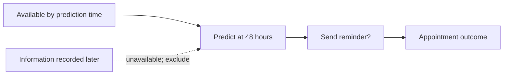
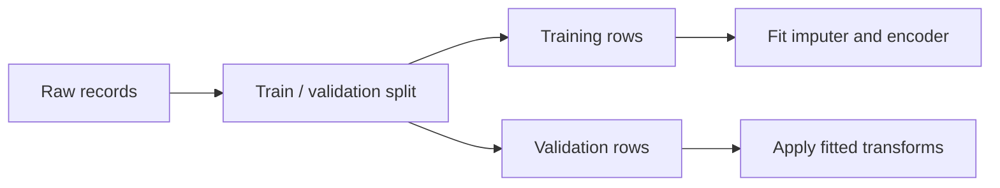
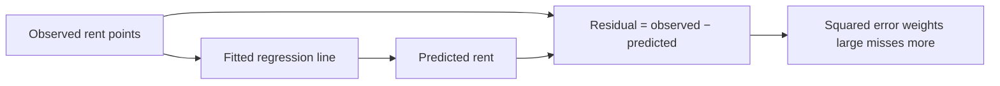
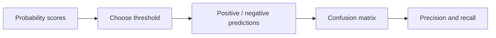
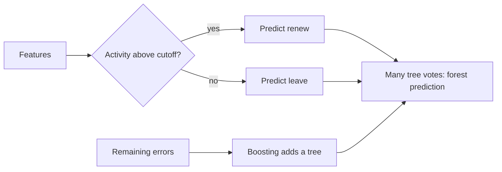
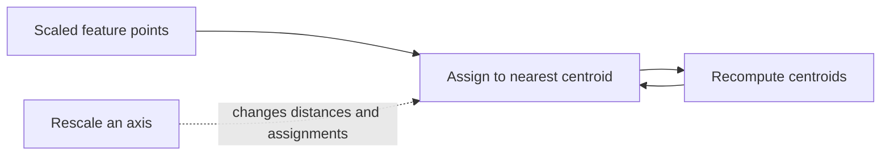
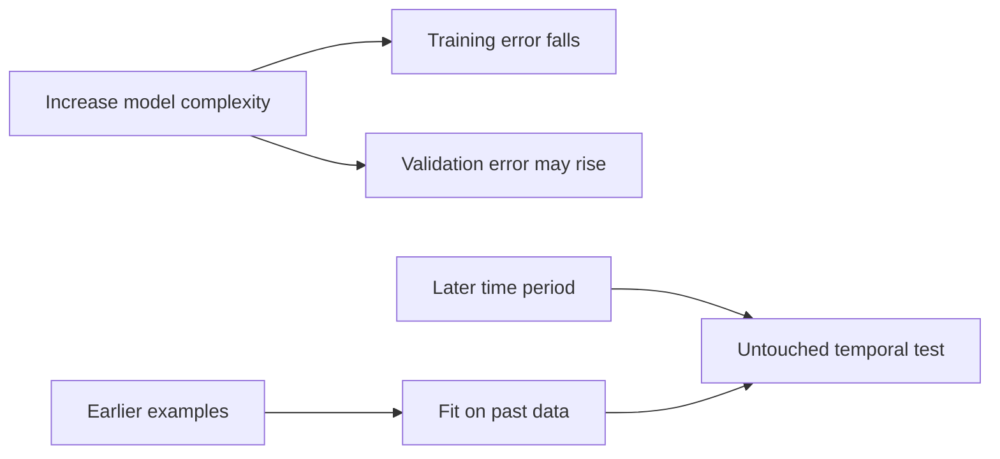

# Machine learning

Machine learning turns the foundation vocabulary into a disciplined workflow for making and evaluating predictions. The curriculum is organized by subtopic mastery; learners can revisit a unit or spend as long as needed without a calendar deadline.

## Topic map

```text
Machine Learning
├── Problem framing and baselines
├── Data preparation and leakage-safe pipelines
├── Regression
├── Classification
├── Trees and ensembles
├── Clustering and representation
└── Evaluation, generalization, and deployment decisions
    └── Practice project → Mastery checkpoint
```

Learning units are the concepts and skills listed within each subtopic. The order is a suggested dependency path, not a schedule. A learner may split a unit across multiple sittings, repeat it, or move ahead after demonstrating mastery.

Where a subtopic offers alternative prerequisites, complete the branch that matches the task you plan to work on; both branches are not required.

## Subtopics

### Problem framing and baselines

**Beginner explanation.** Start with a decision someone actually needs to make. “Predict no-shows” is incomplete by itself: a clinic might use that prediction to send another reminder, reserve an appointment slot, or change a patient's access to care. Those actions have different consequences. Write down who uses the prediction, what action they may take, and what would count as a useful result before selecting a model.

Next define exactly what one row of data represents and the moment when the prediction must be made. If the system predicts an appointment outcome 48 hours before the visit, a feature must be known by that time. A field entered after the visit cannot be used just because it is present in the final table. The target is the measurable outcome the model will learn to predict; it is not necessarily the deeper human concept we care about.

Finally, compare any model with a baseline: a simple rule such as “predict the most common outcome” or “always predict the training-set median.” A baseline answers a practical question: does the more complicated model improve predictions enough to justify its cost and risks? A baseline is not a competitor to beat at all costs; it is a reference that helps detect an unhelpful model or flawed evaluation.

**Prerequisites.** AI mental models: examples, features, labels, models, training, inference, and evaluation; basic data analysis and mathematics help but can be learned alongside problem framing. No prior ML implementation is required.

**Concepts and vocabulary.** Decision and intervention; prediction target/label; unit of observation; prediction time and horizon; feature availability; baseline; stakeholder; false-positive and false-negative costs; intended use.

#### Learning units

1. **Translate a decision.** Translate a user or business decision into a prediction question.
2. **Define the prediction contract.** Define the observation, label, prediction time, horizon, and eligible population.
3. **Check information timing.** List which information is available at prediction time.
4. **Set a baseline.** Select a simple rule, mean/median predictor, or majority-class baseline.
5. **Describe error costs.** Describe how each error type affects the decision and its users.

**Worked example.** A clinic is considering an extra reminder for appointments likely to be missed.

1. **Name the action.** The model would help decide who receives a second reminder. This makes the goal more concrete than “predict attendance”: the prediction matters only if it changes a reminder decision usefully.
2. **Name the observation and target.** One row represents one scheduled appointment. The target might be `missed = yes/no`, with a documented rule for cancellations and reschedules. Without that rule, two data sources could assign different labels to the same appointment.
3. **Fix the prediction time.** The prediction is made 48 hours before the appointment. A reminder sent 24 hours before could be part of the available history, but the eventual attendance status cannot be a feature because it is only known later.
4. **Set a reference.** If 90% of appointments are attended, predicting “attends” every time is a simple baseline with 90% accuracy. It has no ability to find appointments at risk, though, so report a measure that reflects missed visits as well as overall correctness.
5. **State the costs.** A missed appointment caught by the model may be prevented by a reminder; an unnecessary reminder costs time and may annoy someone. If reminders are sent disproportionately to one group, the workflow may also create unequal burden. The clinic must weigh these consequences and its capacity before choosing a threshold or deploying the model.

**Illustration or animation cue.** Draw a timeline from information collection to prediction to decision to outcome. Place candidate features on the timeline and fade out any information that arrives after prediction time.



**Code practice.** This starter computes a majority-class baseline without fitting a model library. The training labels choose the baseline; the test labels are used only to evaluate it.

```python
train_labels = ["attended", "attended", "missed", "attended"]
test_labels = ["missed", "attended", "attended"]

baseline_label = max(set(train_labels), key=train_labels.count)
predictions = [baseline_label] * len(test_labels)
correct = sum(pred == actual for pred, actual in zip(predictions, test_labels))
accuracy = correct / len(test_labels)
print("baseline:", baseline_label)
print("predictions:", predictions)
print("test accuracy:", accuracy)
```

The training labels make “attended” the majority prediction. The test predictions are therefore `attended, attended, attended`, while the known outcomes are `missed, attended, attended`; accuracy is `2 / 3 ≈ 0.67`. This baseline gets both attended cases right but catches zero of the one missed appointment. Treating “missed” as the positive class gives 0 true positives, 1 false negative, and 2 true negatives. The example shows why a reasonable accuracy can still be useless for deciding who gets an extra reminder. Extend the code to print those counts. In comments, record the target and what information exists at prediction time.

**Common mistakes.** Starting with an algorithm before defining a decision; using information that would not exist at prediction time; choosing a metric only because it is familiar; treating the label as a direct measure of a person's underlying behavior; skipping a baseline.

**Exercises and answer guidance.**

- Given a question such as “Which support tickets should be escalated?”, specify the decision, observation, label, prediction time, and one plausible leakage feature. **Answer:** the decision could be which open ticket a supervisor reviews next; one ticket is one observation; the label could be whether it was escalated under a documented policy; and the prediction time might be when the ticket first enters the queue. A `resolution_code` entered after closure is leakage because it reveals information unavailable when the review decision must be made. A good contract also defines whether reopened tickets count as one ticket or several observations. These definitions keep the training label aligned with the actual decision point instead of accidentally asking the model to recreate information recorded after the decision.
- Propose a baseline for predicting apartment rent. **Answer:** predict the median rent among training listings for every held-out listing. The median is a useful starting point because rent errors are often skewed by a few expensive properties, and the median is less pulled by extreme values than the mean. For example, the mean of `[1000, 1100, 1200, 9000]` is `$3,075`, while the median is `$1,150`; the unusually expensive listing pulls the mean upward. Compare the baseline with a model using the same held-out examples and report an error metric in rent units, such as MAE. A model only adds predictive value if it improves on this reference under the same evaluation protocol.


**Practice project.** Produce a prediction brief naming the decision, observation, target, prediction time, baseline, metric, and error costs.
**Mastery checkpoint.** Explain the model's intended decision and prediction contract to another learner. They should be able to identify the label, observation, prediction time, baseline, and at least one risk from your brief without guessing.

### Data preparation and leakage-safe pipelines

**Beginner explanation.** Raw data is collected for some operational purpose, not necessarily arranged in the exact form a model needs. One file may use `"NY"` and another `"New York"`; numeric values may be missing; dates may be text; duplicate rows may represent either repeated events or accidental copies. First inspect what a row means and what values are valid, then document how you will handle problems. Cleaning choices affect the examples the model sees, so record what changed rather than silently dropping inconvenient records.

Models usually require numeric inputs. A preprocessing step may fill missing values, scale numbers, or turn categories into numeric indicator columns. Such a step often learns a quantity from data—for example, a median used to fill missing values. To simulate future use honestly, split the data before learning these quantities. Fit the transformations on training examples, then apply those already learned choices to validation and test examples. If test data helps choose the median, category vocabulary, or scaling range, information from the supposed future has leaked into training.

A pipeline keeps preprocessing and model fitting together so that every training fold learns its own transformations. Choosing the split also matters: if predictions are for future months, a random split that mixes future and past records can give an overly optimistic picture. If multiple rows belong to the same person, related rows may need to stay together in one split.

**Prerequisites.** Problem framing and baselines, Python for AI, and data analysis (including introductory pandas and tabular data).

**Concepts and vocabulary.** Data contract; schema; missingness; categorical and numerical features; duplicates; outliers; encoding; scaling; imputation; train/validation/test split; pipeline; leakage; fit versus transform; temporal split.

#### Learning units

1. **Inspect the data.** Inspect a table's rows, columns, types, ranges, and duplicate records.
2. **Write a data contract.** Write a data contract and check required fields and valid values.
3. **Choose a credible split.** Choose a split that reflects the way future data will arrive, including time or groups where appropriate.
4. **Fit preprocessing safely.** Handle missing values, categories, and scales using transformations fitted on training data.
5. **Build a reproducible pipeline.** Combine preprocessing and model steps in a reproducible pipeline.

**Worked example.** We want to predict apartment rent for listings that will appear next month, using neighborhood, bedrooms, square footage, and listing date.

1. **Check what one row means.** Confirm each row is one listing, inspect missing and duplicate values, and verify that rent is in the same currency and time period throughout. If one apartment was listed several times, decide whether those rows belong together when splitting.
2. **Match the split to use.** Train on earlier listing dates and hold out later dates. A random split could put nearly identical listings from the same period in both groups, which may make evaluation easier than predicting genuinely future listings.
3. **Learn cleanup on training only.** If square footage has missing values, calculate the median using training rows only. Learn the neighborhood categories and any numeric scaling from those same rows. These learned values and category mappings are part of the fitted preprocessing.
4. **Apply, do not relearn, on the holdout.** A future listing with missing square footage receives the training median. An unseen neighborhood must follow a planned unknown-category policy. The validation rows must not contribute to the median or change the mapping.
5. **Evaluate the complete recipe.** Fit preprocessing and the regression model together on training data, then score the later listings. If neighborhood average rent is included, calculate each training example's feature without using its own target, and calculate held-out neighborhood values from training data only; otherwise the feature can smuggle the answer into the model.

**Illustration or animation cue.** Show raw records flowing through a split into train and validation branches. The training branch learns imputation values and encodings; the validation branch can only pass through those already-fitted transformations.



**Code practice.** This scikit-learn starter creates a small example and puts learned preprocessing inside the estimator pipeline. The rows include a month so the split can mimic predicting future listings; month selects the holdout and is deliberately excluded as a feature. Preprocessing is fit after the split, so later rows cannot set the imputation median or category vocabulary.

```python
import pandas as pd
from sklearn.compose import ColumnTransformer
from sklearn.impute import SimpleImputer
from sklearn.linear_model import LinearRegression
from sklearn.pipeline import make_pipeline
from sklearn.preprocessing import OneHotEncoder, StandardScaler

data = pd.DataFrame({
    "month": [1, 2, 3, 4, 5, 6, 7, 8],
    "area": [500, 700, None, 900, 650, 800, 750, 1100],
    "bedrooms": [1, 2, 2, 3, 2, 3, 2, 4],
    "neighborhood": ["A", "B", "A", "C", "B", "A", "C", "D"],
    "rent": [1200, 1600, 1350, 2100, 1550, 1800, 1700, 2500],
})
train = data[data["month"] <= 6]
test = data[data["month"] > 6]
X_train = train[["area", "bedrooms", "neighborhood"]]
y_train = train["rent"]
X_test = test[["area", "bedrooms", "neighborhood"]]
y_test = test["rent"]
numeric = make_pipeline(SimpleImputer(strategy="median"), StandardScaler())
categorical = make_pipeline(
    SimpleImputer(strategy="most_frequent"),
    OneHotEncoder(handle_unknown="ignore"),
)
prep = ColumnTransformer([
    ("numbers", numeric, ["area", "bedrooms"]),
    ("categories", categorical, ["neighborhood"]),
])
model = make_pipeline(prep, LinearRegression())
model.fit(X_train, y_train)
predictions = model.predict(X_test)
print("actual/predicted:", list(zip(y_test, predictions.round(1))))
```

Months 1 through 6 are training data; months 7 and 8 are the later holdout. The median imputer learns separate training medians for area and bedrooms; the missing training area is replaced with 700. The scaler then learns each numeric feature's mean and spread from training rows. The encoder learns categories A, B, and C; D appears only in the test month. `handle_unknown="ignore"` represents D without failing, but it does not tell us that D resembles a known neighborhood. The printed pairs put actual rent first and estimated rent second, so compare them row by row and subtract estimate from actual to see direction of error. This tiny dataset has only two test listings, so those predictions teach pipeline mechanics and provide almost no reliable performance evidence.

**Common mistakes.** Imputing or scaling before the split; allowing duplicate people or time-adjacent records to cross splits when that invalidates evaluation; dropping missing rows without checking who is lost; treating an identifier as a meaningful feature; silently changing test data after seeing scores.

**Exercises and answer guidance.**

- A dataset has a `resolved_at` column and predicts whether a ticket will be resolved within one day. Is it available? **Answer:** not if `resolved_at` is recorded only after resolution. The prediction is meant to be made before that day has passed, so the final timestamp either reveals the target or does not exist yet. Exclude it as a feature; an earlier timestamp, such as when the ticket was opened, may be available and useful. The key check is “would this value exist at the exact moment the model must predict?”
- Explain why a scaler belongs inside cross-validation's pipeline. **Answer:** scaling computes each feature's mean and spread. If you scale everything before cross-validation, a validation fold helps set the values used to transform its own examples, so the evaluation data has influenced the training representation. Put the scaler inside the pipeline: for each fold, fit it on that fold's training rows, then apply those learned numbers to its validation rows. The validation rows are transformed, but do not get to determine the transformation.


**Practice project.** Produce a leakage-safe preprocessing pipeline with data contract, split rationale, and quality report.
**Mastery checkpoint.** Given a small unfamiliar table, identify a credible split, write two leakage checks, and fit a preprocessing pipeline without learning from held-out records.

### Regression

**Beginner explanation.** Regression is used when the answer you want is a number: a rent estimate, delivery time, or energy use. A model learns a relationship between input features and a numeric target, then uses it to estimate the target for a new example. Its output is an estimate, not a promise; real outcomes vary and some useful information may be missing.

Start by comparing with a simple baseline, such as predicting the median rent for every listing. Then measure the model's errors on examples it did not train on. Mean absolute error (MAE) answers, “How many target units off are predictions on average?” Root mean squared error (RMSE) also uses target units but penalizes large misses more heavily. Neither number tells the whole story: plot or inspect residuals (observed value minus prediction) to see whether errors are concentrated among expensive listings, particular neighborhoods, or extreme feature values. A lower overall score can hide a group that is served poorly.

**Prerequisites.** Problem framing and baseline; data preparation; Python with arrays/dataframes. Basic averages and coordinate plots are helpful.

**Concepts and vocabulary.** Target; linear regression; coefficient; intercept; residual; mean absolute error (MAE); mean squared error (MSE); root mean squared error (RMSE); regularization; prediction interval and uncertainty.

#### Learning units

1. **Fit baseline and regression models.** Fit a mean or median baseline and a linear regression model.
2. **Interpret coefficients.** Read coefficients as model associations under the fitted representation.
3. **Measure prediction errors.** Compute and interpret residuals, MAE, MSE, and RMSE in context.
4. **Inspect residual patterns.** Plot errors to look for nonlinearity, changing variance, and unusual cases.
5. **Constrain complexity and describe uncertainty.** Use regularization as a way to constrain an overly flexible linear model; describe uncertainty carefully.

**Worked example.** We predict monthly rent using floor area and bedroom count. Suppose a held-out set contains four rents: `$1,000`, `$1,200`, `$2,000`, and `$2,400`.

1. A training-set median baseline predicts `$1,600` for each listing. Its absolute errors are `$600`, `$400`, `$400`, and `$800`, so MAE is `$2,200 / 4 = $550`.
2. A fitted linear model predicts `$1,100`, `$1,350`, `$1,750`, and `$2,000`. The signed residuals (observed minus predicted) are `-$100`, `-$150`, `+$250`, and `+$400`; absolute errors are `$100`, `$150`, `$250`, and `$400`, so MAE is `$900 / 4 = $225`. On this same holdout, the model's average absolute error is lower.
3. Look beyond the average. It overpredicts the two lower rents and underpredicts the two higher rents. That pattern suggests predictions are compressed toward the middle, and its largest miss is on the most expensive listing. This can matter if high-rent properties are important to the product.
4. The model's coefficient for bedroom count describes a pattern after fitting the selected features and data. It does not establish that adding a bedroom causes the coefficient-sized rent change; location and property quality may explain part of the pattern.

The comparison is useful only if both predictors were evaluated on the same held-out listings and the split resembles future use. Four examples demonstrate the calculation, not a reliable estimate of real-world performance.

**Illustration or animation cue.** Animate a fitted line moving through a scatter plot, then draw vertical residual segments from each point to its prediction. Add a second panel showing how squaring errors gives large misses more influence.



**Code practice.** This starter compares a constant median baseline with linear regression. It holds out data first and reports two metrics on the same rows.

```python
import numpy as np
from sklearn.dummy import DummyRegressor
from sklearn.linear_model import LinearRegression
from sklearn.metrics import mean_absolute_error, mean_squared_error
from sklearn.model_selection import train_test_split
from sklearn.pipeline import make_pipeline
from sklearn.preprocessing import StandardScaler

X = np.array([
    [30, 1], [40, 1], [50, 2], [60, 2],
    [70, 2], [80, 3], [90, 3], [100, 4],
])  # area in square metres, bedrooms
y = np.array([900, 1100, 1300, 1500, 1800, 1950, 2300, 2600])
X_train, X_test, y_train, y_test = train_test_split(
    X, y, test_size=0.25, random_state=3
)
models = {
    "median baseline": DummyRegressor(strategy="median"),
    "linear": make_pipeline(StandardScaler(), LinearRegression()),
}
for name, model in models.items():
    model.fit(X_train, y_train)
    predictions = model.predict(X_test)
    mae = mean_absolute_error(y_test, predictions)
    rmse = np.sqrt(mean_squared_error(y_test, predictions))
    print(name, "MAE:", round(mae, 1), "RMSE:", round(rmse, 1))
    print("actual/predicted:", list(zip(y_test, predictions.round(1))))
    print("residuals:", (y_test - predictions).round(1))
    print("absolute errors:", abs(y_test - predictions).round(1))
```

The first printed pair contains the actual test rent and the model's estimate for the same listing. Subtract prediction from actual to get its residual; for example, actual `$2,000` and prediction `$1,800` gives a residual of `+$200`, meaning the model underpredicted by $200. The new lines show each residual and its absolute value; the metric function's MAE should equal the average of that absolute-error list. MAE averages absolute residuals, so it is in dollars and ignores direction. RMSE squares each residual, averages, and takes a square root; it remains in dollars but a large miss has extra influence. Inspect the pairs because one average can hide that a high-rent example is consistently underpredicted. A residual plot puts predicted rent on the horizontal axis and `actual - predicted` on the vertical axis; points above zero are underpredictions and points below zero are overpredictions. This tiny artificial dataset is for practicing the workflow, not claiming rent accuracy.

**Common mistakes.** Comparing metrics on different splits; calling a coefficient causal; reporting RMSE without explaining its squared-error sensitivity; extrapolating outside the observed feature range; assuming a single average score describes every important slice.

**Exercises and answer guidance.**

- Model A has MAE $200 and model B has MAE $240. Which is better if each dollar of error has equal cost? **Answer:** on the same held-out examples and under the same protocol, model A has the smaller average absolute error by `$240 - $200 = $40` per prediction. Before choosing it, check whether a few large misses, a subgroup, or an unrealistic split changes the conclusion; equal average cost does not mean every error has equal practical impact.
- A residual plot curves upward. What might that indicate? **Answer:** residuals change systematically across predictions, which can mean a straight-line relationship is too simple or an important feature is missing. Check axes and residual definition first: for `actual - predicted`, positive residuals mean underprediction. Then inspect the affected examples and compare a justified nonlinear model on validation data. A curve is a clue to investigate, not proof that a particular model family is best.


**Practice project.** Produce a baseline/model comparison with target units, MAE or RMSE, residual plot, and inspected errors.
**Mastery checkpoint.** Select and explain a regression metric for a stated cost, compare a model to a baseline on held-out data, and describe at least one limitation visible in the errors.

### Classification

**Beginner explanation.** Classification predicts one of a set of categories, such as “fraud” or “not fraud.” Many classifiers first produce a score for each class; in a binary task, the score may be interpreted as a probability, but this interpretation needs calibration checks. A threshold turns the score into a final action: if a fraud score is at least 0.5, flag the transaction, for example. A score of 0.72 is assigned the positive label at a 0.5 threshold; a score of 0.31 is assigned the negative label. Changing the threshold changes the action even though the model scores stay the same. The threshold is therefore a product choice as well as a modeling choice because it controls how many examples receive each action.

To understand the result, compare predictions with known labels in a confusion matrix. The diagonal cells are correct predictions; the off-diagonal cells are mistakes. A false positive is a legitimate transaction flagged for review; a false negative is fraud that is missed. Precision asks what fraction of flagged transactions really were fraud (`true positives / all flagged`). Recall asks what fraction of all confirmed fraud was caught (`true positives / all fraud`). Changing the threshold usually trades one kind of error for another. Accuracy can look high when one class is common, even if the system misses nearly every rare positive case. Choose metrics and thresholds based on error consequences, review capacity, and validation evidence; keep the test set untouched until choices are made.

**Prerequisites.** Problem framing and data preparation. Numeric prediction and held-out evaluation intuition from [Regression](#regression) are useful, but regression is not a gate; basic probability is introduced alongside classification.

**Concepts and vocabulary.** Class; logistic regression; probability score; threshold; confusion matrix; true/false positive; true/false negative; accuracy; precision; recall; F1; ROC-AUC; calibration; class imbalance.

#### Learning units

1. **Fit a classification baseline.** Fit a majority-class baseline and logistic regression classifier.
2. **Interpret scores and thresholds.** Interpret a probability score separately from the final thresholded label.
3. **Read classification metrics.** Read a confusion matrix and calculate accuracy, precision, recall, and F1.
4. **Compare thresholds and ranking.** Compare thresholds and ROC-AUC while keeping the product's error costs in view.
5. **Check calibration and slices.** Check calibration and investigate class imbalance and performance across relevant slices.

**Worked example.** A fraud model scores 100 transactions, of which 10 are later confirmed fraudulent. At threshold 0.5, suppose it flags 8: 6 are fraud and 2 are legitimate.

1. The six correctly flagged cases are true positives; the two legitimate cases flagged are false positives. Four fraud cases were not flagged, so they are false negatives.
2. Precision is `6 / 8 = 75%`: among transactions sent for review, three quarters were fraud. Recall is `6 / 10 = 60%`: the model found six of the ten fraud cases.
3. Lowering the threshold may flag more transactions. If it catches two more fraud cases but also sends twenty additional legitimate transactions to reviewers, recall improves while precision and workload may worsen.
4. Use validation examples to examine this trade-off and choose a threshold that fits review capacity and error costs. After the choice is fixed, report the selected procedure once on the untouched test set.

These sample counts explain the metrics; in a real, rare-fraud setting, 10 positive examples would be too few for a stable performance claim. Include uncertainty and investigate whether outcomes differ across relevant groups.

**Illustration or animation cue.** Use a slider to move a probability threshold across a row of scored examples. Update the confusion matrix and precision/recall values live to show the trade-off.



**Code practice.** The following small example turns scores into labels at two thresholds and prints the counts needed to explain precision and recall. It uses `scikit-learn` metrics but no fitted classifier, so you can first learn the threshold mechanics.

```python
from sklearn.metrics import confusion_matrix, f1_score, precision_score, recall_score, roc_auc_score

y_true = [1, 0, 1, 0, 0, 1, 0, 0, 1, 0]
scores =  [0.90, 0.75, 0.70, 0.60, 0.45, 0.40, 0.35, 0.20, 0.15, 0.10]
for threshold in [0.5, 0.3]:
    predicted = [int(score >= threshold) for score in scores]
    print("threshold:", threshold)
    print("matrix [true 0/1, predicted 0/1]:\n", confusion_matrix(y_true, predicted))
    print("precision:", precision_score(y_true, predicted, zero_division=0))
    print("recall:", recall_score(y_true, predicted, zero_division=0))
    print("F1:", f1_score(y_true, predicted, zero_division=0))
print("ROC-AUC:", roc_auc_score(y_true, scores))
```

At threshold `0.5`, the first four scores are positive: two are fraud and two are legitimate, giving two true positives and two false positives. Of the four actual fraud cases, two remain unflagged, so there are two false negatives. The other four legitimate cases are true negatives. The matrix is `[[4, 2], [2, 2]]`: rows are actual negative/positive and columns predicted negative/positive. Precision is `2 / (2 + 2) = 0.5`; recall is `2 / (2 + 2) = 0.5`; accuracy is `(2 true positives + 4 true negatives) / 10 = 0.6`. F1 combines precision and recall as their harmonic mean, `2PR / (P + R)`, so here it is also 0.5.

At threshold `0.3`, seven scores are flagged: three fraud and four legitimate; one fraud case remains unflagged. The matrix becomes `[[2, 4], [1, 3]]`. Precision falls to `3 / 7 ≈ 0.43`, while recall rises to `3 / 4 = 0.75`; F1 is about `0.55`. The threshold caught one more of the four fraud cases, at the cost of reviewing more legitimate cases. These deliberately tiny, balanced examples make counts easy to follow; they do not model real fraud prevalence.

ROC-AUC evaluates ranking rather than one chosen threshold: it is the share of positive-negative pairs in which the positive example receives a higher score. In this ten-example toy set, the four positive scores outrank 15 of the 24 negative-positive pairs, so AUC is `15 / 24 = 0.625`. AUC does not say how many transactions a review team must handle at any one threshold. Next, replace the hand-entered scores with probabilities from a logistic regression model trained on the training partition, choose a threshold using validation data, and check whether scores described as 70% actually correspond to about 70% positives over many examples. Do not use the test data to make those choices.

**Common mistakes.** Treating accuracy as sufficient for a rare class; assuming 0.5 is inherently correct; changing thresholds after inspecting test outcomes; describing a probability as calibrated without checking it; comparing ROC-AUC as if it reflected operational capacity or error costs.

**Exercises and answer guidance.**

- A medical screening workflow prioritizes catching cases, with follow-up tests available. Which metric deserves attention? **Answer:** recall deserves close attention because a false negative is a missed case and follow-up testing is available to check flagged people. Precision still matters because too many false alarms may overwhelm the follow-up service and cause unnecessary worry. The threshold requires clinical harm, capacity, and validation evidence; “maximize recall” alone could flag everyone. For example, a system that flags all 100 people in a group containing 10 cases has 100% recall but only 10% precision, requiring 90 unnecessary follow-ups.
- A fraud model has high accuracy but catches few fraud cases. Why? **Answer:** if legitimate transactions are much more common, predicting “legitimate” for nearly everything can be correct most of the time and therefore score high on accuracy. For example, if 990 of 1,000 transactions are legitimate, this baseline has 99% accuracy but 0% recall for fraud. Inspect the confusion matrix and class-specific measures rather than relying on a single overall percentage.
- A model assigns scores `0.72` and `0.31` to two cases. Which are flagged at thresholds `0.5` and `0.7`? **Answer:** at `0.5`, the 0.72 case is flagged and 0.31 is not; at `0.7`, the 0.72 case remains flagged and 0.31 remains unflagged. Neither output changes because it is compared to both cutoffs; more generally, raising a threshold can only keep the flagged set the same size or make it smaller. The score itself has not changed—only the decision rule has.


**Practice project.** Produce a classifier report with threshold comparison, confusion matrix, precision/recall, and error-cost rationale.
**Mastery checkpoint.** Explain how a threshold changes false positives and false negatives, select a threshold using validation evidence and a stated constraint, and communicate what the chosen metrics do not establish.

### Trees and ensembles

**Beginner explanation.** A decision tree turns examples into a sequence of questions. For apartment prices it might ask, “Is the area above 900 square feet?” and then ask a different question depending on the answer. A final leaf gives a prediction based on training examples that reached it. A small tree is relatively easy to trace, but a deep tree can keep splitting until it memorizes quirks of its training data.

An ensemble combines several trees. A random forest trains trees with varied samples or features and averages or votes across them, which can make predictions less sensitive to one particular tree. Boosting grows trees in sequence, with later trees addressing patterns left by earlier ones. These methods can improve predictions, but they create a larger model whose reasoning is harder to summarize. Feature importance can help diagnose which inputs a fitted model uses; it does not show that changing a feature would cause an outcome to change. Compare models on the same split and use validation data for tuning, leaving test data for the final check.

**Prerequisites.** Data preparation; either [Classification](#classification) or [Regression](#regression), depending on the task; and basic train/validation/test concepts. Both supervised branches are not required.

**Concepts and vocabulary.** Decision node; leaf; depth; overfitting; pruning; random forest; gradient boosting; hyperparameter; feature importance; permutation importance; correlation versus causation.

#### Learning units

1. **Trace a decision tree.** Trace a small decision tree from a feature vector to its prediction.
2. **Recognize overfitting.** Compare a shallow tree with a deeper tree and observe overfitting.
3. **Explain tree ensembles.** Explain how random forests average diverse trees and boosting adds trees to address earlier errors.
4. **Tune model settings.** Tune a small set of hyperparameters using validation or cross-validation.
5. **Interpret feature importance.** Interpret feature importance as a model diagnostic, not as proof of causal impact.

**Worked example.** Predict whether a customer renews using account age, plan, and recent activity.

1. A shallow tree might first ask whether recent activity exceeds a cutoff. If yes, it predicts “renew”; if no, it asks whether the plan is annual. For a customer with activity below the cutoff and a monthly plan, follow the “no” branch, then the “no” branch again, and arrive at “leave.” Following these questions for one customer makes the prediction path visible and shows which training cases informed the leaf's prediction.
2. Suppose a deeper tree keeps adding questions until it predicts almost every training customer correctly. That seems impressive, but some leaves may contain only one unusual customer. New customers with slightly different activity can then land in the wrong leaf. This is overfitting: the tree captured details of the examples rather than a stable pattern.
3. Limiting the depth or requiring more examples per leaf makes the tree simpler. A random forest combines many varied trees, often reducing the influence of one idiosyncratic split. Boosting adds trees to correct remaining patterns, which can help but also needs careful validation.
4. If recent activity is marked important, it means the fitted model relied on it for prediction under this setup. It does not prove that asking customers to use the product more would cause renewal; customers already intending to renew may simply use it more.

**Illustration or animation cue.** Display one tree's branching questions, then show many trees voting for an outcome. For boosting, animate successive trees focusing on remaining errors.



**Code practice.** Run this starter to compare a baseline, a shallow tree, and a random forest on one shared split. It uses a built-in classification dataset, so the focus is on comparing model complexity rather than a real product claim. The printed recall measures the share of malignant tumors found; training recall describes fitted examples, and test recall describes the held-out examples.

```python
from sklearn.datasets import load_breast_cancer
from sklearn.dummy import DummyClassifier
from sklearn.ensemble import RandomForestClassifier
from sklearn.metrics import recall_score
from sklearn.model_selection import train_test_split
from sklearn.tree import DecisionTreeClassifier

dataset = load_breast_cancer()
X, y = dataset.data, dataset.target
# In this dataset, 0 is malignant and 1 is benign. Use malignant as positive.
y = (y == 0).astype(int)
X_train, X_test, y_train, y_test = train_test_split(
    X, y, test_size=0.25, stratify=y, random_state=12
)
models = {
    "majority baseline": DummyClassifier(strategy="most_frequent"),
    "shallow tree": DecisionTreeClassifier(max_depth=2, random_state=12),
    "deep tree": DecisionTreeClassifier(random_state=12),
    "forest": RandomForestClassifier(n_estimators=100, random_state=12),
}
for name, model in models.items():
    model.fit(X_train, y_train)
    train_recall = recall_score(y_train, model.predict(X_train))
    test_recall = recall_score(y_test, model.predict(X_test))
    print(name, "train recall:", round(train_recall, 3),
          "test recall:", round(test_recall, 3))
```

The source dataset encodes malignant tumors as 0 and benign tumors as 1. The two lines that rebuild `y` make malignant the positive class (1) so the recall output answers “what fraction of malignant cases did the model catch?” The split preserves the class mix with `stratify=y`, and all models share those same rows. The majority baseline predicts the most common training label; in this dataset that is benign, so its malignant recall is 0. If a tree finds 8 of 10 malignant training cases, its training recall is 0.8; if it finds only 6 of 10 malignant test cases, test recall is 0.6. The gap suggests that some fitted patterns did not carry over, though one split alone is noisy evidence. A deep tree can memorize narrow details and get high training recall but lower test recall. Tune depth or leaf size with cross-validation on training data, then inspect test performance after choosing settings. Use a pipeline when preprocessing is learned, and do not treat feature importance as a causal explanation.

**Common mistakes.** Letting a deep tree's training score stand in for future performance; tuning on the test set; interpreting impurity importance as causal or unbiased; comparing models with different splits; assuming ensembles always help.

**Exercises and answer guidance.**

- A deep tree scores nearly perfectly in training but poorly in validation. What is likely happening? **Answer:** the tree is probably overfitting: it has enough splits to fit unusual training cases that do not recur in validation. Try limiting depth or requiring more samples per leaf, but make that choice using training and validation evidence. A simpler tree or ensemble may generalize better; gather more representative data if the current examples are insufficient.
- A feature is highly important in a model. Can a team conclude that changing it changes the outcome? **Answer:** no. Importance describes how much the fitted predictor relied on the feature under the chosen data and importance method. Another correlated feature might substitute for it, and the feature may be associated with rather than causing the outcome. A causal claim needs a causal study or design, not a feature-importance ranking.


**Practice project.** Produce a same-split comparison of a shallow tree and ensemble with validation choices and inspected errors.
**Mastery checkpoint.** Explain the prediction path of a tree, recognize an overfit pattern, compare an ensemble fairly, and state the limits of a feature-importance chart.

### Clustering and representation

**Beginner explanation.** In supervised learning, examples come with a target label. Clustering is unsupervised: it looks for groups without being told the correct group for each example. An algorithm such as k-means represents each example as a vector of feature values, measures distances between vectors, and assigns nearby examples to the same cluster. The result depends on which features and distance are chosen. If price is measured in thousands while a rating ranges from 1 to 5, price can dominate the distance unless the features are scaled appropriately.

A cluster is a mathematical grouping, not proof of a natural kind of person, product, or event. Inspect examples from each group, see whether the result is stable when the data or settings change, and ask whether the groups help a specific task. Dimensionality reduction maps many features onto two or three coordinates so people can view them, but that projection may stretch or compress distances. A picture can suggest patterns; it cannot certify that the clusters are real or useful.

**Prerequisites.** Data preparation, feature scaling, vectors, and distances. Introductory visualization is practiced here. Supervised-learning experience is helpful but not required.

**Concepts and vocabulary.** Unsupervised learning; feature representation; distance; scaling; k-means; centroid; cluster assignment; dimensionality reduction; anomaly detection; stability; qualitative validation.

#### Learning units

1. **Compare feature distances.** Compute and compare distances between a few feature vectors.
2. **Scale features.** Scale numeric features when their units would otherwise dominate distance.
3. **Fit k-means.** Fit k-means and understand assignments, centroids, and the chosen number of clusters.
4. **Visualize representations.** Visualize a lower-dimensional representation while retaining limits on interpretation.
5. **Validate cluster usefulness.** Inspect stability, examples, and downstream usefulness before assigning meaning to groups.

**Worked example.** We want to group retail items by price, package size, and weekly sales rate.

1. Represent each item with three numeric values. If price ranges from 1 to 1,000 while package size ranges from 1 to 10, raw Euclidean distance is driven mostly by price: a 100-unit price difference overwhelms a several-unit size difference.
2. Scale the features using statistics learned from the data. This makes their numeric ranges more comparable, but the choice means a one-standard-deviation change in sales is treated like a one-standard-deviation change in price. Whether that is sensible depends on the task.
3. Choose a value of `k`, the number of groups, and let k-means assign each item to the nearest center. The center is an average feature vector, not necessarily an actual item on the shelf.
4. Inspect representative items and cluster profiles. A group with high average price and low sales might suggest a “premium” segment, but inspect exceptions and confirm that the description is useful before naming it.
5. Repeat with a different random initialization or sample. If item assignments change greatly, the groups may not be stable enough for a consequential use.

A two-dimensional PCA plot may help display the result, but it compresses three or more features and can distort distances. Check conclusions against the original features too.

**Illustration or animation cue.** Animate k-means assignment and centroid updates in a two-dimensional toy dataset. Then show how rescaling one axis changes distances and may change group assignments.



**Code practice.** This example uses three retail-style features, scales them, fits k-means, and projects the scaled data onto two PCA components for a plot. The plot is only a view; keep the original features for interpretation.

```python
import matplotlib.pyplot as plt
import pandas as pd
from sklearn.cluster import KMeans
from sklearn.decomposition import PCA
from sklearn.metrics import silhouette_score
from sklearn.preprocessing import StandardScaler

items = pd.DataFrame({
    "price": [5, 7, 6, 80, 90, 75, 15, 20, 18],
    "size": [2, 3, 2, 8, 9, 7, 3, 4, 3],
    "weekly_sales": [100, 120, 90, 12, 8, 15, 60, 55, 70],
})
scaled = StandardScaler().fit_transform(items)
for k in [2, 3, 4]:
    labels = KMeans(n_clusters=k, n_init=20, random_state=4).fit_predict(scaled)
    print("k:", k, "silhouette:", round(silhouette_score(scaled, labels), 3))

labels = KMeans(n_clusters=3, n_init=20, random_state=4).fit_predict(scaled)
print(items.assign(cluster=labels).groupby("cluster").mean().round(1))
coords = PCA(n_components=2).fit_transform(scaled)
plt.scatter(coords[:, 0], coords[:, 1], c=labels)
plt.xlabel("PCA component 1")
plt.ylabel("PCA component 2")
plt.title("Clusters shown in a two-dimensional projection")
plt.show()
```

`StandardScaler` subtracts each feature's mean and divides by its standard deviation, so the clustering uses comparable units. For each `k`, k-means starts with centers, assigns each item to its nearest center, recomputes the centers, and repeats until assignments settle. The silhouette score for a point compares its average distance to points in its own cluster with its average distance to the nearest other cluster; values near 1 suggest it is much closer to its own group, values near 0 indicate overlap, and negative values suggest it may fit another group better. A larger average is often preferable, but the score cannot decide whether groups are useful. The printed table groups original, unscaled values by their assigned cluster, so you can interpret a profile in price, size, and weekly sales units. Cluster numbers such as 0, 1, and 2 are arbitrary IDs; another run can name the same groups in a different order. PCA makes coordinates for display; the axes are combinations of original features, not new business quantities. Color marks k-means assignments, but a visible gap in this compressed view is not proof of natural segments.

Compare silhouette scores but do not select `k` from that value alone. Read the cluster means in the original units to describe the groups; then inspect actual items near each center and items far from it. Try removing or changing one feature and observe whether the profiles remain meaningful. In a real analysis, document the scaling and distance choices and decide what evidence would make the groups useful for the intended task.

**Common mistakes.** Treating clusters as ground-truth classes; forgetting that scale changes distances; choosing `k` from a single metric alone; reading a 2D projection as if it preserved every high-dimensional relationship; calling unusual points “fraud” without labels or investigation.

**Exercises and answer guidance.**

- Why might scaling change a k-means result? **Answer:** k-means assigns points by distance. Suppose two items differ by 100 in price and 2 in package size. Raw Euclidean distance is `sqrt(100² + 2²) ≈ 100`, so price dominates. Scaling both features changes those contributions to standard-deviation units; a 2-unit size difference could then matter more than a 100-unit price difference. Assignments and centers may change. Choose scaling based on feature meaning and the groups' intended use, not only on a visually tidy result.
- A PCA plot shows two islands. Does that prove two natural populations exist? **Answer:** no. PCA compresses the data and may distort distances; scaling, selected features, and clustering settings also affect the picture. Inspect the original feature values, check whether assignments are stable across reasonable choices, and ask a domain expert whether the groups correspond to a useful distinction. Treat the plot as a way to generate questions, not as proof.


**Practice project.** Produce a clustering notebook documenting features, scaling, candidate settings, representative examples, and limits.
**Mastery checkpoint.** Reproduce a clustering analysis, explain how representation and scaling affect it, and defend a proposed use of the clusters without claiming they prove natural categories.

### Evaluation, generalization, and deployment decisions

**Beginner explanation.** A model is adjusted using training examples, so a good training score only tells us that it fits examples it has already seen. We care about generalization: how well it predicts future or otherwise unseen examples. To estimate that, divide data into roles. Training data fits the model; validation data helps compare choices such as model settings or thresholds; test data is held back for a final, limited check after those choices are settled.

The split should imitate how predictions will be used. A random split may be fine for unrelated, independently sampled examples. It can be misleading when future predictions are needed but records from future and past are mixed, or when several examples from the same person appear on both sides. Cross-validation repeats training and validation on multiple partitions, which can give a steadier estimate for model selection, but it does not fix leakage in the features or a split that fails to match deployment.

After aggregate metrics, inspect examples and slices: by time, device, location, or relevant user group. A good average can hide a serious failure in one slice, while very small slices have uncertain estimates. Data can also change after deployment. Define what will be monitored, who reviews a change, and when the system should be updated or paused. A historical score is evidence about a particular dataset and protocol, not a guarantee about future conditions.

**Prerequisites.** Problem framing and data preparation, plus either [Regression](#regression) or [Classification](#classification) and its task-appropriate metrics. Completing both is useful for breadth but is not a gate.

**Concepts and vocabulary.** Generalization; train/validation/test; cross-validation; leakage; overfitting; underfitting; distribution shift; slice analysis; error analysis; calibration; monitoring; model card.

#### Learning units

1. **Separate data roles.** Explain the distinct role of training, validation, and test data.
2. **Choose an appropriate split.** Choose random, grouped, stratified, or temporal splitting to match data collection and intended use.
3. **Use cross-validation safely.** Use cross-validation for model selection without consuming the final test set.
4. **Diagnose generalization problems.** Diagnose overfitting, underfitting, leakage, and distribution shift using scores and examples.
5. **Analyze slice-level errors.** Analyze errors across relevant user, device, location, or time slices, including uncertainty and sample size.
6. **Document deployment limits.** Document limitations, intended use, and monitoring signals before deployment decisions.

**Worked example.** A subscription company predicts which customers will cancel. Its random test split reports 92% accuracy, but the model performs poorly on the newest month.

1. A random split placed customers from every month in both training and test data. The result estimates performance on a mixture of past and recent patterns, not necessarily on the next month's customers.
2. A temporal split trains on earlier months and tests on a later month. If the product or pricing changed, the later examples expose a distribution shift that the random split partly concealed.
3. Compare errors by time and inspect cases around the change. If cancellation behavior changed after a new plan launched, the model may need new features or retraining; if labels were recorded differently, the apparent shift may be a data problem.
4. Keep the split rationale and both scores in the report. Choosing the random split because it has the nicer number would answer the wrong question.
5. Before deployment, specify what signal will trigger review, who checks it, and what fallback is available if performance degrades. A model should not continue making consequential predictions merely because it once scored well.

For example, if 92 of 100 randomly held-out customers were predicted correctly, accuracy is 92%. But if the newest month contains a pricing change and performance falls to 60 of 100, the later-period result answers a different and more relevant question: how well does the model handle the conditions it will face next? The score difference does not itself prove the pricing change caused the errors. Compare feature and label distributions across months, review misclassified examples, and check whether data collection changed. Keep both results with their split definitions so readers can see what each estimate supports.

**Illustration or animation cue.** Show training and validation curves diverging as model complexity grows. Beside them, show a timeline split where older examples train the model and a later period tests it.



**Code practice.** This example contrasts a random split with a time-based holdout. The synthetic data includes a change in the relationship over time, so a random split can look easier than predicting the latest period.

```python
import numpy as np
from sklearn.linear_model import LinearRegression
from sklearn.metrics import mean_absolute_error
from sklearn.model_selection import train_test_split

rng = np.random.default_rng(2)
time_index = np.arange(200)
feature = rng.normal(size=200)
target = 3 * feature + rng.normal(scale=0.5, size=200)
target[160:] += 5  # Later period has shifted upward
X = feature.reshape(-1, 1)

random_train, random_test = train_test_split(
    time_index, test_size=0.2, random_state=9
)
temporal_train, temporal_test = time_index[:160], time_index[160:]
for name, train_idx, test_idx in [
    ("random", random_train, random_test),
    ("temporal", temporal_train, temporal_test),
]:
    model = LinearRegression().fit(X[train_idx], target[train_idx])
    errors = np.abs(target[test_idx] - model.predict(X[test_idx]))
    print(name, "MAE:", round(errors.mean(), 2))
```

The target is the true value and `model.predict` gives an estimate for each indexed row. `abs(...)` makes each error nonnegative, and `.mean()` averages these errors. The random test MAE averages 40 mixed rows; some shifted rows were available during training. The temporal MAE averages the final 40 rows, whose targets are about five units higher than training targets. Since the model's fitted intercept never saw that offset, it will generally underpredict there by about five units, with additional random error. Both numbers are in target units; neither is a universal model-quality score independent of the deployment question.

Explain why the random test set includes some shifted examples in training while the temporal test set contains only the shifted period. The target rises by five after index 159, but the model only sees earlier targets in the temporal split, so it tends to underpredict the later values. The random split puts some later rows into its training set, teaching that model about the offset before it predicts other later rows. This is why the two MAEs differ: the split changes what information the model has seen.

Add a table of temporal errors by an appropriate slice, such as low versus high feature values, with the count for each group. In a real project, do not use the test score to choose model settings; use training-only cross-validation or a validation period, then evaluate once on the final holdout. The synthetic shift is deliberately simple and visible; real shifts can involve features, labels, user populations, or data collection and need investigation rather than an automatic retraining response.

**Common mistakes.** Reusing test data for tuning; assuming cross-validation prevents every kind of leakage; reporting aggregate metrics without inspecting slices; ignoring small slice counts; describing historical accuracy as a guarantee under distribution shift; deploying without a monitoring and fallback plan.

**Exercises and answer guidance.**

- Records contain multiple visits per person. What split concern arises? **Answer:** if visits from one person appear in both training and test, the model may recognize person-specific patterns or repeated context rather than generalize to new people. If deployment is for unseen people, split by person so all visits from one individual stay in one partition. If deployment predicts later visits for known people, use a time-aware design that reflects that workflow and still exclude information recorded after each prediction time. The split is determined by what “new case” means in use.
- The test score is strong, but one subgroup has few examples and weak recall. What should be reported? **Answer:** show the subgroup's recall together with its sample count and uncertainty, and compare its errors with the overall result. Recall is `true positives / (true positives + false negatives)`, so with only two positive cases, missing one changes recall by 50 percentage points. That estimate is unstable but may still identify a serious risk. Investigate label quality, feature coverage, and workflow effects before drawing a conclusion; do not conceal the result in the aggregate or claim it will improve without evidence.


**Practice project.** Produce an evaluation protocol and model card with split rationale, metrics, error slices, limits, and monitoring ideas.
**Mastery checkpoint.** Defend the split and metric to a reviewer, show that test data did not guide tuning, explain a meaningful failure slice, and state what evidence would trigger review or rollback.

## Topic practice project

Build a small end-to-end project around a clearly framed prediction task. Suitable options include apartment-rent regression, appointment attendance classification, or a public dataset with a documented target and collection process. Reuse the relevant subtopic artifacts and include:

- a problem-framing brief and data contract;
- a reproducible, leakage-safe cleaning and preprocessing pipeline;
- a simple baseline and at least two appropriate model families;
- an evaluation protocol and metric rationale chosen before examining the final test score;
- held-out evaluation and error analysis with at least five concrete examples;
- slice analysis for relevant groups or conditions, with sample sizes;
- a model card describing intended use, limitations, shift risks, and monitoring or fallback ideas.

The project is complete when the artifacts support a reviewable decision about whether the model is useful for the stated task. It is not necessary to deploy a model to demonstrate this learning.

## Topic mastery checkpoint

Present the project to a reviewer. You should be able to explain the decision and target, defend the split and baseline, choose metrics based on the cost of mistakes, compare models fairly, identify errors and limitations, and describe what further evidence or monitoring would be needed. Do not claim that correlation or predictive importance proves that a product intervention causes an outcome.
