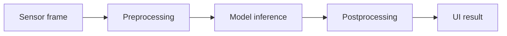
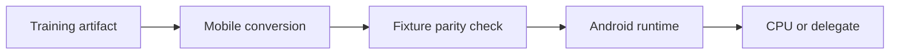
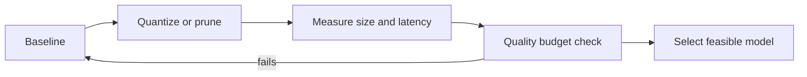
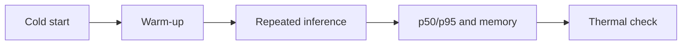
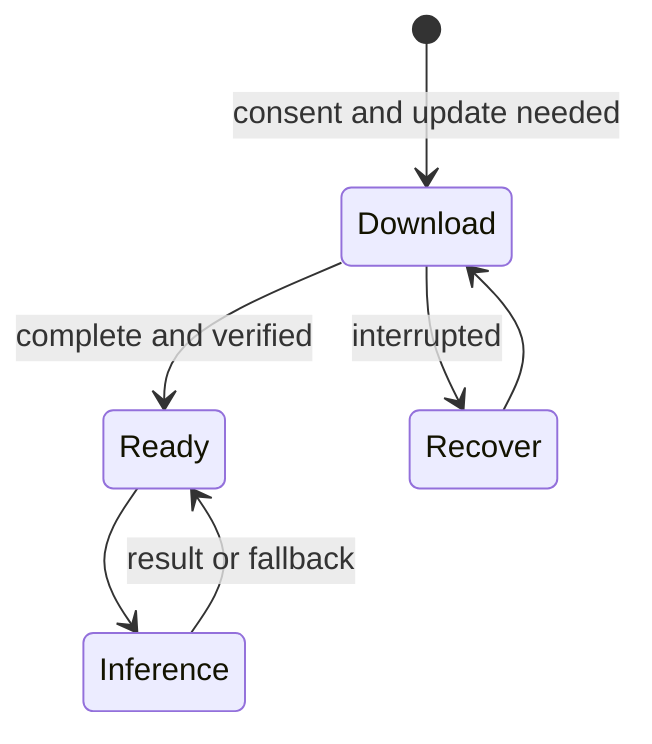

# On-device AI/ML

This specialization track focuses on Android and mobile systems. The inference-contract subtopic depends on its listed tensor and model-evaluation prerequisites but has no dependency on AI Engineering; runtime, performance, and product work build on the relevant evaluation and reliability foundations. Work through subtopics when prerequisites are met; calendar pacing is optional. Track proficiency from tested artifacts and device evidence.

## Subtopics

### Mobile inference contract

#### Learning units

- **Preprocessing and postprocessing:** Match training preprocessing and output postprocessing, documenting tensor shapes, normalization, labels, and error cases. The app should perform the same resize, color conversion, and scaling as training; otherwise the model sees a different problem even though the tensor has a valid shape.
- **Model versioning and Kotlin boundaries:** Expose inference through a typed Kotlin boundary and handle model versions and incompatible updates explicitly. Pair each model artifact with the input/output contract and label-map version, then return a clear error if the app loads an incompatible combination instead of displaying a silently incorrect class.

**Beginner explanation:** A model expects inputs in a particular numerical form and returns outputs with a particular meaning. The **inference contract** records that agreement so the app can prepare input and interpret output the same way the model-development pipeline did. If training used RGB images resized to 224×224 and normalized from `[0,255]` into `[0,1]`, but the app sends a 192×192 BGR bitmap with raw values, the model still produces numbers; they are simply based on the wrong input. This kind of mismatch often looks like a weak model when the actual cause is an integration error.

The contract also protects the application from assuming that every result is useful. A classifier returns scores associated with a label order; an output index is not itself a label. A confidence-like score may not be a calibrated probability, so a threshold is a product decision that should be measured. The Kotlin boundary should make shape, types, model version, and failure states explicit, keeping runtime details from leaking through every screen in the app.

Work through the image path one transformation at a time: inspect the camera frame dimensions and color format, convert it to the model’s channel order, resize using the same method as training, apply the exact scale/offset, then check the final tensor shape before inference. Keeping these steps in one adapter makes it possible to compare the Android tensor with a training-side fixture. On the way back, verify that the output length matches the label-map version before looking up an index. Return a typed error if the model is unavailable or its version does not match the contract; that is safer than showing a plausible label from a misinterpreted output.
**Prerequisites:** Tensors and model evaluation. Assumed software background: Kotlin basics. [AI engineering](ai-engineering.md) is a suggested route, while this contract subtopic can be started independently.
**Concepts and vocabulary:** A **tensor** is a multi-dimensional array of numbers; its **shape** gives the size along each dimension, such as `[1, 224, 224, 3]` for one RGB image. **Preprocessing** resizes and converts raw input into that shape and range. **Normalization** applies the scale and offset expected by training. **Postprocessing** turns model output into something meaningful, such as a class label. A **label map** defines which output index means which class. A **model version** identifies the artifact and its associated contract. The **inference contract** is the complete set of input, output, version, and error assumptions.
**Worked example:** Imagine a camera classifier trained on RGB images of size 224×224, with channel values converted using `x / 255.0`. The camera gives a 1280×720 bitmap in Android's image format. The adapter converts color order to RGB, resizes to 224×224, divides every channel by 255, and packs the values in row-major `[1,224,224,3]` order. The model returns `[0.05, 0.82, 0.13]`; if the label map is `cat, dog, fox`, the candidate is “dog.” If the accepted threshold is 0.75, the app can show “dog”; with scores `[0.36, 0.39, 0.25]`, it should show an uncertain result or ask for another image. That threshold must be validated on examples, because a score of 0.82 is not necessarily an 82% chance of correctness.
**Illustration cue:** Data-path diagram from sensor input through preprocessing, model, postprocessing, and UI, with shapes and units annotated.


**Code practice:** Use this Kotlin-style starter; fill in the conversion and threshold checks, then run the fixtures below.

```kotlin
data class Classification(val label: String, val score: Float)
class InvalidInput(val reason: String) : Exception(reason)
class UnsupportedModel(val version: String) : Exception("Unsupported model: $version")

fun classify(bitmap: Bitmap, modelVersion: String): Result<Classification> {
    if (modelVersion != "plant-v3") return Result.failure(UnsupportedModel(modelVersion))
    val input = preprocessRgb224(bitmap) // TODO: RGB, 224x224, each byte / 255f
    val scores = interpreter.run(input) // fixture output: [0.10f, 0.82f, 0.08f]
    val labels = listOf("daisy", "rose", "tulip")
    val best = scores.indices.maxBy { scores[it] }
    if (scores[best] < 0.75f) return Result.failure(InvalidInput("Uncertain result"))
    return Result.success(Classification(labels[best], scores[best]))
}
```

For the pixel fixture `(R,G,B)=(255,128,0)`, expected normalized RGB is approximately `[1.0, 0.502, 0.0]`; output scores above map to `rose`. Then pass model version `plant-v2` and scores `[0.36,0.39,0.25]`: the first must report an unsupported version and the second must report uncertainty, not display a confident label. Keep actual bitmap/runtime calls behind a testable adapter so these contract checks can run with fixtures.
**Common mistakes:** Mismatched color channels or normalization; hard-coded output indexes; blocking the UI thread; assuming confidence is calibrated probability.
**Exercises and solution guidance:** The training fixture is a `224×224` RGB image; pixel `(10,20,30)` should enter the model as `[10/255,20/255,30/255] = [0.039,0.078,0.118]`. The Android adapter currently resizes to `192×192`, keeps BGR, and passes bytes unchanged. Fix in order: resize to `224×224`; reorder bytes from B,G,R to R,G,B; divide each channel by `255`; confirm shape `[1,224,224,3]`. If the output label changes from wrong to expected on the same saved fixture, explain that the weights never changed—the model was previously receiving out-of-contract values. Also verify output-index-to-label mapping before treating a changed score as restored quality.
**Practice project.** Produce a Kotlin adapter with sample fixtures proving preprocessing and output parity. Include the contract in a short README, fixtures for normal and malformed inputs, and explicit handling for unavailable model files and uncertain predictions.
**Mastery checkpoint:** Trace one real input to its output, verify preprocessing parity, and demonstrate safe behavior for malformed or low-confidence results. Show the input shape and value range, label-map version, and the user-facing fallback when confidence is insufficient.

### Model formats, conversion, and runtimes

#### Learning units

- **SavedModel, LiteRT, ONNX, and Core ML:** Compare SavedModel, LiteRT, ONNX, and Core ML representations against target platform and operator needs. A format is useful only if the chosen Android runtime can load its graph and the team can maintain the conversion path.
- **Conversion and operator compatibility:** Convert a model, inspect signatures and operator coverage, and check numerical parity on fixed fixtures. A converted file can still name the wrong input or contain an operation the target runtime cannot execute, so inspect metadata and run known inputs before integration.
- **LiteRT and MediaPipe:** Run a fixture through LiteRT and MediaPipe, and identify which runtime API fits the application task. Compare the task each API simplifies—for example, direct model execution versus a higher-level vision pipeline—and verify that its preprocessing matches the model contract.
- **GPU/NPU delegates and acceleration:** Benchmark CPU and available GPU/NPU delegates on target devices, keeping a compatible fallback. An accelerator helps only when it supports enough of the graph to outweigh data transfer and fallback overhead.
- **Runtime lifecycle and threading:** Manage interpreter or session creation, background inference, cancellation, and resource release safely. Reuse initialized runtime resources for repeated frames, avoid blocking the UI thread, and ensure an obsolete inference can be cancelled or ignored when a newer input arrives.

**Beginner explanation:** A model trained in one environment is usually represented as a graph: operations such as convolution, matrix multiplication, and activation are connected by tensors. Mobile apps use runtimes optimized for deployment, and those runtimes support specific operations and device accelerators. Conversion translates the original graph and weights into a form a target runtime can load. It may fail when an operation is unsupported, or succeed after replacing/fusing operations while changing numerical results slightly. So “the file converted” only means the conversion step completed; it does not prove the app will load the model on every supported phone or produce equivalent predictions.

Compare formats by the complete deployment path: source tooling, supported operators, Android integration, package size, hardware delegate support, license, and maintenance status. Runtime lifecycle matters too: creating an interpreter for every frame wastes time and memory, but sharing a mutable interpreter across concurrent calls can corrupt results. Usually the app initializes a runtime once, serializes access or uses a safe worker pool, cancels obsolete work, and closes resources when the model is replaced.

It helps to separate four checks that can otherwise get mixed together. First, did conversion produce a file? Second, can the runtime load the file and find the expected named inputs and outputs? Third, do the target phone and optional delegate support the graph operations? Fourth, are the output values close enough to the reference behavior on representative fixtures? A failure at each stage has a different remedy: fix conversion settings, correct the input signature, choose supported operations or a CPU fallback, or reconsider the numerical change. A GPU or NPU is not automatically faster: transferring tensors and splitting unsupported operations back to the CPU can cost more than running the whole graph on the CPU. Benchmark each path on the devices the app supports.
**Prerequisites:** Mobile inference contract and tensor shapes. The first units introduce the model-graph vocabulary needed for conversion.
**Concepts and vocabulary:** A **model format** is a file representation of graph and weights. A **converter** maps one representation to another. **Operator coverage** describes which graph operations a runtime supports. A **delegate** hands compatible operations to an accelerator. The **CPU**, **GPU**, and **NPU** have different performance, power, and supported-operation characteristics. A **runtime** loads and executes the graph. A **signature** describes named inputs and outputs. **Compatibility** means the model, operations, runtime version, and target device work together.
**Worked example:** Take a small image classifier and five fixed input images. Run them through the original framework to save reference outputs. Convert to a mobile format, inspect that input shape and output names match the expected contract, and run the same five fixtures using the Android CPU runtime. If the maximum score difference is 0.002 and the chosen tolerance is 0.01, the candidate passes this small numeric parity check; you still inspect whether the predicted class changes on edge fixtures. Next try a GPU delegate. If it does not support an operation, the runtime may fall back to CPU or fail, depending on configuration. Record which path occurred. This small comparison isolates conversion/runtime differences because the inputs are identical.
**Illustration cue:** Pipeline showing training artifact → conversion → validation → Android runtime → optional delegate.


**Code practice:** Follow this reproducible sequence: (1) save model hash, converter/runtime version, and expected signature; (2) load the model once at feature startup; (3) log input/output shapes and names; (4) run fixture `dark_leaf_01` through source framework and Android CPU; (5) repeat on GPU/NPU delegate if available; (6) close the old interpreter after a replacement is loaded. Write one comparison row per path: `device, path, init_ms, inference_ms, max_abs_delta, top_label, delegated_ops`. For a reference output `[0.10,0.82,0.08]` and mobile `[0.101,0.819,0.080]`, max delta is `0.001`, within a chosen `0.01` tolerance and the top label is unchanged. If the delegate ran zero ops, report that it fell back; do not call it accelerated just because delegate setup succeeded.
**Common mistakes:** Assuming format conversion guarantees parity; bundling unsupported ops unknowingly; selecting an accelerator without measurement; omitting runtime/model versions.
**Exercises and solution guidance:** Candidate A fails to load because `ResizeBilinearV3` is unsupported on the minimum phone; candidate B loads, but on 40 dark-leaf fixtures its top-label accuracy changes from `34/40` in the source runtime to `27/40` on mobile. First, treat A as a compatibility failure: replace/convert the op to one supported by the target runtime, then load it on the minimum phone. Separately, treat B as a parity/quality failure: inspect output deltas and changed labels only on those same 40 images; do not hide the issue by averaging in bright images. Define acceptable per-slice change with the product owner, rerun all fixtures, and keep CPU fallback if the accelerator is absent. If no candidate meets both gates, do not claim support for that device/runtime combination.
**Practice project.** Produce a reproducible model conversion record with runtime versions and reference-output parity report. Include the original artifact hash, converter settings, target format, operator inspection, fixture inputs, output comparison, and device results.
**Mastery checkpoint:** Explain why the chosen format/runtime fits the model and show fixture parity plus fallback behavior on unsupported hardware. Demonstrate runtime creation/release and state what compatibility claims you have and have not measured.

### Compression and quality budgets

#### Learning units

- **Post-training and aware quantization:** Compare post-training quantization with quantization-aware training using representative calibration data and task metrics. Post-training conversion is simpler but depends on calibration samples that cover real input ranges; aware training takes more work to adapt the model to reduced precision.
- **Pruning and distillation:** Apply pruning or distillation to a baseline and measure model size, latency, memory, and quality changes. Removing connections or teaching a smaller student can reduce resource use, but the change must be checked on the same task examples because lost capacity may affect difficult cases first.

**Beginner explanation:** A mobile model competes for download/storage space, memory, compute, battery, and time. Compression changes how the model is represented or trained so it can use fewer resources. Quantization stores numbers with fewer bits; pruning removes some weights or connections; distillation trains a smaller model to imitate a larger one. These approaches can reduce size and sometimes speed inference, but they can also remove distinctions the task needs. The effect is not uniform: an overall accuracy score might remain high while one low-light camera condition or one important class gets much worse.

An **accuracy budget** is a pre-agreed limit on acceptable quality loss, including slices that matter to users. Representative calibration data is especially important for post-training quantization: the runtime observes its value ranges to choose compact representations. If calibration images are all bright while users submit dim images, some values may be clipped or represented poorly. Quantization-aware training can reduce that gap by exposing training to quantized behavior, but it requires a training workflow and still needs evaluation. Compression is a measured candidate selection process, not an assumption that smaller means better.

The comparison should be controlled so the change you observe is attributable to compression. Keep the labeled inputs, runtime, device, warm-up, and measurement method fixed; run baseline and candidate on the same examples. Compare resource changes with task outcomes, not just with each other: a 50% smaller package is useful only if it fits the app's storage/download needs and stays within its quality budget. If a candidate fails, inspect which examples changed and whether they share a pattern (such as dim lighting); that suggests whether calibration coverage, precision, or model capacity is the issue. Change one compression choice at a time, then rerun the same evaluation.
**Prerequisites:** [Model lifecycle](generative-ai.md#model-lifecycle-and-selection), evaluation metrics, and conversion basics.
**Concepts and vocabulary:** **Quantization** represents weights or activations with fewer numeric bits. **Calibration** uses representative examples to estimate ranges for post-training conversion. **Quantization-aware training** simulates reduced precision during training so model weights can adapt. **Pruning** removes selected weights or structures; **distillation** teaches a smaller student model to imitate a larger teacher. An **accuracy budget** is the largest accepted quality regression, usually by task slice as well as overall. **Representative data** resembles the inputs the shipped feature will actually encounter.
**Worked example:** Evaluate a float baseline and an int8 candidate on 1,000 representative images, including 200 dim images. The baseline is 91% overall and 86% on dim images. The int8 model is 90% overall but 75% on dim images. If the stated budget allows at most a 2-point overall loss and a 5-point dim-slice loss, the candidate fails the slice budget even though the headline score looks close. Measure file size and p95 latency on the same device and thermal state; suppose the model is 70% smaller and 20% faster. Those benefits are real but do not override a quality failure. Try more representative calibration data or quantization-aware training, then run the same test again.
**Illustration cue:** Pareto plot of model size, latency, and quality with the acceptable quality boundary highlighted.


**Code practice:** Put 500 calibration images into the converter, sampled across daylight, dim rooms, and backlit scenes. Then run baseline and int8 candidate on the same labeled evaluation folder; do not reuse calibration labels as evaluation evidence. Save columns `version, slice, correct, total, size_mb, p50_ms, p95_ms, peak_mb`. For each slice compute `correct/total` and candidate-minus-baseline percentage points. Expected sample report: `baseline, dim, 86/100, 86%`; `int8, dim, 75/100, 75%`; delta `-11 points`. If only 10 dim examples existed, report `n=10` and collect more before treating the observed percentage as stable.
**Common mistakes:** Calibrating on unrepresentative samples; reporting only aggregate accuracy; comparing latency across different devices or warm states.
**Exercises and solution guidance:** The baseline gets `950/1,000` examples correct overall and `44/50` correct for “stop” (a safety-critical class). The int8 model gets `940/1,000` overall and `40/50` for “stop”; model size drops from `80 MB` to `24 MB`, and p95 improves from `180 ms` to `130 ms`. Compute the deltas: overall `-1 percentage point`; safety class `-8 points`. If the agreed limits are at most `-2` overall and `-3` for the safety class, reject the candidate despite speed/size gains. The class sample is only 50, so inspect the 10 changed examples and collect more representative safety cases before trying new calibration or aware training; keep the baseline until a candidate passes both limits.
**Practice project.** Produce a baseline-versus-compressed comparison of model size, latency, memory, and quality. Describe the calibration set, compression method, runtime/device conditions, and failure examples so the comparison can be repeated.
**Mastery checkpoint:** Select or reject a compression strategy with repeatable measurements and explain the failure cases introduced. State how each result meets or exceeds the agreed quality budget and what new evidence would change your decision.

### Performance and benchmarking

#### Learning units

- **Cold start, steady-state latency, and throughput:** Measure cold start separately from warm inference, then report latency percentiles and throughput. The initial model load is part of the user's first-use experience, while p50/p95 describe repeated calls; reporting both avoids hiding either cost.
- **Memory, battery, and thermal behavior:** Observe peak memory, battery use, competing workloads, and thermal throttling during sustained inference. A short run can look fast before the device heats up, so sustained measurements show whether performance holds during realistic use.
- **Repeatable device benchmarking:** Run fixed workloads repeatedly across named devices and runtimes, and compare local results with a matched cloud baseline. Keep inputs, quality criteria, and timing boundaries the same, and record device/runtime versions so later results can be compared fairly.

**Beginner explanation:** One timing does not describe an on-device model. The first use may include loading a model from storage, initializing a runtime, and allocating memory (**cold start**); later calls reuse those resources (**steady state**). The slowest portion of repeated calls matters because users experience individual delays, so report percentiles such as p50 (middle run) and p95 (a run slower than 95% of observations). A phone also shares limited memory and power with the rest of the app. Continuous inference can heat the device; thermal controls then lower CPU/GPU speed, making a model that was fast for 30 seconds too slow after five minutes.

Benchmark with a named workload, target device, runtime, and environmental conditions. Use the same image/audio samples, warm-up policy, and measurement boundaries each time. Record startup separately from inference and include sustained runs to reveal heat and battery cost. A matched cloud comparison should use the same inputs and quality task; otherwise the result confounds model quality with placement.

For a camera feature, a “workload” should include how often frames arrive and how often the app actually runs inference. If inference takes 100 ms but the app starts a new run every 30 ms, work can pile up and the UI may display results for old frames. A bounded policy might keep only the newest frame and discard stale queued frames, so the user sees a current result instead of a delayed sequence. Report throughput only alongside latency and resource use: processing more frames per second is not helpful if the phone overheats or the preview stutters. Battery measurements should use a long enough, repeatable session to distinguish model cost from ordinary variation in screen/network use.
**Prerequisites:** Model formats, conversion, and runtimes. Basic statistics from [Mathematics](foundations.md#mathematics) is useful for interpreting repeated benchmark results; review it as needed.
**Concepts and vocabulary:** **Cold start** includes first-time loading and initialization. **Warm start** reuses already initialized components. **p50/p95** describe latency percentiles. **Throughput** is completed work per time interval. **Peak memory** is the highest memory use during the measured period. **Thermal throttling** reduces processing speed to control heat. **Battery** cost reflects energy over the session. A **workload** is a realistic set and rate of inputs.
**Worked example:** On two Android devices, measure model load, then run 100 camera frames after 10 warm-up frames. Device A has 420 ms cold start, 85 ms p50 and 130 ms p95 inference, with 180 MB peak memory. Device B has 900 ms cold start, 140 ms p50 and 250 ms p95. After a five-minute continuous run, Device B's p95 rises to 480 ms and the device reports high thermal state. The feature's target is a new result within 250 ms while preview remains smooth. B passes in a short test but fails sustained use; reduce inference frequency or select a smaller model, then benchmark again. This is why reporting only the best warm run would mislead the product decision.
**Illustration cue:** Timeline separating cold start, warm runs, and thermal slowdown, alongside device-class comparison plots.


**Code practice:** Use fixed durations in milliseconds and this minimal Python summary, after collecting timings from the Android harness:

```python
from math import ceil

def summarize(times_ms):
    ordered = sorted(times_ms)
    n = len(ordered)
    # Nearest-rank percentile: rank = ceil(percentile * n), then use rank - 1.
    p50 = ordered[ceil(0.50 * n) - 1]
    p95 = ordered[ceil(0.95 * n) - 1]
    return {"count": n, "p50_ms": p50, "p95_ms": p95,
            "max_ms": ordered[-1]}

print(summarize([82, 85, 90, 110, 260]))
```

Expected output is `count=5, p50_ms=90, p95_ms=260, max_ms=260` using nearest-rank percentiles. With only five samples p95 equals the maximum, which illustrates why useful tail estimates need many observations. For the Android run, record model-load time separately, warm up 10 times, then time 100 fixed frames; repeat once before and after a five-minute sustained run and record device/runtime/thermal state. Do not combine load time with inference samples.
**Common mistakes:** Reporting a single best run; mixing startup and steady-state; overlooking thermal limits; comparing cloud/device quality with different inputs.
**Exercises and solution guidance:** A device reports cold start `500 ms`, first-minute p95 `180 ms`, five-minute p95 `390 ms`, memory rising from `220 MB` to `510 MB`, and high thermal status; camera capture arrives at 30 fps while inference takes about `100 ms`. Reason in order: inference is slower than frame arrival, so queued frames can accumulate; memory growth supports that possibility; heat may then throttle compute and increase p95 further. Change the harness to keep at most one pending frame (drop older frames), run the same five-minute workload, and compare queue depth, memory, thermal state, and p95. If memory stabilizes but p95 still climbs with heat, reduce inference frequency or model cost and repeat. Report cold-start separately; it is not the cause of sustained slowdown.
**Practice project.** Produce a repeatable device benchmark with startup, p50/p95 latency, memory, thermal notes, and quality. Compare at least two device classes under the same workload and report whether each meets the feature's actual response-time and resource limits.
**Mastery checkpoint:** Reproduce performance claims and explain where local inference meets product constraints or requires a different placement. Tie the decision to measurements over both short and sustained runs and identify the trade-off users will experience.

### Mobile product behavior and multimodal features

#### Learning units

- **Offline behavior and privacy:** Specify what works offline, what data stays on device, and what limitations users see. Trace every input from capture through temporary buffers and telemetry; local inference does not prove that no raw data is stored or transmitted.
- **Model downloads, updates, and fallbacks:** Design model download, update, integrity-check, rollback, and fallback behavior for interrupted or incompatible releases. Keep the current verified version active until a new package is complete, verified, and loadable; an interrupted or invalid update should not leave the feature without a working model.
- **Consent and accessibility:** Explain camera or microphone consent, accessible controls, and how users can stop or clear processing. Ask when the capability is needed, communicate progress and errors to assistive technologies, and stop capture when permission or user consent ends.
- **Camera, audio, and sensor inputs:** Define capture and preprocessing contracts for camera, audio, and sensor inputs. Include dimensions/sample rate, color or numeric range, timestamp behavior, and what happens when a sensor produces missing or malformed data.
- **Multimodal orchestration:** Connect synchronized modalities through a bounded streaming pipeline and handle partial or late results. Bound buffer size and waiting time, then state whether a missing audio or camera segment produces a partial answer, a retry, or a clear cancellation.

**Beginner explanation:** A model working on a development phone is only one part of the feature. The app also has to explain permissions, manage model files, make progress and error states accessible, recover from interrupted downloads, and set clear expectations when the device is offline. A model update can change quality and resource use, so an update is a product release: download it safely, verify its integrity, keep a known-good version where possible, and switch only when it is ready. If it fails, the app should be able to return to the previous version or a simpler fallback.

On-device execution can reduce the need to upload sensitive camera or microphone data, but it does not automatically guarantee privacy. The app might still keep a frame in memory, save a clip, or send telemetry. The feature should say what it processes and stores, ask for permission at the moment it is needed, and stop capture when consent is withdrawn. Accessibility includes meaningful status announcements, large controls, and non-visual ways to understand errors. For multimodal features, inputs can arrive late or stop independently; the pipeline needs bounded buffers and a clear policy for partial results instead of waiting forever.

For each input, map the full path: capture, conversion, inference, any temporary buffer or saved file, and any network/telemetry destination. This answers a concrete privacy question—does the raw camera frame leave the phone?—more reliably than simply saying “inference runs locally.” For audio/video, timestamps matter: if the microphone and camera clocks differ or one stream pauses, the app must decide whether to wait briefly, return a partial result, or cancel the task. Buffers need maximum size and age so a slow model cannot accumulate seconds of sensitive media in memory. The user should be able to stop capture and see when the feature has stopped processing.
**Prerequisites:** Mobile inference contract; data contracts and reliability fundamentals.
**Concepts and vocabulary:** **Offline mode** is the behavior when network access is absent. A **model package** is the versioned model and metadata delivered to the app. An **update** replaces or adds a package. **Rollback** restores a known-good version. **Consent** is clear permission for a stated use; **accessibility** makes controls and feedback usable with different abilities and assistive technology. **Streaming** processes a continuous sequence. A **modality** is an input/output type such as image, audio, or motion. A **fallback** is a usable alternative when the preferred path fails.
**Worked example:** A plant-identification app downloads a new model on Wi-Fi. It stores the new package separately, verifies its hash, and keeps the old package active until the new one loads and passes a smoke check. If airplane mode interrupts the download, the app resumes later and continues using the old model. The camera permission request appears when the user starts identification, with a short explanation; if permission is denied, the user can choose a saved photo instead. A screen reader announces “Analyzing image” and then the result or error. If the user revokes permission, the app stops capture and clears transient frame buffers. These choices turn model lifecycle and privacy requirements into observable product behavior.
**Illustration cue:** State diagram for model download/update and inference, plus a multimodal data path with consent boundary.


**Code practice:** Implement transitions with this simple reducer, then add UI announcements at each state change:

```kotlin
sealed interface ModelState
data class Ready(val version: String) : ModelState
data class Downloading(val activeVersion: String?, val version: String, val bytes: Long) : ModelState
data class Verifying(val version: String) : ModelState
data class RecoverableError(val activeVersion: String?, val reason: String) : ModelState

fun onDownloadComplete(state: ModelState, hashValid: Boolean): ModelState =
    when (state) {
        is Downloading -> if (hashValid) Verifying(state.version)
                          else RecoverableError(activeVersion = state.activeVersion, reason = "checksum")
        else -> state
    }
```

Test: start at `Ready(v2)`, begin `Downloading(activeVersion=v2, version=v3, bytes=60%)`, then interrupt the network. Keep `v2` active and preserve the byte offset so `v3` can resume later. If the completed file has a bad hash, expect `RecoverableError(activeVersion=v2)` and discard `v3`; with a valid hash and successful load, switch to `Ready(v3)`. Separately test capture with permission denied (no camera start), permission granted plus user action (capture starts), and revoke during capture (stop camera and clear pending frames). The screen reader should announce “Update paused; using model v2” or the relevant state.
**Common mistakes:** Downloading large models without user/system constraints; silently changing behavior after updates; collecting sensor data without clear purpose; making progress/error states inaccessible.
**Exercises and solution guidance:** App has verified `v5`; `v6` is 60% downloaded when airplane mode begins; a later download completes but its checksum differs; meanwhile the user revokes camera permission with two frames queued. Expected reasoning: retain `v5` as active and mark `v6` resumable; after the bad checksum, discard/quarantine `v6` and show an update error while continuing on `v5`; on permission revocation, stop capture immediately and clear both queued frames before any inference. State that saved-photo analysis may still work offline if separately allowed. Give an accessible status for each transition so users know which model is active and whether camera data is being processed.
**Practice project.** Produce a mobile feature prototype/spec with offline, update, consent, accessibility, and fallback states. Include a state diagram, copy for permission and failure messages, update verification, and a test scenario for interruption and rollback.
**Mastery checkpoint:** Demonstrate predictable state transitions, accessible feedback, consent enforcement, and recovery from an interrupted or invalid model update. Show that the user can understand the current model/status and that revoked permission stops processing, including queued or buffered inputs.

## Topic practice project and mastery checkpoint

Ship an Android feature running a small model locally. Start with a user task and state the reason local inference is useful, such as offline availability or keeping raw inputs on the device. Define the inference contract, integrate a versioned runtime/model, and design the offline, update, permission, and failure states before measuring the result. Measure model size, cold start, steady-state p50/p95 latency, peak memory, sustained thermal behavior, battery impact, and quality on at least two device classes. Document runtime and model versions, fixtures, acceptance limits, and the cloud/device decision so another learner can reproduce it. The local PDF collection has useful small-language-model and quantization material but no complete Android on-device textbook, so pair the project with current official Android/runtime documentation as APIs evolve. Mastery follows evidence, not calendar speed.
