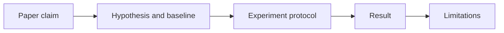
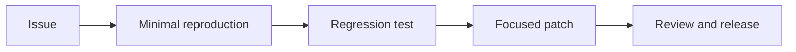
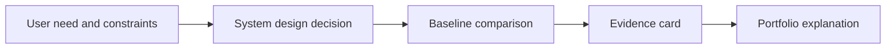

# Research, open source, and career

These topics run alongside the technical curriculum. Complete subtopics at a sustainable pace; a major research project benefits from reliable model-evaluation skills. Record mastery from reproducible work and artifacts rather than time elapsed.

## Subtopics

### Research literacy and paper reproduction

#### Learning units

- **Reading papers in passes:** Read in passes: identify the question and claim, inspect methods and evidence, then consult implementation details.
- **Reproduction, ablations, and reporting:** Reproduce a bounded result with recorded data, environment, seeds, and metrics; use ablations to test components and report discrepancies.

**Beginner explanation:** A research paper makes claims based on a particular question, dataset, method, and set of measurements. A reader should ask what comparison would make the claim believable and which details are needed to repeat it. Reproduction means trying to recover a stated result under documented conditions; a difference is useful evidence to investigate, not something to hide. An ablation changes or removes one part of a system to check whether that part contributes to the result. Neither activity requires inventing a new method: careful records and an honest account of what the result does and does not show are valuable work.
**Prerequisites:** Model evaluation, Python, and statistics. Experiment tracking and reproducibility are practiced in this subtopic, building on [Python environments and reproducibility](foundations.md#python-for-ai).
**Concepts and vocabulary:** hypothesis, baseline, ablation, seed, variance, reproduction, limitation, statistical uncertainty.
**Worked example:** A paper claims method A raises held-out F1 over baseline B. (1) Write down the comparison before running code: same dataset split, same label definition, same metric (higher F1 is better), and same training budget. (2) Run both methods for three recorded seeds. Suppose B scores `0.80, 0.82, 0.81` and A scores `0.82, 0.81, 0.84`. Pair by seed: differences are `+0.02, −0.01, +0.03`; the mean difference is `(0.02 − 0.01 + 0.03)/3 = +0.013`. A is higher on average in this small run, but one seed reverses the result and three runs give limited evidence. (3) Disable A's new component while keeping the rest fixed. If the ablation scores 0.81, compare it with A's 0.823 mean and B's 0.81 mean: the component may explain some gain, but variation and exact protocol still matter. (4) If the result differs from the paper, check one discrepancy at a time—preprocessing, package version, precision, then evaluation code—and record changes rather than tuning until the desired result appears. Report the original claim, your measurements, uncertainty, and unmatched details; this reproduction informs this setup, not every possible setting.
**Illustration cue:** Three-pass paper-reading map linked to a hypothesis → experiment → result → limitation chain.

**Code practice:** Build a small command-line experiment with a configuration file containing dataset path/version, model choice, random seed, and metric. Save the resolved configuration, package versions, command, and output metrics beside each run. Before a long run, execute a tiny smoke test and verify that changing the seed or one parameter appears in the saved record. Add one ablation that disables a component and compare it with the same baseline and evaluation split.
**Common mistakes:** Treating abstract claims as evidence; tuning on the test set; omitting failed runs; confusing a reproduced result with a novel contribution.
**Exercises and solution guidance:** A paper says, “Our method improves performance on small datasets.” Turn that into a test and list two reasons your result might differ. **Solution:** Choose, for example, training sizes 50, 100, and 200; reserve the same held-out test set; compare the method with a baseline using F1, where higher is better. At each size, use the same five seeds for both methods and compute a paired difference per seed. If at size 50 the differences are `+0.03, +0.01, −0.02, +0.02, +0.01`, the mean is `+0.01`; report both the mean and the mixed outcomes rather than saying it always improves. Two plausible discrepancies are (a) another split or preprocessing pipeline, which changes the examples or features, and (b) optimizer/library or numeric-precision differences, which change training behavior. Record these as separate setup facts; do not alter the test set or silently select only favorable seeds.
**Practice project.** Produce a paper note and runnable reproduction with experiment log, ablation, and discrepancy analysis.
**Mastery checkpoint:** Another learner can rerun the experiment from your instructions and understand what the evidence supports and does not support.

### Open source practice

#### Learning units

- **Project conventions and contribution rules:** Inspect contribution rules, architecture, issue workflow, release process, and license before proposing a change.
- **Tests, docs, and measured changes:** Reproduce an issue, add or update tests or documentation, and measure behavior when the change affects performance.

**Beginner explanation:** An open-source repository is a project maintained by people who have chosen conventions for code, documentation, tests, and releases. Before changing it, learn how to reproduce the current behavior and how maintainers want changes proposed. A narrow fix with a clear reproduction is easier to review than a large rewrite because a reviewer can connect the change to a specific problem. Review comments are part of the contribution process: they may ask for more evidence, a smaller change, or an approach that fits the project's design.
**Prerequisites:** None within the AI curriculum. Assumed software background: ability to read project documentation and basic Git; the first exercise reviews clone, branch, commit, and status if needed. Use the testing units in [Python for AI](foundations.md#python-for-ai) if you need practice running checks.
**Concepts and vocabulary:** contribution guide, issue, pull request, regression, reproduction, review, changelog, license.
**Worked example:** A library issue says empty input crashes in `normalize(values)`. (1) Record the installed version and reduce the report to `normalize([])`, preserving the traceback. (2) Inspect nearby tests and decide the intended contract; suppose an empty list should return an empty list. Add `assert normalize([]) == []`. Run it before the fix: it fails with division by zero, proving the test reaches the bug. (3) Make a narrow guard before computing the scale: if there are no values, return an empty list. Run the new test again: it passes. (4) Run the neighboring non-empty tests, such as `normalize([2, 4]) == [0, 1]`, to check the ordinary path still behaves as before. (5) In the contribution, state the observed failure, expected contract, minimal patch, and commands/results. A failing-before/passing-after regression test links the change to the issue; nearby tests reduce the chance that the fix merely hides the exception while breaking normal input.
**Illustration cue:** Contribution path from issue → reproduction → test → patch → review → release.

**Code practice:** Choose a maintained project with a clear contribution guide. Clone it, create a branch, and run one documented check before changing anything; save the command and result. Make a small documentation, test, or example change tied to a real issue or an observed confusing behavior. Run the relevant check again and write a short summary with reproduction steps. If a full setup cannot run on your machine, report that plainly and provide whatever focused evidence is available.
**Common mistakes:** Proposing a large redesign before understanding conventions; filing an issue without a reproduction; ignoring license or maintainer guidance.
**Exercises and solution guidance:** You can reproduce a typo in a command example, but you cannot yet reproduce a reported performance regression. Which contribution is ready to make? **Solution:** Verify the typo against the command's documented behavior or a clean run, then submit that narrow documentation correction with the exact old and corrected command. For the performance report, capture a baseline before proposing code: same project version, hardware, input size, warm-up, and repeated timings. If the old version takes 100 ms and the new version 130 ms on the same repeated workload, that is a 30% latency increase (`(130−100)/100`), but one run could be noise. Repeat enough times and report median/tail latency. Until this evidence exists, the docs fix is ready and the performance patch is not yet grounded in a reproducible cause.
**Practice project.** Produce a merged contribution or review-ready patch with reproduction instructions and checks.
**Mastery checkpoint:** Present the contribution with a clear problem statement, reproducible evidence, project-compliant change, and response to review feedback.

### Career case studies and system design

#### Learning units

- **Evidence-based project case studies:** Present a project with its problem, baseline, personal contribution, measured outcome, and limitations.
- **System design and interview practice:** Practice a system-design walkthrough that defends boundaries, data flow, metrics, failure handling, privacy, and cost decisions.

**Beginner explanation:** A project case study is a short technical argument: what user or engineering problem mattered, what options were considered, what evidence favored the chosen design, and what remains uncertain. A list of tools does not show which decisions you made or whether the result helped. A system-design interview uses the same reasoning under a new set of constraints: clarify the request, draw the boundaries, follow data through the system, and explain how the design handles failures, measurement, privacy, and cost.
**Prerequisites:** At least one software project or AI artifact that you can inspect and explain. Classical ML, generative AI, on-device AI, and AI engineering projects are useful portfolio examples, not gates; select evidence relevant to the role you are pursuing.
**Concepts and vocabulary:** baseline, decision record, trade-off, metric, failure mode, system boundary, portfolio, role requirement.
**Worked example:** Consider a classifier that routes support tickets into billing or account access. (1) Define the baseline: a current rules system correctly routes 82 of 100 held-out tickets. (2) Evaluate the candidate on those same 100 tickets: it correctly routes 88, so accuracy rises from 82% to 88%, a 6 percentage-point gain. Accuracy alone may hide a weak category, so inspect a billing slice: 30 billing tickets include 27 correctly routed, giving billing recall `27/30 = 90%`; inspect its 3 misses to see whether they are unusual languages or mislabeled data. (3) Measure the system cost: if 100 requests take 4 seconds of model time, mean model latency is 40 ms/request for this batch, but also measure p95 under realistic load before promising response time. If inference costs $0.02 per 100 tickets, state volume assumptions before projecting. (4) Identify sensitive ticket text, limit logs, and roll out to a small fraction first. Define rollback in advance—for example, revert if audited routing errors exceed 10% in a reviewed sample. The case study separates observed results (88/100) from interpretation (the model may help) and from limitations (language slice and small sample need further review).
**Illustration cue:** One-page system design diagram paired with an evidence card for each major decision.

**Code practice:** Prepare one repository or notebook that another engineer can run from a clean environment. Include a short setup, data provenance or safe sample data, the evaluation command, baseline and candidate outputs, and a versioned result file. Add a one-page case study linking each design decision to evidence, an assumption, or a limitation. Practice presenting it aloud, then check whether every metric can be traced back to the command and dataset that produced it.
**Common mistakes:** Listing frameworks without outcomes; hiding negative results; presenting a metric without its baseline or dataset; claiming ownership ambiguously.
**Exercises and solution guidance:** Rewrite “Built an app with Kotlin, TensorFlow Lite, and Room” as a case-study opening. **Solution:** Start with the user need and your contribution: “I added offline image classification to a camera workflow so users could get a result without network access.” Next supply evidence: for example, on 200 held-out images the old flow produced no offline result, while the local model classified 176 correctly (`176/200 = 88%`); p95 inference was 140 ms on the target phone. Explain the errors: if 15 of 24 misses are low-light images, report that slice and avoid claiming general reliability. Name the exact Kotlin integration, model conversion, and persistence work you personally implemented. This gives a reviewer a problem, baseline, method, measured result, and limitation; technology names can then clarify how you delivered it.
**Practice project.** Produce three evidence-based case studies and a system-design walkthrough grounded in project artifacts.
**Mastery checkpoint:** Explain system boundaries and decisions clearly, answer questions with reproducible evidence, and identify what you would change with more data or time.

## Topic practice project and mastery checkpoint

Publish one reproducible paper reproduction or open-source contribution, then present the three case studies as decisions and evidence rather than a list of technologies. Include sources, limitations, and reproducibility instructions. Calendar time is optional pacing; mastery depends on the artifacts and checkpoint evidence.
