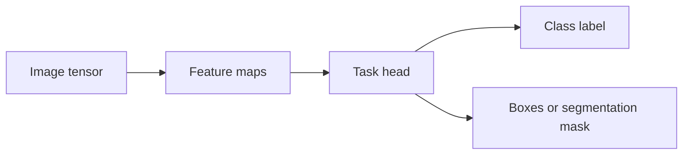
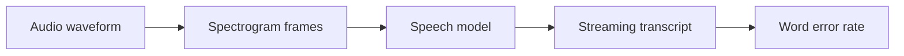
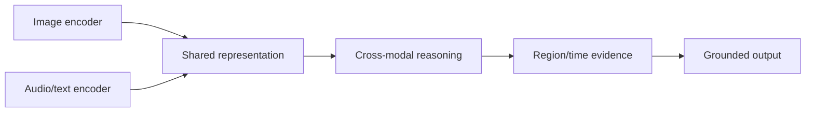
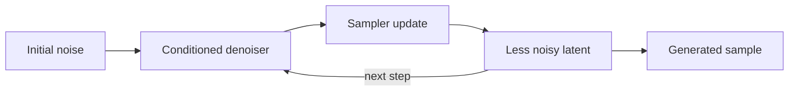
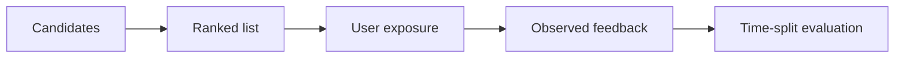
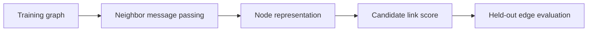
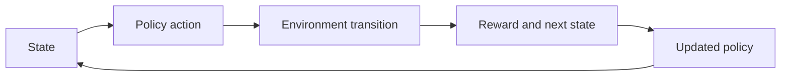
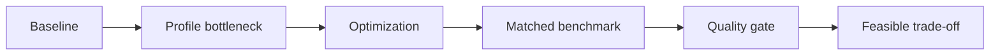
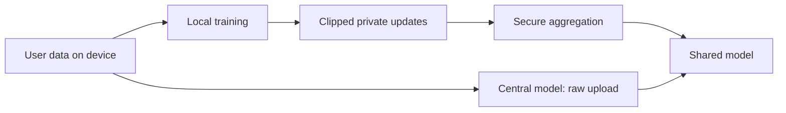

# Specializations

After core topics, choose one primary specialization and study others as needed. Each branch below uses the same structure: a subtopic contains named learning units, one practical artifact, and evidence-based mastery. A selected branch project follows the subtopics. A learner may spend multiple sessions on a subtopic; calendar pacing is optional and speed is not a measure of competence.

## Subtopics

### Computer vision

#### Learning units

- **Image representations and geometry:** Represent images with explicit pixel, channel, and color-space conventions, and apply geometric transforms with tracked coordinates.
- **Vision evaluation and robustness:** Choose task-appropriate metrics and test performance across classes, lighting, viewpoints, and capture devices.

**Beginner explanation:** A digital image is a grid of pixel values. A color image usually stores three values per pixel (red, green, and blue), so a model might receive an array shaped height × width × 3. The model learns patterns in those values, such as edges and textures, that can help answer a question about the image. The question determines the output: classification assigns a label to the whole image, detection returns labels with bounding boxes, and segmentation assigns labels to individual pixels. These outputs are different data types, so they need different labels and metrics. For example, a correct scene label says nothing about whether an object was located precisely.
**Prerequisites:** Python, NumPy, probability, and either [Classification](machine-learning.md#classification) or [Regression](machine-learning.md#regression) as a basic supervised-learning path.
**Concepts and vocabulary:** pixel, channel, convolution, feature map, bounding box, IoU, segmentation mask, augmentation.
**Worked example:** Suppose a phone app must locate a barcode. (1) Label the barcode with a rectangle and ask the model for a predicted rectangle; a whole-image “barcode present” label cannot tell whether the rectangle is usable. (2) Compare predicted box A with labeled box B. If A covers 80 pixels, B covers 80 pixels, and their overlap is 60 pixels, their union is `80 + 80 - 60 = 100` pixels. (3) IoU is intersection/union, so `60/100 = 0.60`. At a match threshold of 0.5 this prediction counts as a match; at 0.75 it does not. The threshold therefore changes the number of detections counted as correct, and should be reported with precision/recall. (4) Repeat over held-out images from different phones, distances, glare, and rotations. If the average IoU is high but glare images fail, the average hides a capture-condition gap; inspect that slice before claiming the feature is robust.
**Illustration cue:** Show image tensor channels and a visual progression from image to feature maps to labeled regions.

**Code practice:** Make a small notebook that loads a labeled image set, displays several examples with their labels, and prints a class count before training. After fitting a baseline, show a confusion matrix and a contact sheet of false positives and false negatives. Change one input condition at a time—such as brightness or crop—and compare which examples change. Record the split and keep near-duplicate images from the same source together so the held-out score does not benefit from seeing almost the same image during training.
**Common mistakes:** Data leakage from near-duplicate images; inappropriate random splits; treating accuracy as sufficient under class imbalance.
**Exercises and solution guidance:** A document scanner needs to find page corners, while a gallery app needs to group photos by scene. Which output and metric fit each task? **Solution:** First identify the shape of the desired answer. Page corners are coordinates, so compare predicted corners with labeled coordinates (for example, mean pixel error) or compare the predicted page polygon with the labeled polygon using IoU. A whole-image accuracy score cannot show whether a crop cuts off text. Scene grouping needs a whole-image class or an explicitly defined similarity/grouping objective; for classes, report per-class precision/recall and inspect confusions such as “beach” versus “lake.” Then check held-out examples from target camera conditions: the metrics summarize the selected labels, while examples reveal why a failure occurs.
**Practice project.** Produce an evaluated vision prototype with dataset card and visual error gallery.
**Mastery checkpoint:** Explain the task, labels, metric, and at least three failure modes using concrete examples.

### Speech and audio

#### Learning units

- **Audio signals and features:** Inspect waveforms and spectrograms, and implement sampling, framing, and feature extraction with stated units.
- **Recognition and generation tasks:** Compare recognition and generation tasks using suitable outputs and measures such as word error rate or listening review.

**Beginner explanation:** A microphone converts changing air pressure into a sequence of numbers called samples. The sample rate says how many numbers are recorded each second; a 16 kHz recording contains 16,000 samples per second. A waveform shows the signal over time. A spectrogram rearranges short overlapping pieces of that signal into time and frequency, making sounds such as vowels or background hum easier to inspect. Speech recognition turns audio into text, sound-event detection might identify a siren, and speech generation creates audio from text. These tasks need different expected outputs. A transcription can be accurate but arrive too late for a live caption, so quality and latency both matter.
**Prerequisites:** Python arrays, basic statistics, and model evaluation.
**Concepts and vocabulary:** sample rate, waveform, spectrogram, frame, VAD, ASR, WER, streaming, noise robustness.
**Worked example:** Let the reference be `turn | left | at | the | next | street` (6 words) and the hypothesis be `turn | right | at | next | street`. Align them in order: `left → right` is one substitution, `the` is one deletion, and there are no insertions. Word error rate is `(S + D + I) / N = (1 + 1 + 0) / 6 = 0.33`, or 33%. This means about one-third as many word edits as reference words were needed for this clip; it does not mean 67% probability that a command is safe. Here the single substitution reverses the direction, so inspect action-critical errors separately. Repeat on clean, noisy, and previously unseen-speaker slices: if WER rises only with noise, noise robustness is weak; if it rises only for one device, check its sample rate and preprocessing before blaming the model.
**Illustration cue:** Animate waveform to spectrogram frames to recognized text, marking streaming latency.

**Code practice:** Assemble five short, licensed or self-recorded clips and manually checked transcripts. Check each file's sample rate before inference; if conversion is needed, resample the waveform rather than changing only its sample-rate label. Run the same model and decoding settings on every clip, store reference and hypothesis text, and calculate substitutions, deletions, insertions, and WER. Listen to each high-error clip and note whether the cause appears to be noise, an accent, clipping, a name, or a model mistake.
**Common mistakes:** Ignoring sample-rate mismatch; using test speakers during tuning; reporting one clean clip; confusing transcription quality with command success.
**Exercises and solution guidance:** A model expects 16 kHz but receives a 48 kHz waveform whose metadata was merely changed to “16 kHz.” What went wrong, and what would you do? Then choose measures for live captions and a voice-command feature. **Solution:** A three-second 48 kHz clip contains `3 × 48,000 = 144,000` samples. Merely relabeling it as 16 kHz leaves those samples untouched, so the model reads them as `144,000 / 16,000 = 9` seconds; pitch and timing are wrong. Resample the waveform to about `3 × 16,000 = 48,000` samples using an audio resampler (with appropriate filtering), then verify duration and listen. For captions, report WER and time-to-display because correct words that arrive late are less useful. For commands, count intended actions recognized and false activations separately; WER alone does not capture the cost of executing a wrong action.
**Practice project.** Produce a speech/audio evaluation set and script with noise and speaker slices.
**Mastery checkpoint:** Demonstrate repeatable audio preprocessing and explain errors across clean, noisy, and varied-speaker slices.

### Multimodal AI

#### Learning units

- **Cross-modal representations:** Encode text, image, audio, or video inputs and examine how shared embeddings or cross-attention align modalities.
- **Grounding and evaluation:** Link model claims to timestamped or localized evidence and score grounding, alignment, and failure cases.

**Beginner explanation:** Text, images, and audio are different modalities: their raw inputs have different shapes and meanings. A multimodal system first converts each input into representations the model can process, then combines information across them. Combining inputs does not guarantee that a response is grounded in all of them. If a system says “the pedestrian is crossing at 00:04,” the evidence should identify a frame or interval that supports that claim. Grounding makes the output inspectable: a reviewer can compare the claim with the cited region or time instead of trusting a fluent description.
**Prerequisites:** Language-model foundations and either [Computer vision](#computer-vision) or [Speech and audio](#speech-and-audio).
**Concepts and vocabulary:** modality, embedding, alignment, fusion, cross-attention, grounding, timestamp, evidence span.
**Worked example:** Give an assistant a ten-second clip and ask, “What color is the car that enters after the pedestrian?” Split the answer into checkable claims: (a) an identified car enters after the pedestrian, (b) its color is red, and (c) it appears near 00:06. Suppose the annotated clip shows a red car entering at 00:06, and the response cites 00:06: claims (a)–(c) are supported. If the response says “the red car is parked by the curb” but the cited frame shows only its color and entry, the color may be right while the extra location claim lacks evidence. Score answer correctness and evidence support separately; on a three-claim example, 2 supported claims out of 3 is `2/3`, not a fully grounded answer. Include ambiguous and absent-object clips with expected qualification or abstention so guessing is not rewarded.
**Illustration cue:** Diagram modalities entering separate encoders, joining in a shared reasoning path, then grounding output to region/time evidence.

**Code practice:** Make a small table containing an example ID, media path, question, expected answer, evidence region or timestamp, model answer, and cited evidence. Run a model over the set and store the complete output. Have a reviewer label answer correctness and evidence support separately; this distinguishes “the answer happened to be right” from “the model pointed to evidence that justifies it.” Do not upload private camera or audio samples to an external service without an appropriate data policy.
**Common mistakes:** Assuming modalities are synchronized; trusting fluent descriptions without evidence; overlooking privacy in camera/audio capture.
**Exercises and solution guidance:** A clip shows a closed door, then cuts to a person holding an umbrella. The model says “the person picked up the umbrella by the door.” What can be supported? **Solution:** Separate the sentence into claims: “person is holding an umbrella” is visible after the cut; “picked it up” describes an action not shown; “by the door” assigns a location not established by the shown frame. Only the first claim is supported. Mark the post-cut frame as evidence and the two unsupported claims in the annotation. A grounded response should say “The person is holding an umbrella” or explain that the pickup and location are not shown. This turns the example into a test where adding a plausible but invisible event lowers evidence support.
**Practice project.** Produce a curated multimodal test set with evidence annotations and grounding rubric.
**Mastery checkpoint:** Show grounded examples and failure cases, and specify when the system should abstain.

### Diffusion and generation

#### Learning units

- **Iterative denoising:** Visualize the forward noise process and implement or trace repeated reverse denoising steps.
- **Conditioning, controls, and safety:** Vary text or image conditioning and guidance under controlled seeds, then review artifacts, provenance, and misuse risks.

**Beginner explanation:** A diffusion model is trained using a puzzle it can practice on many times: take a clean training image, gradually add known amounts of noise, and learn to estimate how to undo one noise step. At generation time, begin with random noise and repeatedly apply the learned denoising step, often with text conditioning. The text guides the process but does not specify every pixel, which is why two runs can produce different images from the same prompt. More denoising steps or stronger guidance do not guarantee a better result; they can cost more compute or create distorted details. Treat samples as variable outputs that need review, not as evidence that the requested scene is faithfully represented.
**Prerequisites:** Probability distributions, vectors, and basic neural-network concepts from [Neural networks and forward computation](deep-learning.md#neural-networks-and-forward-computation).
**Concepts and vocabulary:** diffusion, noise schedule, denoiser, sampler, conditioning, guidance scale, seed, provenance.
**Worked example:** Compare guidance settings for “a red bicycle beside a brick wall.” Keep model, sampler, size, step count, prompt, and three seeds fixed; change only guidance. Use four binary checks per image: bicycle present, bicycle red, brick wall present, bicycle beside wall. In this illustrative score sheet, weak guidance passes 2, 3, and 2 checks (`7/12 = 58%`); stronger guidance passes 3, 3, and 3 (`9/12 = 75%`) but shows a visible spoke artifact in two of three images. The score suggests better prompt adherence in this tiny sample, while the artifact count exposes a quality cost. It does not establish that stronger guidance is generally better: inspect the same rubric across more seeds, record compute time, and retain all samples rather than selecting a favorite.
**Illustration cue:** Animate a noise image gradually becoming a sample, with conditioning signal shown at each denoising step.

**Code practice:** Use an available small generation pipeline with a fixed model version. Save the prompt, seed, dimensions, sampler, step count, guidance setting, and output path for every image. Create a contact sheet and score each sample against a short rubric before changing settings. Keep the prompt set and seeds fixed while changing one control; otherwise you cannot tell which change caused a visible difference. Include a provenance note for the model and any input image.
**Common mistakes:** Treating one attractive sample as evidence; comparing runs with many changed settings; ignoring provenance and harmful prompt cases.
**Exercises and solution guidance:** You want to compare two samplers. What must stay fixed, and why should you use several seeds? **Solution:** Keep model/version, prompt set, image size, guidance, step budget, and seed set fixed; only sampler changes. For example, if sampler A scores 3/4 and sampler B 4/4 on one seed, that is one paired observation, not a reliable winner. Repeat both samplers on the same several seeds, calculate each score using the same rubric, compare the per-seed differences and compute time, and show the full sample grid. Pairing seeds helps make the sampler the main difference; multiple seeds show whether a result depends on a lucky draw.
**Practice project.** Produce a controlled generation study with fixed settings, sample grid, evaluation, and safety analysis.
**Mastery checkpoint:** Reproduce the study and explain quality, variability, and safety trade-offs beyond cherry-picked examples.

### Recommendation

#### Learning units

- **Ranking and feedback:** Build candidate-generation and ranking baselines, and distinguish explicit feedback from exposure-dependent implicit feedback.
- **Recommendation evaluation:** Evaluate ranked results with temporal splits and ranking metrics, then identify online trade-offs and cold-start gaps.

**Beginner explanation:** A recommender usually has two jobs. It first creates a manageable candidate set, then ranks those candidates for a user or situation. A click is not the same as liking an item: people can only click items they were shown, and items placed near the top receive more attention. That means logged feedback reflects both preference and past exposure. Evaluation should therefore ask not only whether a model predicts clicks but also whether the ranking puts useful items near the top, handles new users and items, and avoids repeating content in ways that harm the product goal.
**Prerequisites:** Data analysis, statistics, and either [Classification](machine-learning.md#classification) or [Regression](machine-learning.md#regression) for basic supervised-learning practice. Either branch is sufficient.
**Concepts and vocabulary:** candidate, ranker, implicit feedback, exposure bias, recall@k, NDCG, cold start, temporal split.
**Worked example:** Use a tiny held-out case to see what ranking metrics mean. A user's relevant held-out stories are `{A, C}` and the ranker returns `[B, C, A]`. Recall@3 is relevant items in the first three divided by all held-out relevant items: `2/2 = 1.0`; both appeared, but this ignores order. For NDCG@3 with binary relevance, rank 2 contributes `1/log₂(2+1) ≈ 0.631` and rank 3 contributes `1/log₂(3+1) = 0.5`, so DCG is `1.131`. The ideal order `[A, C, B]` has IDCG `1/log₂(1+1) + 1/log₂(2+1) = 1 + 0.631 = 1.631`; NDCG is `1.131/1.631 ≈ 0.69`. Recall is perfect because both relevant stories appear; NDCG is lower because neither is first. For a real news app, train on January–April and evaluate May–June; a random split can expose June clicks while evaluating earlier events. These metrics describe held-out logged interactions, not all user interests or satisfaction, so also inspect new stories and freshness.
**Illustration cue:** Funnel from candidate items to ranked list to user exposure and feedback, marking selection bias.

**Code practice:** Starting from an interaction table with user, item, and timestamp columns, sort each user's events by time and hold out later events. Rank items by training-period popularity, then compute Recall@10 separately for returning users and users with little history. Print a few ranked lists with relevant held-out items highlighted. If adding personalization, keep the split and candidates fixed so its comparison with popularity is meaningful; explain what the offline ranking score does not measure, such as satisfaction or long-term retention.
**Common mistakes:** Using future interactions in training; equating clicks with satisfaction; ignoring new items/users and exposure bias.
**Exercises and solution guidance:** A team reports 90% click prediction accuracy for a feed but says nothing about what users saw or where it appeared. Is that enough to choose a ranker? **Solution:** No. A classifier can achieve high accuracy by predicting the majority “no click” class: if 900 of 1,000 logged impressions had no click, predicting no click every time already scores 90%. That baseline says nothing about whether relevant stories rank near the top. Use a time-based split, compute ranking metrics such as NDCG@K for logged relevant items, and inspect new/returning-user and freshness slices. The result still measures exposed interactions, not complete satisfaction; pair it with product outcomes or careful user review.
**Practice project.** Produce an offline recommender report with baseline, temporal split, ranking metrics, and exposure-bias analysis.
**Mastery checkpoint:** Defend the split and metrics and show where recommendations fail for meaningful user/item slices.

### Graph machine learning

#### Learning units

- **Nodes, edges, and graph features:** Construct a graph from nodes and edges, documenting attributes, direction, and feature choices.
- **Message passing and graph evaluation:** Implement neighborhood message passing and evaluate a node or link task with held-out relationships removed from inputs.

**Beginner explanation:** A graph represents entities as nodes and relationships as edges. For example, people may be nodes and follows may be directed edges. A graph model can use a node's own features plus information from its neighbors, a process called message passing. This can help when relationships carry useful context, but it changes the data-splitting problem: if the edge being predicted is still visible to the model, the answer has leaked into the input. Write down which nodes, edges, and features exist at prediction time before deciding that a score represents generalization.
**Prerequisites:** Linear algebra, basic machine learning evaluation, and comfort with Python data structures.
**Concepts and vocabulary:** node, edge, adjacency, degree, feature, neighborhood, message passing, graph embedding, transductive, inductive, link prediction, leakage.
**Worked example:** For a small directed follow graph, let A follow C and B follow C. Hold out the candidate edge A→B before constructing test features. A simple shared-follow-neighbor score is `|N_out(A) ∩ N_out(B)|`; if both follow C, the score for predicting A→B is 1. Let D follow E instead; then `N_out(A) ∩ N_out(D)` is empty and candidate A→D scores 0. The score ranks A→B above A→D because A and B share a neighbor; it is evidence for a baseline, not proof the link exists. Compare this score with actual held-out positive and sampled negative candidates. If A→B were left in the graph, the test would include the answer as an input edge and the score would no longer measure prediction of an unseen link.
**Illustration cue:** Draw a node receiving messages from its neighbors over several layers, then mark which edges are visible in training and held out for evaluation.

**Code practice:** Create a tiny directed graph from an edge list. Print each node's in-degree and out-degree, then write a common-neighbor score for candidate links. Split target links before calculating graph features; construct the training graph without held-out links and verify with an assertion that no test edge remains. Compare ranking of true held-out links with sampled non-links and record which negative sampling rule you used.
**Common mistakes:** Letting held-out edges remain in the input graph; confusing transductive and inductive evaluation; treating connections as independent observations; assuming graph construction is neutral.
**Exercises and solution guidance:** A link model predicts whether user A follows creator B, but the edge `(A, B)` is still present during neighbor aggregation for the test examples. Why is the score misleading? **Solution:** The model can observe the target relationship during message passing, so a high score may come from copying the answer. First make a held-out list, remove those edges from the graph, and recompute all derived features from this training graph. Then score each positive target and a documented set of negative candidates. For example, if the target edge is the only evidence connecting A to B and its removal changes the prediction, that is a meaningful test; retaining it tests edge recognition, not link generalization.
**Practice project.** Produce a graph prediction baseline with construction note, leakage-safe split, scores, and errors.
**Mastery checkpoint:** Explain how graph construction affects the task, defend the split, and demonstrate that target relationships do not leak into the input.

### Reinforcement learning

#### Learning units

- **States, actions, and rewards:** Define an environment’s states, actions, transitions, and rewards, then step through a small episode.
- **Policies and delayed reward:** Compare a learned policy with a baseline when reward is delayed, reporting returns across seeds and checking exploration constraints.

**Beginner explanation:** In reinforcement learning, an agent repeatedly observes a state, chooses an action, and receives a new state and reward from an environment. The reward can arrive later than the action, so the agent must learn which earlier choices contributed to a good outcome. A policy is the rule that maps the current state to an action. The reward is only a measurement chosen by the designer: if it rewards the wrong shortcut, the agent may succeed at the score while failing the intended task. Start with a tiny simulator where you can inspect every transition before trusting results from a complex environment.
**Prerequisites:** Probability, Python, and basic optimization.
**Concepts and vocabulary:** state, action, policy, reward, return, value, exploration, episode, simulator.
**Worked example:** In a grid world, compare a safe route of three moves before the goal with a two-move shortcut through a hazard. Let each ordinary move cost −0.1, entering the hazard add −1 (so that move rewards −1.1), reaching the goal reward +1, and discount `γ = 0.9`. The safe return is `−0.1 + 0.9(−0.1) + 0.9²(−0.1) + 0.9³(1) = −0.1 − 0.09 − 0.081 + 0.729 = 0.458`. The shortcut return is `−1.1 + 0.9(−0.1) + 0.9²(1) = −1.1 − 0.09 + 0.81 = −0.38`, so the penalty makes it unattractive. If the hazard penalty is omitted, the shortcut becomes `−0.1 + 0.9(−0.1) + 0.9²(1) = 0.62`, greater than the safe route's 0.458. The agent would then rationally choose the dangerous shortcut under that flawed reward. Compare a learned policy with a random-policy baseline over the same evaluation episodes and several seeds; one good trajectory is not enough to establish reliable learning.
**Illustration cue:** Animate state → action → environment transition → delayed reward → updated policy.

**Code practice:** Implement a grid with explicit `reset()` and `step(action)` operations. Print a few state-action-next-state-reward transitions before training so the rules are inspectable. Run the random baseline and learned policy for the same number of episodes under several random seeds; report mean return and spread, not only the best run. Save evaluation episodes separately from those used to tune the policy, and show a short trace of actions so a reader can see what the score corresponds to.
**Common mistakes:** Reward hacking; tuning on evaluation episodes; comparing policies on too few seeds; overlooking unsafe exploration.
**Exercises and solution guidance:** A delivery robot receives one point for every package dropped off and no penalty for damaging a package or entering a restricted area. What behavior might this reward encourage? **Solution:** Compare two hypothetical 10-package routes: a safe route earns 8 points after delays, while a fast route earns 10 despite damaging one package and entering a restricted area. Under the stated reward, `10 > 8`, so choosing the unsafe route is rational for the agent. Add explicit safety constraints or costs, and report delivery count, damage, and restricted-area violations separately. A combined score alone can hide that the agent traded away safety to gain deliveries.
**Practice project.** Produce a simulator experiment with baseline policy, multi-seed results, and reward-design analysis.
**Mastery checkpoint:** Reproduce results across seeds and explain whether the learned behavior meets the intended objective and constraints.

### Efficient inference

#### Learning units

- **Profiling and bottlenecks:** Profile a representative workload to locate compute, memory, transfer, or startup bottlenecks.
- **Quantization, batching, and caching:** Apply quantization, batching, or caching one at a time and compare matched quality, latency, and memory results.

**Beginner explanation:** Inference is the work a trained model performs to answer a request. Efficiency has several measures: latency is time per request, throughput is requests per unit time, memory is the working space required, and quality is how useful the answers remain. Optimizing one can worsen another. Batching can increase throughput but make an individual request wait; quantization can reduce memory and sometimes speed up computation but change predictions. First measure a representative workload and identify whether time is spent loading the model, transferring data, or computing. Then change one factor and compare under the same device and inputs.
**Prerequisites:** [Model lifecycle](generative-ai.md#model-lifecycle-and-selection) and task evaluation. Profiling and bottleneck analysis are introduced in this subtopic.
**Concepts and vocabulary:** latency, throughput, peak memory, quantization, pruning, batch, cache, distillation, Pareto frontier.
**Worked example:** A mobile model takes 900 ms on its first request and 120 ms on each later request. For five requests in a short session, total time is `900 + 4×120 = 1,380 ms`, or an average of `276 ms/request`; reporting only the 120 ms warm time understates what a new session experiences. Profile before optimizing. If loading dominates the first request, changing compute precision may leave the 900 ms startup nearly unchanged. Suppose a quantized candidate reduces warm inference from 120 ms to 84 ms (`(120−84)/120 = 30%` faster) but drops task quality from 92% to 90%. If the product's minimum quality is 91%, reject that candidate despite the speedup. This is an illustrative decision: benchmark cold and warm paths on the same device/runtime and apply the actual quality budget.
**Illustration cue:** Show a request timeline and a size/latency/quality Pareto plot.

**Code practice:** Write a benchmark that records device/runtime versions, input shapes, model version, warm-up count, repeated timings, peak memory, and task metric. Report p50 and p95 latency so occasional slow requests are visible. Compare one optimization at a time against the same request set, and retain the unoptimized baseline output to measure quality changes. If caching is tested, state the cache key and hit rate; a benchmark with repeated identical requests can otherwise make caching appear universally beneficial.
**Common mistakes:** Optimizing without a profile; comparing different hardware/workloads; claiming speedup while omitting quality loss or startup cost.
**Exercises and solution guidance:** A one-request-at-a-time camera feature has a strict response deadline, and profiling shows accelerator compute dominates latency. Should you first increase batch size or test quantization? **Solution:** Batching waits for multiple requests and mainly helps throughput; with one request, there is nothing to combine, so it may add waiting without reducing compute time. Quantization changes compute and is therefore the relevant candidate for the measured bottleneck. Test baseline and quantized versions with the same images and device. For example, if p95 falls from 180 ms to 130 ms but recall drops below the agreed floor, the candidate fails even though it is faster. If the workload later becomes a queue of many requests, run a separate matched batch benchmark.
**Practice project.** Produce a repeatable inference benchmark with workload, device, quality, memory, and latency results.
**Mastery checkpoint:** Reproduce a claimed improvement and justify it across the relevant quality, memory, and latency measures.

### Privacy-preserving ML

#### Learning units

- **Privacy threats and data minimization:** Map sensitive assets and likely attackers, then minimize collected data and justify each retained field.
- **Federated and privacy-aware methods:** Compare federated or other privacy-aware methods under an explicit threat model, measuring utility and residual leakage.

**Beginner explanation:** Privacy work starts by naming what needs protection (for example, a user's location), who might try to learn it, and what access they have. A data-minimization decision may remove a field entirely; local processing may reduce raw-data transfer; federated learning keeps training examples on devices but still sends model updates that can reveal information. Differential privacy provides a mathematical bound on how much a released result can depend on one person's data, under stated assumptions and a chosen privacy budget. None of these labels alone says a system is safe. Define the attacker and release path, test relevant leakage, and document what risk remains.
**Prerequisites:** Probability, model evaluation, and security fundamentals from [Security and abuse resistance](ai-engineering.md#security-and-abuse-resistance). For broader system-oriented practice, use [System boundaries and data contracts](ai-engineering.md#system-boundaries-and-data-contracts) as supporting context.
**Concepts and vocabulary:** data minimization, federated learning, differential privacy, privacy budget, membership inference, secure aggregation, residual risk.
**Worked example:** A keyboard team compares a centralized baseline with a privacy-aware prototype. First draw what each party sees: centralized training sends example text; federated training keeps examples local but sends updates and metadata. Next define a test, such as whether an attacker can distinguish training examples from held-out examples. In a toy evaluation with 20 members and 20 nonmembers, an attack flags 12 members (TPR `12/20 = 60%`) and wrongly flags 4 nonmembers (FPR `4/20 = 20%`). After adding a specified protection, it flags 9 members (45% TPR) and still flags 4 nonmembers (20% FPR); next-word accuracy changes from 84% to 82%. This small illustrative result suggests lower attack detection alongside a 2-point utility cost, but the small sample and one attack do not prove privacy. Record the actual mechanism and parameters, test more attacks, and state what the server still observes.
**Illustration cue:** Compare raw-data flow in centralized training with local data and aggregated updates, labeling trust boundaries.

**Code practice:** Choose one public toy dataset and a specific threat, such as whether an example was in the training set. Run a baseline attack or a provided differentially private training example. Record the privacy mechanism, clipping rule, noise multiplier or privacy budget, assumptions, and task metric. Compare attack success and model utility across the same held-out examples. A statement such as “we used federated learning” is not a measurement of privacy; show which data moved and what the attack could still infer.
**Common mistakes:** Treating federated learning as automatically private; reporting privacy without parameters/threat model; ignoring metadata or output leakage.
**Exercises and solution guidance:** A product sends gradient updates from phones to a central server and claims that user data never leaves the device. What can still go wrong, and what information belongs in the claim? **Solution:** Trace the upload: raw files may remain local, but gradients and metadata leave the device and may expose patterns; the server may also see identifiers and timing. Name the attacker (for example, an honest-but-curious server), the exact fields/updates it receives, aggregation and privacy mechanisms with parameter values, and a leakage test. Report utility cost and residual risk. “Raw files remain on device” is a statement about storage location; it is not evidence that updates reveal nothing.
**Practice project.** Produce a privacy-aware prototype with threat model and privacy/utility evaluation.
**Mastery checkpoint:** Explain the protected asset and attacker, reproduce a relevant test, and state residual risks and utility costs.

## Topic practice project and mastery checkpoint

For the chosen branch, publish a problem statement, baseline, evaluation protocol, failure analysis, and explanation of why the method fits the problem. Show results from the branch checkpoint and name the next unresolved limitation. Progress is evidence-based; pacing may vary by learner.
